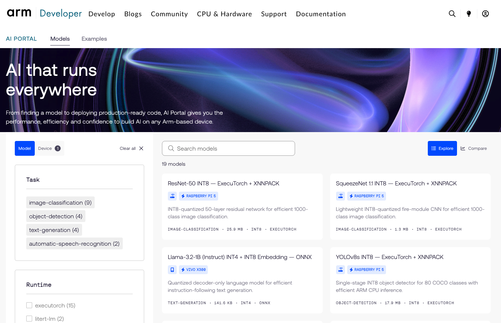
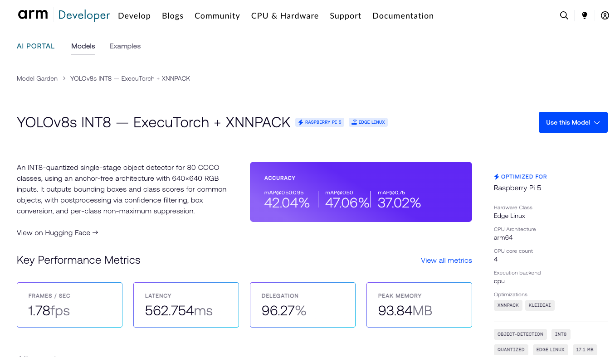
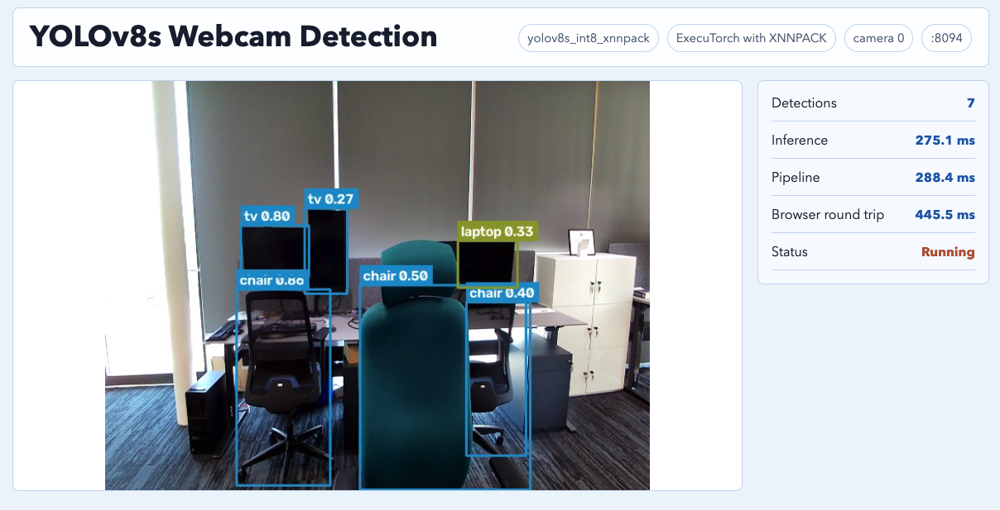

# Optional Next Step: Deploy a Pre-Optimized YOLOv8s Object Detector from Arm AI Portal
### When should I use a pre-optimized AI Portal model instead of exporting and quantizing a model myself?

[Module 2: YOLOv8s Object Detection with an AI Portal Model]
> Draft status: keep this section unpublished until the AI Portal model page
> and download path are public. When released, integrate it into Module 2. The
> current workflow assumes access to `Arm/yolov8s-int8-xnnpack-executorch`.

## About this extension

Earlier in this module, you used the full AOT path for MobileNetV2. You prepared a
PyTorch model, lowered it to ExecuTorch with XNNPACK, quantized it with PT2E, copied
the `.pte` artifact to the Raspberry Pi, and measured latency and
classification output on the target.

In this section, you will use a pre-optimized YOLOv8s object detection model
packaged for ExecuTorch with XNNPACK. Instead of exporting and quantizing the
model yourself, you will download the prepared `.pte` artifact and focus on
application integration.

Instead of exporting and quantizing locally, you download a prepared YOLOv8s INT8 ExecuTorch with XNNPACK package, run it on the Raspberry Pi, and focus on application integration: camera input, letterbox pre-processing, detector post-processing, box drawing, and latency checks.

In this extension, “pre-optimized” means that the package already includes the ExecuTorch `.pte` artifact for the selected backend and precision. It does not mean the full product is ready. The application still owns camera input, pre-processing, post-processing, thresholds, drawing, user experience, and production validation.

For this workflow, the model is:

- model: YOLOv8s INT8
- runtime: ExecuTorch
- delegate: XNNPACK
- target: Raspberry Pi 5, Edge Linux, `arm64`
- package: `Arm/yolov8s-int8-xnnpack-executorch`

In this section, you skip local export and quantization. The work is to
integrate a pre-optimized `.pte` artifact into an application and understand
the pre-processing, post-processing, and runtime checks needed around it.

| Workflow step | What changes vs stays the same in this section |
|---|---|
| Model preparation | Download a pre-optimized AI Portal package instead of exporting from PyTorch |
| Quantization | Use the packaged INT8 model instead of running PTQ calibration locally |
| Runtime | Run ExecuTorch with XNNPACK on Raspberry Pi |
| Application work | Add camera input, YOLO pre-processing, post-processing, and box drawing |

YOLO stands for "You Only Look Once." It is a family of object detection models
that predicts object locations and classes in one forward pass. YOLOv8s is the
small variant of YOLOv8, so it is a practical choice when you want object
detection on an edge CPU rather than only image classification.

Earlier in this module, we used MobileNetV2 for image classification. Object
detection is more complex because the model output is not a single class score
vector. A detector returns boxes and class scores, and the application must
apply confidence filtering, box conversion, and non-maximum suppression before
the output is useful.

The scripts follow the same layout used earlier in this module:

- `module-2-cnn-inference-with-quantization/module_2_ext/scripts/pi`: Raspberry Pi download and application entry points
- `module-2-cnn-inference-with-quantization/module_2_ext/scripts/pi/core`: YOLOv8s runtime, pre-processing, and post-processing helpers
- `module-2-cnn-inference-with-quantization/module_2_ext/scripts/_support/web`: web page rendering for the webcam demo



## What will you be able to do?

By the end of this extension, you will be able to:

- decide when a pre-optimized AI Portal package is a better starting point than a local export and quantization workflow
- download and verify a YOLOv8s INT8 ExecuTorch with XNNPACK package
- run the object detector on a Raspberry Pi
- explain the application work around the `.pte` artifact: camera capture, letterbox pre-processing, confidence filtering, non-maximum suppression, label lookup, and box drawing
- distinguish model inference latency from end-to-end application timing
- identify what must still be validated before production use

# Plan the AI Portal object detection workflow

You will use a different workflow from the MobileNetV2 path:

1. Find the pre-optimized YOLOv8s INT8 ExecuTorch with XNNPACK package.
2. Download the package to the Raspberry Pi.
3. Verify the `.pte`, label, and model specification files.
4. Attach a USB webcam or choose a video input.
5. Run the YOLOv8s webcam detector.
6. Inspect the pre-processing, ExecuTorch runtime call, and post-processing code.
7. Compare this workflow with the MobileNetV2 AOT workflow.
8. Decide when a pre-optimized model package is a better starting point.

As you work, pay attention to the engineering trade-offs: model-package trust, target compatibility, latency, memory, pre-processing requirements, post-processing cost, camera behavior, and production validation still needed.

## 1. Inspect the AI Portal Model Garden

The AI Portal Model Garden shows YOLOv8s INT8 optimized for
Raspberry Pi 5 with ExecuTorch and XNNPACK. It reports:

| Metric | AI Portal value |
|---|---:|
| mAP@0.50:0.95 | 42.04% |
| mAP@0.50 | 47.06% |
| mAP@0.75 | 37.02% |
| Frames per second | 1.78 fps |
| Latency | 562.754 ms |
| Delegation | 96.27% |
| Peak memory | 93.84 MB |
| Model size | about 17 MB |



These values are model-package evidence, not a production guarantee. They help you decide whether the package is worth testing on your target setup. You still need to measure behavior in your own application because camera input, lighting, object distance, post-processing thresholds, and system load can change the observed result.

### Check the model package evidence

Before downloading the package, record the published model evidence:

| Question | Your notes |
|---|---|
| What task does the model perform? | |
| What runtime, delegate, and precision does the package use? | |
| What target device or platform is it optimized for? | |
| What latency, FPS, memory, and model-size values are reported? | |
| Which metric matters most for your intended application? | |

## 2. Setup the Raspberry Pi runtime

Connect to the Raspberry Pi over SSH and forward the Object Detection app port:

```bash
ssh -L 8094:localhost:8094 <user>@<pi>
```

This keeps the YOLOv8s web app available at `http://localhost:8094` on your
development machine while the server runs on the Raspberry Pi.

Use the same Raspberry Pi environment as earlier in this module:

```bash
cd ~/executorch_on_arm
source .cpu_lab_venv/bin/activate
python -m pip install -r module-2-cnn-inference-with-quantization/module_2_ext/requirements.txt
```

## 3. Download and prepare the pre-optimized model on the Raspberry Pi

Download the AI Portal model package from Hugging Face directly on the Pi:

```bash
module-2-cnn-inference-with-quantization/module_2_ext/scripts/pi/download_yolov8s_ai_portal_model.py \
  --repo-id Arm/yolov8s-int8-xnnpack-executorch \
  --out module-2-cnn-inference-with-quantization/module_2_ext/artifacts/yolov8s_int8_xnnpack
```

The script does three jobs. First, it downloads the model package from Hugging
Face:

```python
snapshot_path = Path(
    snapshot_download(
        repo_id=args.repo_id,
        revision=args.revision,
        allow_patterns=["*.pte", "*.json", "*.txt", "*.md"],
    )
)
```

The `allow_patterns` list keeps the download focused on files the application
needs: ExecuTorch `.pte` artifacts, metadata, labels, and documentation. It
does not download training checkpoints or unrelated repository files.

Next, the script copies those files into the local artifact folder:

```python
for path in source.rglob("*"):
    if path.suffix.lower() not in {".pte", ".json", ".txt", ".md"}:
        continue
    shutil.copy2(path, out / path.name)
```

Finally, it makes sure the downloaded package has the files expected by the web
app:

```python
labels_path = out / "coco_labels.json"
pte_name = select_pte(out).name
spec_path = out / "model_spec.json"
```

The AI Portal package may use its own `.pte` filename, such as
`yolov8s-int8-executorch.pte`. The script selects the INT8 `.pte` artifact and
records that filename in `model_spec.json`, so the server command does not need
to hard-code it. It also writes `coco_labels.json` if the package does not
include one. Those labels are needed to turn YOLO class IDs into names such as
`person`, `chair`, or `laptop`.

The downloaded `model_spec.json` records the application contract:

```json
{
  "model_variant": "yolov8s",
  "task": "object_detection",
  "runtime": "executorch",
  "backend": "xnnpack",
  "precision": "int8",
  "inputs": [
    {
      "shape": [1, 3, 640, 640],
      "color": "rgb",
      "value_range": [0.0, 1.0]
    }
  ]
}
```

The model is already quantized, so this workflow does not run
calibration or PT2E conversion.

### Check downloaded package files

Before running the app, confirm that the package contains:

- an ExecuTorch `.pte` artifact
- `model_spec.json`
- labels or a generated `coco_labels.json`
- any package metadata needed to understand input shape, precision, runtime, and backend

If the filenames differ from the examples in this course, use the generated `model_spec.json` rather than hard-coding the `.pte` name.


## Run the YOLOv8s webcam detector

Attach a USB webcam to the Raspberry Pi. The app
uses OpenCV camera index `0`, which is usually the first connected camera. The
`--camera` argument can also accept a different OpenCV camera index, such as
`1`, or a video file path if you want to test without a live camera.

Start the app on the Raspberry Pi:

```bash
module-2-cnn-inference-with-quantization/module_2_ext/scripts/pi/serve_yolov8s_webcam.py \
  --spec ~/executorch_on_arm/module-2-cnn-inference-with-quantization/module_2_ext/artifacts/yolov8s_int8_xnnpack/model_spec.json \
  --camera 0 \
  --host 0.0.0.0 \
  --port 8094
```

Open `http://localhost:8094` on the development machine.

The app displays the camera frame, detected objects, inference latency, and
end-to-end pipeline timing:



Read the timing panel carefully. Model inference latency measures the ExecuTorch forward pass. End-to-end pipeline time also includes camera capture, letterbox pre-processing, post-processing, drawing, and web serving. For object detection, the pipeline time may matter more to the user than model inference latency alone.

### Check application behavior

After running the webcam detector, answer:

| Application-fit question | Your conclusion |
|---|---|
| Did the app load the downloaded `.pte` package successfully? | |
| Did the detector run at an acceptable latency or frame rate for the intended interaction? | |
| Were the detected boxes and labels useful for the scene you tested? | |
| Did camera input, lighting, or object distance affect results? | |
| What would you validate before using this detector in production? | |

## 5. Inspect the object detection application code

The app follows the same high-level pattern as the MobileNetV2 web demo:
create a runner, accept input from an application source, call the ExecuTorch
runtime, and convert the raw model output into something the user can read.

The server entry point creates a `YoloV8Runner` from the downloaded
`model_spec.json`:

```python
runner = YoloV8Runner(args.spec)
```

The runner uses the `.pte` artifact recorded in `model_spec.json`. This keeps
the server command simple and avoids hard-coding the AI Portal package's
downloaded filename:

```python
from executorch.extension.pybindings.portable_lib import _load_for_executorch

model_path = spec_path.parent / self.spec["pte"]
self.model = _load_for_executorch(str(model_path))
```

`_load_for_executorch()` loads the prepared `.pte` artifact through the
ExecuTorch Python bindings. The runtime call itself is small:

```python
with torch.inference_mode(), suppress_stderr():
    raw_output = self.model.forward((input_tensor,))[0]
```

The tuple around `input_tensor` is intentional. ExecuTorch programs receive
their inputs as a tuple, even when the model has only one input tensor. The
`[0]` selects the first output tensor from the returned output tuple.

The difference from MobileNetV2 is the data around the model call. MobileNetV2
converted one image into a normalized tensor and then used softmax plus top-k.
YOLOv8s converts each camera frame into a `1x3x640x640` tensor, runs the
detector, and turns raw detector output into boxes:

```python
input_tensor, scale, pad = self._preprocess(frame_bgr)
raw_output = self.model.forward((input_tensor,))[0]
detections = self._postprocess(raw_output, frame_bgr.shape[:2], scale, pad, 0.25, 0.45)
```

Pre-processing uses letterboxing, which resizes the image without changing
its aspect ratio and pads the remaining area:

```python
scale = min(self.input_size / height, self.input_size / width)
resized = cv2.resize(image_rgb, (resized_w, resized_h), interpolation=cv2.INTER_LINEAR)

canvas = np.full((self.input_size, self.input_size, 3), 114, dtype=np.uint8)
canvas[pad_y : pad_y + resized_h, pad_x : pad_x + resized_w] = resized

tensor = torch.from_numpy(canvas).permute(2, 0, 1).contiguous().float().unsqueeze(0) / 255.0
```

The final tensor shape is `[1, 3, 640, 640]`, matching the input shape recorded
in `model_spec.json`. The image is converted from OpenCV's BGR camera format to
RGB, arranged as NCHW, converted to floating point, and scaled to `[0.0, 1.0]`.

Post-processing reverses the letterbox padding and scale so the boxes line up
with the original camera frame. This is where object detection differs most from
classification:

- confidence filtering removes low-confidence candidate boxes
- box conversion changes YOLO center-format boxes into corner-format
  boxes
- per-class non-maximum suppression removes overlapping boxes that refer
  to the same object
- drawing code overlays labels and boxes on the frame

The core box handling looks like this:

```python
boxes_xywh = predictions[:, :4]
class_scores = predictions[:, 4:84]

class_ids = class_scores.argmax(axis=1)
scores = class_scores[np.arange(class_scores.shape[0]), class_ids]
keep = scores >= conf_thres

boxes = xywh_to_xyxy(boxes_xywh[keep])
selected = nms_by_class(boxes, scores[keep], class_ids[keep], iou_thres)
```

These steps are part of the application integration. They are not handled by
the `.pte` artifact unless the packaged model explicitly includes them. For
this AI Portal package, ExecuTorch runs the YOLOv8s model, and the Python
application handles camera capture, letterbox pre-processing, confidence
filtering, non-maximum suppression, label lookup, drawing, and web serving.

### Inspect the object detection pipeline

| Pipeline question | Your notes |
|---|---|
| What input shape does the model expect? | |
| Which steps happen before the ExecuTorch forward pass? | |
| Which steps happen after the ExecuTorch forward pass? | |
| Which steps affect user-visible latency but are not part of the `.pte` model? | |
| Which threshold or post-processing setting would you tune first for your application? | |

## Apply the AI Portal deployment decision

A team wants to add object detection to an edge camera prototype. The AI Portal has a YOLOv8s INT8 ExecuTorch with XNNPACK package for Raspberry Pi 5. The package runs on the Pi, but the webcam demo shows variable end-to-end timing under different lighting and scene complexity.

Which next step is best?

A. Ship the package because the AI Portal page reports latency and mAP

B. Validate the package with representative camera scenes, threshold settings, pipeline timing, and memory measurements

C. Re-run MobileNetV2 classification because object detection cannot run on edge CPUs

D. Ignore pre-processing and post-processing because they are outside the `.pte` artifact

<details>
<summary>Answer</summary>

**B. Validate the package with representative camera scenes, threshold settings, pipeline timing, and memory measurements**
</details>

<details>
<summary>Incorrect answer feedback</summary>

A. Published latency and mAP are useful package evidence, but they do not prove that the full camera pipeline meets the product requirement.

C. MobileNetV2 classification does not answer the object detection requirement. It is useful as a comparison workflow, not as a replacement for detector validation.

D. Pre-processing and post-processing are part of the deployed application path. They affect correctness, latency, and user-visible behavior even when they are outside the `.pte` artifact.

</details>

# Decide when to use a pre-optimized AI Portal model

The MobileNetV2 workflow showed how to create an optimized `.pte` artifact yourself. The YOLOv8s workflow shows a different deployment path: start from a prepared model package and focus engineering effort on integration and validation.
| Question | MobileNetV2 workflow | YOLOv8s AI Portal workflow |
|---|---|---|
| Who creates the `.pte` artifact? | You export, lower, and quantize locally | The package provides a prepared `.pte` |
| Main learner work | AOT workflow, quantization, benchmarking | Download, verify, integrate, validate |
| Output type | Top-5 classification labels | Boxes, classes, and confidence scores |
| Extra application code | Pre-processing, softmax, top-k | Camera capture, letterbox, confidence filtering, NMS, drawing |
| Main deployment risk | Quantization and classification quality | Package fit, post-processing, camera behavior, end-to-end latency |


Use a pre-optimized AI Portal model when:

- the model task matches your application closely
- the package targets your runtime, backend, precision, and hardware
- the published latency, memory, and accuracy metrics are close to your requirements
- you want to prototype application integration before investing in your own export and quantization flow

Use the local AOT workflow instead when:

- you need to modify the model architecture or training data
- you need control over calibration, quantization, or backend choices
- the model package does not match your target hardware or deployment constraints
- the application requires validation beyond the published model-card metrics

A strong deployment decision should connect package provenance, target compatibility, measured device behavior, pre-processing and post-processing cost, camera quality, and production validation.

## Summary

This workflow uses the same target-side ExecuTorch pattern from earlier in this
module, but starts from a pre-optimized AI Portal package. The AOT export and
PTQ work are already done, so the main work is application integration: camera
input, letterbox pre-processing, ExecuTorch runtime execution, detector
post-processing, box drawing, and checking latency on the Raspberry Pi.

## Draft Release Checklist

Before releasing this section:

- confirm that the AI Portal model page is public
- confirm that `Arm/yolov8s-int8-xnnpack-executorch` can be downloaded
  without private credentials
- refresh the two screenshots if the AI Portal UI or metrics changed
- verify that the downloaded package file names match the commands in
  this draft
