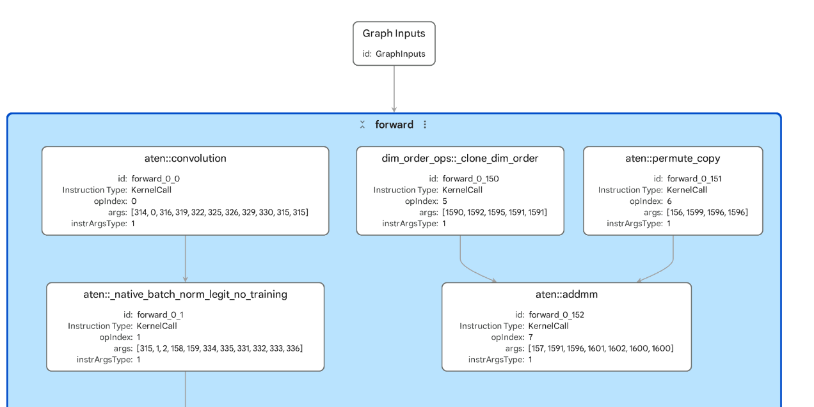
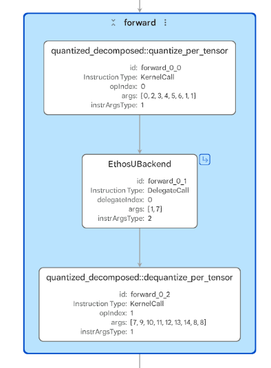
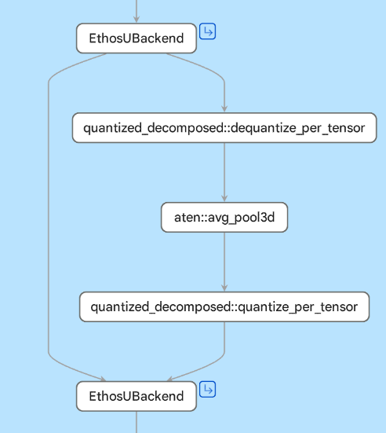
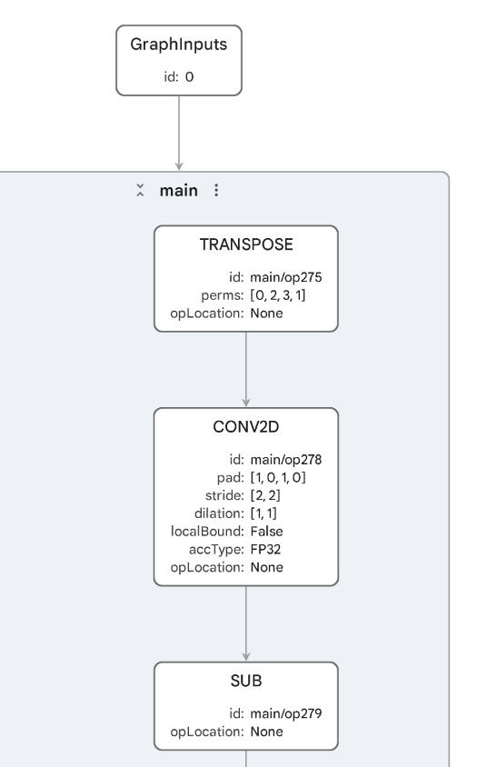
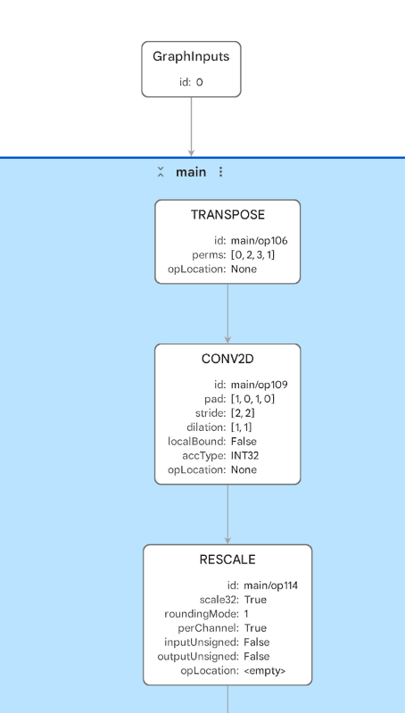
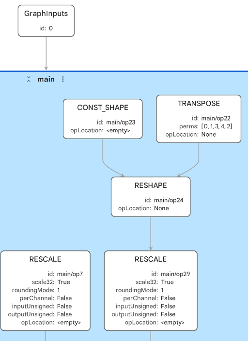
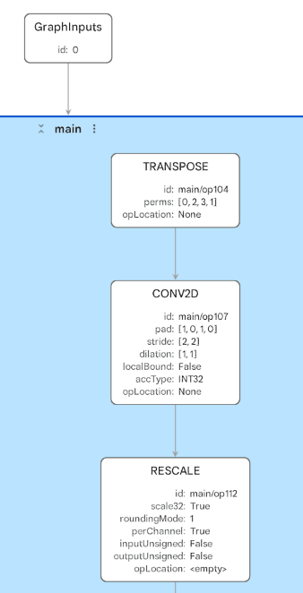
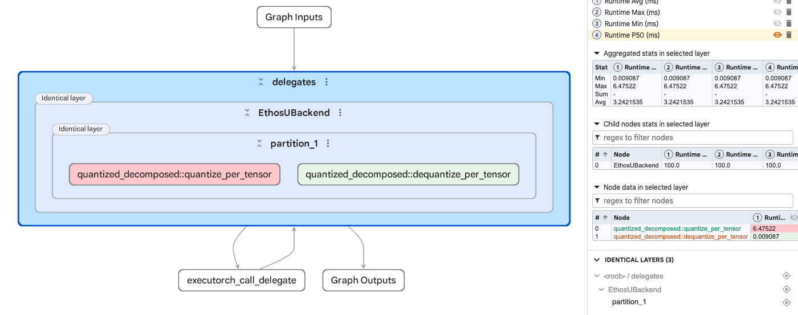

# Module 4: Deploy ExecuTorch Models with Arm Ethos-U Acceleration

## Introduction

In the first three modules, you deployed models through Arm CPU backends. In
this module, you move the main neural-network compute to an Arm Ethos-U neural
processing unit (NPU). You will prepare and quantize MobileNetV2, compile it for
an Ethos-U85, and run the resulting ExecuTorch program on a Corstone-320 Fixed
Virtual Platform (FVP). The module compares three model variants, runs the INT8
model on the FVP, and uses it in a simple classification application:

| Model/runtime path | How we use it / what it shows |
|---|---|
| FP32 MobileNetV2 with Ethos-U partitioning | Shows why exportable FP32 models are not automatically NPU-ready |
| INT8 MobileNetV2 with Ethos-U | Shows the main quantized deployment path for Ethos-U |
| INT8 MobileNetV2 with inserted LRN | Shows how a model change can split Ethos-U delegation into multiple regions and introduce an unsupported operator |
| INT8 MobileNetV2 on Corstone-320 FVP | Checks that the compiled `.pte` artifact executes in a simulation of the target |
| INT8 MobileNetV2 classification app | Adds model-specific output handling to the generic runner |

Optional sections cover TOSA artifact generation, the ExecuTorch Inspector, Model
Explorer, and the ML Inference Advisor (MLIA).

## NPU and Ethos-U Fundamentals

### What Is an NPU?

An NPU is a specialized accelerator for the tensor operations used by neural
networks. Convolutions and matrix multiplications contain large numbers of
multiply-accumulate (MAC) operations. An NPU implements these operations with
parallel data paths and memory access patterns designed for neural-network
inference.

The Arm Ethos-U family targets embedded and edge systems where compute,
memory, power, and area are constrained. Ethos-U configurations provide
different numbers of MAC units, allowing a system designer to trade silicon
area against neural-network throughput. This module targets an Ethos-U85 with
256 MAC units.

The CPU remains part of the system. It starts ExecuTorch, configures memory,
invokes delegated regions, and handles input, output, and application control
flow. Any model operation outside the Ethos-U delegate needs a compatible CPU
kernel in the target runtime.

This is similar to XNNPACK delegation in earlier modules: ExecuTorch
partitions the graph, and supported regions are delegated to a backend. Work
that is not delegated remains on the default ExecuTorch path. Whether that
work can execute depends on the kernels included in the target runtime. The
backend is different, and the preparation path is more constrained.

Ethos-U executes quantized integer workloads rather than FP32 model compute.
An FP32 model can still be exported and packaged as an ExecuTorch program, but
that does not make it an Ethos-U-accelerated program. INT8 quantization changes
the graph into the form used by the NPU backend and Vela compiler.

Use an Ethos-U path when the model is quantized, its important operators are
supported, and it forms one or a few large delegated regions. A CPU path may be
the better choice when the model depends on unsupported operations or when
flexibility matters more than accelerator efficiency.

## ExecuTorch Ethos-U Workflow

The simplified flow is:

```text
PyTorch model
  -> torch.export
  -> PT2E quantization with EthosUQuantizer
  -> TOSA lowering
  -> Vela compilation
  -> ExecuTorch `.pte` artifact
  -> executor runner
  -> Corstone-320 FVP
```

This workflow uses Python on the Linux host and C++ on the target. Python is
used ahead of deployment to load the PyTorch model, calibrate it, lower it, and
write the `.pte` artifact. The Python process is not part of the deployed
application.

The Corstone-320 FVP runs the same type of bare-metal C++ application that
would run on a Cortex-M target. A microcontroller does not normally provide the
Python interpreter, operating-system services, or memory available on the
development host. The C++ executor runner links the ExecuTorch runtime,
Ethos-U delegate and driver, memory allocators, and platform I/O into one ELF.
At runtime it loads the prepared `.pte` artifact, supplies input tensors, and
calls the model method. This split keeps model conversion on the development
machine and the deployed runtime small enough for an embedded system.

The `EthosUQuantizer` prepares the model for post-training quantization (PTQ).
ExecuTorch then partitions supported graph regions for the Arm backend. Vela is
Arm's compiler for Ethos-U: ExecuTorch represents those regions as TOSA and
passes them to Vela. Vela performs target-aware operator selection, scheduling,
memory planning, and command-stream generation for the selected Ethos-U
configuration. ExecuTorch packages the command stream and the remaining
program structure into the `.pte` artifact.

TOSA is the intermediate representation used before Vela. It gives the
compiler stack a stable way to represent tensor operations before
target-specific compilation.

The compile specification used throughout the module contains three important
settings:

| Setting | Value | Meaning |
|---|---|---|
| Target | `ethos-u85-256` | Ethos-U85 with 256 MAC units |
| System configuration | `Ethos_U85_SYS_DRAM_Mid` | Vela's memory and bandwidth assumptions for the target system |
| Memory mode | `Shared_Sram` | The CPU and NPU use a shared SRAM region |

The Corstone-320 FVP is a software model of a Cortex-M85 and Ethos-U85 system - a type of simulation.
Use it to validate the program, runtime, driver, and NPU integration before
moving to a board. FVP counters are not final hardware benchmark results.

### Learning Outcomes

By the end of this module, you will be able to:

- explain the roles of the CPU, Ethos-U NPU, TOSA, and Vela
- explain why FP32 models do not delegate to Ethos-U
- quantize and calibrate models for Ethos-U
- interpret ExecuTorch delegation and Vela compiler reports for Ethos-U
- compare one large delegate with a model split into multiple delegate regions
- build and run an ETDump-enabled ExecuTorch runner on Corstone-320 FVP
- turn raw model output into an ImageNet classification result

### Script Layout

Module 4 follows the same script-first pattern as the earlier modules. The AOT
steps run on a Linux host, which also runs the FVP simulation of the target:

- `module-4-ethos-npu-accelerated-inference/scripts/aot`: preparation, FP32 lowering, calibration, INT8
  quantization, Ethos-U lowering, and TOSA dumping
- `module-4-ethos-npu-accelerated-inference/scripts/fvp`: input tensor creation and output decoding
- `module-4-ethos-npu-accelerated-inference/apps/fvp_image_classifier`: a small patch that adds
  MobileNetV2 top-5 output to the upstream FVP runner
- `module-4-ethos-npu-accelerated-inference/patches`: the ETDump build patch for the pinned ExecuTorch revision
- `module-4-ethos-npu-accelerated-inference/artifacts`: generated weights, `.pte` artifacts,
  `.etrecord` files, TOSA artifacts, runners, and logs
- `module-4-ethos-npu-accelerated-inference/results`: optional result summaries generated during the
  module

Generate artifacts on the Linux host. Keep the logs, screenshots, and result
files that you need for the final comparison.

## Linux Host Setup

Use Linux for this module for the best support of Arm FVPs. Ubuntu on
AArch64/Arm64 or x86_64 is recommended. An AWS Ubuntu instance is a suitable
option if you do not already have a Linux machine.

Suggested AWS configuration:

- Ubuntu LTS
- at least 4 vCPUs and 16 GB RAM
- 100 GB disk
- stop the instance after you finish the module

Run on the Linux host. These commands install the build tools, install
Python 3.11.14 with `pyenv`, and select that Python version before the
ExecuTorch environment is created:

```bash
sudo apt update
sudo apt install -y \
  git curl ca-certificates build-essential cmake ninja-build \
  libssl-dev zlib1g-dev libbz2-dev libreadline-dev libsqlite3-dev \
  libncursesw5-dev xz-utils tk-dev libxml2-dev libxmlsec1-dev \
  libffi-dev liblzma-dev

curl https://pyenv.run | bash

export PYENV_ROOT="$HOME/.pyenv"
export PATH="$PYENV_ROOT/bin:$PATH"
eval "$(pyenv init -)"

pyenv install 3.11.14
pyenv shell 3.11.14
python3 --version
```

The final command should print Python 3.11.14. Keep this shell open for the
ExecuTorch setup commands below so the virtual environment is created with the
selected Python version.

### How This Setup Differs from Modules 1 and 2

Modules 1 and 2 used prebuilt Python packages inside virtual
environments. In those modules, setup was mostly a `pip install` step: you
installed ExecuTorch, PyTorch, and the Python dependencies needed to export,
lower, and run CPU examples.

Module 4 uses a different setup because the Ethos-U flow needs more than the
Python package. You will clone the ExecuTorch source tree, install its Python
package from that checkout, install the Arm backend tools, and build the
bare-metal ExecuTorch runtime libraries used by the FVP runner.

The practical difference is:

| Modules | Setup style | Why |
|---|---|---|
| Modules 1 and 2 | Install prebuilt Python packages into course virtual environments | CPU examples use Python export, Python runtime checks, and Raspberry Pi scripts |
| Module 4 | Build from an ExecuTorch source checkout | Ethos-U needs the Arm backend, Vela/FVP tooling, bare-metal runtime libraries, ETDump support, and executor-runner builds from the same tree |

In this module, `~/executorch` is the source checkout used to build the
runtime and runner that execute the `.pte` artifact on the Corstone FVP.

Clone ExecuTorch and check out the revision used by this module:

```bash
EXECUTORCH_COMMIT=fbd14e65299071097a9b729d826cf1ad414db16f

git clone https://github.com/pytorch/executorch.git ~/executorch && \
  cd ~/executorch && \
  git checkout --detach "$EXECUTORCH_COMMIT" && \
  test "$(git rev-parse HEAD)" = "$EXECUTORCH_COMMIT" && \
  echo "Using ExecuTorch commit $(git rev-parse HEAD)"
```

The final line must print:

```text
Using ExecuTorch commit fbd14e65299071097a9b729d826cf1ad414db16f
```

Do not continue if the clone, checkout, or commit check fails. If
`~/executorch` already exists, move or remove that checkout only after checking
whether it contains work you need to keep.

After the commit has been verified, create the Python environment, install the
Arm tools, and build the bare-metal runtime:

```bash
cd ~/executorch
PYENV_VERSION=3.11.14 python -m venv .venv
source .venv/bin/activate
CMAKE_ARGS="-DEXECUTORCH_BUILD_COREML=OFF -DEXECUTORCH_BUILD_OPENVINO=OFF" \
  ./install_executorch.sh --minimal --optional-dependency ethos_u
./examples/arm/setup.sh --i-agree-to-the-contained-eula
source examples/arm/arm-scratch/setup_path.sh
./backends/arm/scripts/build_executorch.sh --etdump
```

The checkout is pinned to a specific commit validated for this module. The
second command block creates `~/executorch/.venv`, installs the
ExecuTorch Python package with the Ethos-U dependencies, and builds the
bare-metal libraries with ETDump support.

ETRecord is build-time metadata that describes the exported graph, operators,
debug handles, and delegate partitions. ETDump, enabled here, is the matching runtime event
trace: it records what happened while the model ran, including delegate
execution and references to captured intermediate output. ExecuTorch Inspector
and Model Explorer are both tools that combine the two artifacts to map FVP events back to the
model graph and its Ethos-U delegate region.

The first FVP run we perform will use the generic runner provided at:

```text
~/executorch/examples/arm/executor_runner
```

That runner is model-agnostic: it loads the embedded `.pte` artifact, reads
tensor inputs through semihosting, runs the model, and writes raw output
tensors back to the host.

Semihosting lets bare-metal code request services from a connected debugger or
simulator. In this lab, the FVP handles the runner's file operations using a
directory on the Linux host, so the simulated Cortex-M system does not need its
own filesystem. Semihosting is intended for development and simulation; a
deployed application would obtain inputs and store outputs through its board's
actual interfaces and storage.

Later in the module, you will apply a small patch to the runner to adapt it into a simple image classification app that prints MobileNetV2 top-5 class
IDs over UART.

Clone the course repo onto the Linux host, enter the repo, and activate
the ExecuTorch Python environment. Install the Module 4 add-on requirements
before running Task 1; the course scripts use TorchVision and Pillow in
addition to the packages installed by the ExecuTorch source setup.

```bash
git clone https://github.com/arm-education/executorch_on_arm_course.git ~/executorch_on_arm
cd ~/executorch_on_arm
source ~/executorch/.venv/bin/activate
python -m pip install -r module-4-ethos-npu-accelerated-inference/requirements.txt
```

## Task 1: Prepare MobileNetV2 and Try FP32 Ethos-U Lowering

Start by preparing the same MobileNetV2 model used in Module 2. The preparation step is similar to Module 2. The difference is the target:
these artifacts will be used for Ethos-U lowering and FVP execution rather
than for a Cortex-A CPU.

Run on the Linux host:

```bash
python module-4-ethos-npu-accelerated-inference/scripts/aot/prepare_mobilenetv2.py \
  --out module-4-ethos-npu-accelerated-inference/artifacts/mobilenetv2
```

The preparation script downloads the same TorchVision MobileNetV2 `IMAGENET1K_V1` weights and
public-domain yellow Labrador image used in Module 2, saves a state dict, and
writes ImageNet labels:

```python
weights = MobileNet_V2_Weights.IMAGENET1K_V1
model = mobilenet_v2(weights=weights).eval()
torch.save(model.state_dict(), weights_path)

labels_path.write_text(json.dumps(weights.meta["categories"], indent=2) + "\n")
```

The script also writes the model input shape and preprocessing settings and creates `model_spec.json`:

```python
spec = {
    "name": "mobilenetv2",
    "weights": weights_path.name,
    "labels": labels_path.name,
    "sample_image": sample_path.name if sample_path.exists() else None,
    "input": {
        "shape": [1, 3, 224, 224],
        "preprocessing": {
            "resize": 256,
            "center_crop": 224,
            "mean": [0.485, 0.456, 0.406],
            "std": [0.229, 0.224, 0.225],
        },
    },
}
```

The shape `[1, 3, 224, 224]` is one RGB image in NCHW order: batch, channels,
height, and width. The resize, crop, mean, and standard deviation are the
ImageNet preprocessing values expected by the pretrained MobileNetV2 model.

Now take your FP32 MobileNetV2 model, and attempt to lower it to ExecuTorch with the Ethos-U target:

```bash
python module-4-ethos-npu-accelerated-inference/scripts/aot/lower_fp32_ethosu.py \
  --spec module-4-ethos-npu-accelerated-inference/artifacts/mobilenetv2/model_spec.json \
  --target ethos-u85-256 \
  --system-config Ethos_U85_SYS_DRAM_Mid \
  --memory-mode Shared_Sram
```

You should expect to see output similar to this:

```text
PTE size: 14.24 MB

Delegation
==========
Ethos-U delegate call sites: 0
Fallback call_function ops:  463

Selected non-delegated operators:
  aten._native_batch_norm_legit_no_training.out (52)
  aten.add.out (10)
  aten.addmm.out (1)
  aten.convolution.out (52)
  aten.hardtanh.out (35)
  aten.mean.out (1)
```

The script writes a `.pte` artifact, but the delegation summary shows
that no region was handed to Ethos-U. The selected operators show that the
MobileNetV2 convolutions, batch normalization, activations, and classifier
remain outside the Ethos-U delegate. The important line is
`Ethos-U delegate call sites: 0`: this FP32 artifact is packaged for
ExecuTorch, but it is not an NPU-accelerated MobileNetV2 artifact.

The script follows the same basic export-and-lower pattern used in Module 2.
It reloads the MobileNetV2 weights prepared earlier, creates an example tensor
with the shape from `model_spec.json`, exports the model, lowers with a backend
partitioner, writes the `.pte` artifact, and prints a delegation summary.

```python
spec = json.loads(args.spec.read_text())
artifact_dir = args.spec.parent

model = mobilenet_v2(weights=None).eval()
model.load_state_dict(torch.load(artifact_dir / spec["weights"], map_location="cpu"))

example_inputs = (torch.randn(*spec["input"]["shape"]),)
exported = export_no_guards(model, example_inputs)
```

The main difference from Module 2 is the backend. Module 2 used
`XnnpackPartitioner` for CPU execution. This script uses an Ethos-U compile
specification and `EthosUPartitioner`, so the Arm backend can try to identify
regions that can lower through TOSA and Vela for the selected Ethos-U target.

The lowering stage is:

```python
compile_spec = EthosUCompileSpec(
    target=args.target,
    system_config=args.system_config,
    memory_mode=args.memory_mode,
    extra_flags=args.extra_flag,
)

edge = to_edge_transform_and_lower(
    exported,
    compile_config=EdgeCompileConfig(_check_ir_validity=False),
    partitioner=[EthosUPartitioner(compile_spec)],
)
```

{}
`EthosUCompileSpec` records the target NPU, system configuration, memory mode,
and Vela options used by the Arm backend. `EthosUPartitioner` uses this
configuration when identifying regions that can lower through TOSA and be
compiled by Vela. The partitioner is supplied to the same
`to_edge_transform_and_lower()` API used with XNNPACK in earlier modules.
{}

The compile specification tells the Arm backend which NPU target,
system configuration, and memory mode to use. In this module, the target
is `ethos-u85-256`, the system configuration is
`Ethos_U85_SYS_DRAM_Mid`, and the memory mode is `Shared_Sram`.

This result is expected. Ethos-U acceleration is designed around supported
quantized integer workloads. An FP32 `.pte` artifact can still be generated,
but that is not the same as NPU acceleration. The operations would have to fallback to a CPU instead.

When you inspect this artifact later in Model Explorer, the graph remains an
FP32 program rather than an Ethos-U delegated program:

- no `EthosUBackend` delegate node
- many visible `aten::` operators

### Task 1 Takeaway

The FP32 model is exportable, but it has zero Ethos-U delegate calls. A `.pte`
artifact proves that ExecuTorch packaged the program; it does not prove that
the NPU can execute its compute. This shows why quantization matters for Ethos-U. Without it, Vela cannot
compile any part of the model for the NPU.

## Task 2: Quantize MobileNetV2 and Lower It to Ethos-U

Create 16 calibration variants from the prepared sample image:

```bash
python module-4-ethos-npu-accelerated-inference/scripts/aot/create_calibration_images.py \
  --out module-4-ethos-npu-accelerated-inference/artifacts/mobilenetv2/calibration_images \
  --source-image module-4-ethos-npu-accelerated-inference/artifacts/mobilenetv2/sample.jpg \
  --count 16
```

This is the same local calibration method used in Module 2. The script creates
cropped, resized, and mirrored variants in an ImageFolder-compatible
directory. A production model should be calibrated and evaluated with separate
images that match the
camera, lighting, composition, and subjects used by the application.

Quantize MobileNetV2 to INT8 and lower to Ethos-U:

```bash
python module-4-ethos-npu-accelerated-inference/scripts/aot/quantize_lower_ethosu.py \
  --spec module-4-ethos-npu-accelerated-inference/artifacts/mobilenetv2/model_spec.json \
  --calibration-images module-4-ethos-npu-accelerated-inference/artifacts/mobilenetv2/calibration_images \
  --num-calib 16 \
  --target ethos-u85-256 \
  --system-config Ethos_U85_SYS_DRAM_Mid \
  --memory-mode Shared_Sram \
  --validate-image module-4-ethos-npu-accelerated-inference/artifacts/mobilenetv2/sample.jpg \
  --etrecord
```

The quantization setup uses `EthosUQuantizer`:

```python
compile_spec = EthosUCompileSpec(
    target=args.target,
    system_config=args.system_config,
    memory_mode=args.memory_mode,
    extra_flags=args.extra_flag,
)

quantizer = EthosUQuantizer(compile_spec)
quantizer.set_global(get_symmetric_quantization_config())
prepared = prepare_pt2e(graph_module, quantizer)
```

{}
`EthosUQuantizer` supplies the quantization rules for the selected Ethos-U
compile specification. `get_symmetric_quantization_config()` creates the
symmetric INT8 configuration applied by `set_global()`. PyTorch PT2E then uses
that backend policy during preparation, calibration, and conversion.
{}

The calibration loop is the same PTQ pattern introduced in Module 2:

```python
for index, (image, _) in enumerate(calibration_loader):
    if index >= args.num_calib:
        break
    prepared(image)
```

After calibration, the script converts the model, exports the quantized
graph, and lowers through the Ethos-U partitioner:

```python
quantized_model = convert_pt2e(prepared)
exported_quantized = export_no_guards(quantized_model, example_inputs)
edge = lower_to_ethosu(exported_quantized, args)
```

Some quantize and dequantize nodes can remain around the Ethos-U delegate
boundary. Before packaging, the script replaces those boundary q/dq nodes with
Cortex-M-compatible equivalents so `to_executorch()` can write the final
`.pte` artifact:

```python
edge = replace_boundary_quant_nodes(edge)
```

{}
The helper calls `edge.transform([ReplaceQuantNodesPass()])` to apply an
ExecuTorch pass to the lowered edge program. `ReplaceQuantNodesPass()` replaces
quantize and dequantize operations at delegate boundaries with forms supported
by the Cortex-M runtime used in this deployment.
{}

CMSIS-NN is Arm's library of optimized neural-network kernels for Cortex-M
CPUs. An operator that is not delegated to Ethos-U does not automatically use
the most optimized CMSIS-NN implementation; it runs through whichever
compatible kernel is included in the ExecuTorch runtime. These boundary q/dq
operators use ExecuTorch's Cortex-M kernels, with Helium/MVE vectorized paths
where available, rather than CMSIS-NN. Module 4 focuses on getting the main
model workload onto the Ethos-U NPU. Module 5 examines Cortex-M execution,
CMSIS-NN optimization, and non-delegated operators in more detail.

The `--validate-image` option compares FP32 and converted INT8 output before
Ethos-U lowering. Both should place `Labrador retriever` and `golden retriever`
near the top. This check catches incorrect weights, preprocessing, or
calibration before the backend compilation step.

The prediction comparison should look similar to this:

| Model | Top prediction | Second prediction | Top-1/top-2 logit margin |
|---|---:|---:|---:|
| FP32 | Labrador retriever: 63.93% | golden retriever: 34.00% | 0.6313 |
| Converted INT8 | Labrador retriever: 76.46% | golden retriever: 21.97% | 1.2474 |

Both models classify the sample as a Labrador retriever. The higher INT8
confidence on this image does not show that INT8 improves accuracy across a
dataset; it only shows how quantization changed this output distribution.

The `--etrecord` option keeps a copy of the lowered edge program before
packaging. ETRecord uses this graph metadata later when runtime events are
mapped back to the program:

```python
edge_for_etrecord = copy.deepcopy(edge) if args.etrecord else None
program = edge.to_executorch(
    config=ExecutorchBackendConfig(extract_delegate_segments=False)
)
```

{}
`edge.to_executorch()` converts the edge program to its deployable ExecuTorch
representation. `ExecutorchBackendConfig` controls packaging options. Here,
`extract_delegate_segments=False` keeps the delegate data within the generated
program rather than extracting it as a separate segment.
{}

The script then writes the matching ETRecord:

```python
generate_etrecord(str(path), edge_for_etrecord, program)
```

{}
`generate_etrecord()` combines the lowered edge graph with the packaged
ExecuTorch program to create build-time debugging metadata. Inspector later
uses this metadata to map runtime ETDump events back to operators and delegate
regions.
{}

The generated INT8 `.pte` artifact should be about 3.59 MB, and the terminal
should print an ExecuTorch delegation summary similar to:

```text
PTE size: 3.59 MB

Delegation
==========
Ethos-U delegate call sites: 1
Fallback call_function ops:  5
```

The small fallback count includes boundary q/dq, tensor-access, and allocation
operations around the delegate. The important result is the single Ethos-U
delegate call containing the main MobileNetV2 workload.

The INT8 model forms one large Ethos-U delegated region. Most supported
quantized MobileNetV2 compute is behind one Ethos-U delegate call, so the
top-level `.pte` artifact mostly shows data entering the delegate, leaving the
delegate, and returning to ExecuTorch.

Vela prints the NPU assignment before ExecuTorch writes the `.pte` artifact.
For MobileNetV2, you should expect a summary like this:

```text
Total SRAM used                               1474.72 KiB
Total DRAM used                               3494.75 KiB
CPU operators = 0 (0.0%)
NPU operators = 55 (100.0%)
Total SRAM bandwidth            per input     30.84 MB/inference (batch size 1)
Total DRAM bandwidth            per input      3.44 MB/inference (batch size 1)
Neural network macs                         300987520 MACs/batch
```

### Read and understand the Vela Report

Vela prints one report for each graph region sent to it. For INT8 MobileNetV2,
one report corresponds to one large delegated region.

- **CPU and NPU operators:** these counts describe the region Vela compiled.
  `NPU operators = 55` and `CPU operators = 0` mean all operators in that
  region were assigned to the NPU. The CPU still runs ExecuTorch and the
  application around the delegate.
- **Neural network MACs:** the MAC count estimates the amount of neural compute
  for one input. It is not an inference-time measurement.
- **Memory area usage:** the report shows how weights, constants, and feature
  maps are placed in the memory areas defined by the system configuration and
  memory mode.
- **Bandwidth estimates:** Vela estimates reads and writes between SRAM and
  off-chip memory. High traffic can indicate a memory-bound configuration, but
  the values are compiler estimates rather than measurements from a board.

Use the report to check operator support and memory planning for the selected
target. Final performance and energy measurements require the intended hardware.

### Task 2 Summary

INT8 quantization changes MobileNetV2 into a graph that Vela can compile for
Ethos-U85. The model forms one large delegated region, while the
pre-lowering prediction comparison checks that the quantized result remains
useful for the sample image.

## Task 3: Add an Unsupported Operator and Compare Delegation Outcomes

Local Response Normalization (LRN) rescales each activation using values from
nearby channels at the same spatial position. It was used in some earlier CNNs
to reduce the relative strength of activations surrounded by other strong
responses, but it is not part of standard MobileNetV2. We insert it here to
show how adding one operation can break a single NPU-delegated region into
separate regions with a non-delegated operation between them.

Insert `LocalResponseNorm` into MobileNetV2 before quantization and lowering:

```bash
python module-4-ethos-npu-accelerated-inference/scripts/aot/quantize_lower_ethosu.py \
  --spec module-4-ethos-npu-accelerated-inference/artifacts/mobilenetv2/model_spec.json \
  --calibration-images module-4-ethos-npu-accelerated-inference/artifacts/mobilenetv2/calibration_images \
  --num-calib 16 \
  --target ethos-u85-256 \
  --system-config Ethos_U85_SYS_DRAM_Mid \
  --memory-mode Shared_Sram \
  --insert-lrn \
  --etrecord
```

The wrapper used by the script adds LRN after the MobileNetV2 feature
extractor:

```python
def forward(self, image):
    x = self.features(image)
    x = self.lrn(x)
    x = F.adaptive_avg_pool2d(x, (1, 1))
    x = torch.flatten(x, 1)
    return self.classifier(x)
```

The supported operations on either side of the LRN path still compile through
Vela, but `aten.avg_pool3d.out` remains non-delegated between two NPU-delegated
regions. Vela therefore generates two Ethos-U command streams instead of one.

Compare the baseline report with the two LRN-region reports:

| Graph region | NPU operators | SRAM used | DRAM used | Estimated DRAM traffic | MACs |
|---|---:|---:|---:|---:|---:|
| Baseline INT8 | 55 | 1474.72 KiB | 3494.75 KiB | 3.44 MB/inference | 300,987,520 |
| LRN region 1 | 59 | 1474.72 KiB | 2301.31 KiB | 71.88 MB/inference | 299,833,156 |
| LRN region 2 | 5 | 262.50 KiB | 1194.08 KiB | 1.17 MB/inference | 1,468,160 |

These are per-region compiler estimates, not measured latency. The reports
show that the LRN variant is split into two compilable NPU regions and that its
estimated memory traffic differs substantially from the baseline.

The script then packages the model and prints the top-level ExecuTorch delegation
summary. You should expect output similar to this:

```text
PTE size: 3.60 MB

Delegation
==========
Ethos-U delegate call sites: 2
Fallback call_function ops:  13
  aten.avg_pool3d.out (1)
  cortex_m.dequantize_per_tensor.out (2)
  cortex_m.quantize_per_tensor.out (2)
```

Read the Vela summaries and the ExecuTorch delegation summary together. Vela
reports what each NPU command stream contains. ExecuTorch reports the top-level
`.pte` artifact graph: two Ethos-U delegate calls plus small operations around
the delegate boundaries. The `cortex_m.quantize_per_tensor` and
`cortex_m.dequantize_per_tensor` entries are the boundary q/dq nodes that the
script rewrites before packaging. The omitted `getitem` and `alloc` entries are
small output-selection and allocation operations. `aten.avg_pool3d.out` is the
operation left between the two delegated regions in this variant.

A single-delegate pattern looks like:

```text
ExecuTorch runtime -> [large Ethos-U delegated region] -> ExecuTorch runtime
```

The LRN variant looks closer to:

```text
ExecuTorch runtime -> [Ethos-U region] -> [q/dq + non-delegated avg_pool3d] -> [Ethos-U region] -> ExecuTorch runtime
```

The second pattern still uses the NPU, but moving between two delegates can add
q/dq operations, synchronization, and tensor movement.

Whether the non-delegated operation can execute on a target CPU also depends on the
kernels included in that target runtime, and even if it can execute, it could add a lot of additional overhead, bottlenecking your application, and potentially obscuring benefits gained through NPU acceleration.

### Task 3 Summary

The LRN variant still uses the NPU, but the non-delegated operation separates
the supported graph into two regions. The result is two Vela reports and two
ExecuTorch delegate calls instead of one. Operator support affects both whether
delegation occurs and whether the delegated graph remains contiguous.

## Task 4: Understand TOSA

TOSA is the Tensor Operator Set Architecture. It is a stable operator-level
intermediate representation used between framework graphs and backend-specific
compilers. In this workflow, ExecuTorch lowers supported regions to TOSA and
Vela consumes those regions before generating an Ethos-U command stream.

TOSA compatibility is not the same as Ethos-U execution. Ethos-U is one of the
backends that consumes TOSA representations. TOSA has floating-point and
integer profiles, so FP32 MobileNetV2 can be represented as
`TOSA-1.0+FP`. Ethos-U still requires a supported quantized graph and successful
Vela compilation.

### Optional: Generate TOSA Artifacts

Generate TOSA artifacts for the FP32, INT8, and INT8 + LRN variants:

```bash
python module-4-ethos-npu-accelerated-inference/scripts/aot/dump_tosa_artifacts.py \
  --spec module-4-ethos-npu-accelerated-inference/artifacts/mobilenetv2/model_spec.json \
  --calibration-images module-4-ethos-npu-accelerated-inference/artifacts/mobilenetv2/calibration_images \
  --out module-4-ethos-npu-accelerated-inference/artifacts/tosa
```

The script exports the FP32 model directly and prepares, calibrates, and
converts the two INT8 variants:

```python
fp32_ep = export_no_guards(base_model, example_inputs)
int8_ep = quantized_export(base_model, spec, args, example_inputs, datasets)

lrn_model = MobileNetV2WithLRN(base_model).eval()
lrn_int8_ep = quantized_export(
    lrn_model, spec, args, example_inputs, datasets
)
```

For each exported program, `dump_tosa()` selects a TOSA profile, enables
artifact output, and runs the TOSA partitioner:

```python
tosa_spec = TosaSpecification.create_from_string(profile)
compile_spec = TosaCompileSpec(tosa_spec)
compile_spec.dump_intermediate_artifacts_to(str(out_dir))
partitioner = create_partitioner(compile_spec)

to_edge_transform_and_lower(
    exported,
    partitioner=[partitioner],
    compile_config=EdgeCompileConfig(_check_ir_validity=False),
)
```

This path stops after TOSA lowering and does not pass the artifacts to Vela.
The Arm backend writes one `.tosa` file for each supported graph region. You
should expect:

```text
Dumping MobileNetV2 FP32: TOSA-1.0+FP
  1 .tosa file in module-4-ethos-npu-accelerated-inference/artifacts/tosa/mobilenetv2_fp32
Dumping MobileNetV2 INT8: TOSA-1.0+INT
  1 .tosa file in module-4-ethos-npu-accelerated-inference/artifacts/tosa/mobilenetv2_int8
Dumping MobileNetV2 LRN INT8: TOSA-1.0+INT
  2 .tosa files in module-4-ethos-npu-accelerated-inference/artifacts/tosa/mobilenetv2_lrn_int8
```

The FP32 and baseline INT8 models each produce one TOSA artifact. The LRN
variant produces two because the non-delegated `avg_pool3d` operation separates
the supported graph into two regions.

### Task 4 Summary

TOSA shows how a graph region is represented before backend-specific
compilation. A valid TOSA FP graph does not imply that Ethos-U can execute FP32
compute, while multiple TOSA files reveal where a supported graph was split.

## Task 5: Build and Run on Corstone-320 FVP

The Arm executor runner is a generic bare-metal application. It loads the
`.pte` artifact embedded during the build, reads raw input tensors through
semihosting, invokes the ExecuTorch method, and writes output files back to the
Linux host.

The build converts the selected `.pte` artifact into `model_pte.h`. The runner
uses that byte array to load the ExecuTorch program and its first method:

```cpp
#include "model_pte.h"

model_data = model_pte;
model_size = sizeof(model_pte);

ctx.loader.reset(model_data, model_size);
auto& loader = ctx.loader.value();
Result<Program> program_result = Program::load(&loader);
ctx.program.reset(std::move(program_result.get()));
Program& program = ctx.program.value();

ctx.method.reset(program.load_method(
    ctx.method_name, &ctx.memory_manager.value(), event_tracer_ptr));
```

With semihosting enabled, the `-i i0.bin` argument reads the raw input from the
Linux host. The runner checks its byte count against the method input and
copies it into the ExecuTorch tensor:

```cpp
auto [buffer, buffer_size] = read_binary_file(
    input_tensor_filename, ctx.input_file_allocator.value());
input_buffers.push_back(std::make_pair(buffer, buffer_size));

if (buffer_size == tensor_meta->nbytes()) {
  Tensor& tensor = input_evalues[i].toTensor();
  std::memcpy(tensor.mutable_data_ptr<int8_t>(), buffer, buffer_size);
}
```

The model runs through the standard ExecuTorch `Method` API. After execution,
the runner obtains each output tensor and writes its raw bytes to `out-0.bin`:

```cpp
status = ctx.method.value()->execute();

ctx.method.value()->get_outputs(outputs.data(), outputs.size());
fwrite(
    tensor.const_data_ptr<char>(), 1, tensor.nbytes(), out_file);
```

### Create the FVP Input

The FVP runner does not decode JPEG files or run TorchVision transforms. Create
the normalized MobileNetV2 input tensor on the Linux host:

```bash
python module-4-ethos-npu-accelerated-inference/scripts/fvp/create_mobilenetv2_input.py \
  --spec module-4-ethos-npu-accelerated-inference/artifacts/mobilenetv2/model_spec.json \
  --image module-4-ethos-npu-accelerated-inference/artifacts/mobilenetv2/sample.jpg \
  --out module-4-ethos-npu-accelerated-inference/artifacts/fvp_runs/mobilenetv2_int8/i0.bin
```

The script reads the resize, crop, mean, and standard-deviation values from
`model_spec.json`, applies the same preprocessing used during validation, and
adds the batch dimension:

```python
transform = transforms.Compose(
    [
        transforms.Resize(prep["resize"]),
        transforms.CenterCrop(prep["center_crop"]),
        transforms.ToTensor(),
        transforms.Normalize(mean=prep["mean"], std=prep["std"]),
    ]
)
tensor = transform(image).unsqueeze(0)
```

It then writes the contiguous tensor as raw float32 values, without a file
header, so the runner can read the bytes directly:

```python
tensor.contiguous().numpy().astype("float32").tofile(args.out)
```

The resulting `[1, 3, 224, 224]` tensor occupies 602,112 bytes. The companion
JSON file records the source image, shape, data type, and byte count; it is for
host-side reference and is not read by the FVP runner.

### Build the ETDump-Enabled Runner

ExecuTorch uses CMake to configure its C and C++ builds. CMake is not the
compiler: it generates the build instructions used by tools such as Ninja or
Make. Here, `build_executor_runner.sh` supplies CMake with the Arm cross-
compiler toolchain, Corstone-320 target settings, feature options, and the
selected `.pte` artifact. The generated build then compiles the runner and
ExecuTorch runtime, links the Ethos-U delegate and supporting libraries, and
embeds the model in the final bare-metal ELF. You normally use the wrapper
script rather than invoking CMake directly because it keeps these settings
consistent.

The runner handles the embedded ExecuTorch runtime sequence on behalf of the
application. In simplified form, the relevant calls are:

```cpp
executorch::runtime::runtime_init();
Result<Program> program = Program::load(&loader);
Result<Method> method = program->load_method("forward", &memory_manager);
method->execute();
```

{}
`runtime_init()` initializes the platform runtime, `Program::load()` parses
the `.pte` data, and `load_method()` creates the executable method using the
supplied memory manager. `Method::execute()` runs that method. The Arm executor
runner includes error handling, input setup, tracing, and allocator management
around these calls.
{}

ETDump is disabled in a standard ExecuTorch build. The setup command used
`build_executorch.sh --etdump`, which enables the event tracer and builds the
ETDump libraries for the target runtime. The runner build below also uses
`--etdump`, which enables the event tracer and intermediate-output capture:

```text
-DEXECUTORCH_ENABLE_EVENT_TRACER=ON
-DET_DUMP_INTERMEDIATE_OUTPUTS=ON
```

In this ExecuTorch revision, those CMake settings do not consistently add the
tracer definition to every target in the standalone runner build. Apply the
provided patch from the ExecuTorch repository root:

```bash
cd ~/executorch
git apply ~/executorch_on_arm/module-4-ethos-npu-accelerated-inference/patches/executor_runner_etdump_cmake.patch
cd ~/executorch_on_arm
```

The patch explicitly defines `ET_EVENT_TRACER_ENABLED` for ExecuTorch core, the
Ethos-U delegate, and the runner when ETDump capture is requested. It also makes
the runner link the `etdump` and `flatccrt` libraries:

```cmake
if(EXECUTORCH_ENABLE_EVENT_TRACER OR
   ET_DUMP_INTERMEDIATE_OUTPUTS OR
   ET_DUMP_OUTPUTS)
  target_compile_options(
    arm_executor_runner PUBLIC -DET_EVENT_TRACER_ENABLED
  )
  list(APPEND arm_executor_runner_link etdump flatccrt)
endif()
```

This keeps the tracer definition consistent across the components that create
and record runtime events.

Build a runner containing the baseline INT8 `.pte` artifact:

```bash
~/executorch/backends/arm/scripts/build_executor_runner.sh \
  --pte="$PWD/module-4-ethos-npu-accelerated-inference/artifacts/mobilenetv2/mobilenetv2_int8_ethosu.pte" \
  --target=ethos-u85-256 \
  --system_config=Ethos_U85_SYS_DRAM_Mid \
  --memory_mode=Shared_Sram \
  --etdump \
  --extra_build_flags="-DSEMIHOSTING=ON -DET_ARM_BAREMETAL_SEMIHOSTING_FILE_ALLOCATOR_POOL_SIZE=0x01000000" \
  --output="$PWD/module-4-ethos-npu-accelerated-inference/artifacts/fvp_runner/mobilenetv2_int8"
```

The build embeds the `.pte` artifact in this ELF:

```text
module-4-ethos-npu-accelerated-inference/artifacts/fvp_runner/mobilenetv2_int8/arm_executor_runner
```

### Run the FVP

```bash
FVP_Corstone_SSE-320 \
  -C mps4_board.subsystem.ethosu.num_macs=256 \
  -C mps4_board.visualisation.disable-visualisation=1 \
  -C vis_hdlcd.disable_visualisation=1 \
  -C mps4_board.telnetterminal0.start_telnet=0 \
  -C mps4_board.uart0.out_file='-' \
  -C mps4_board.uart0.unbuffered_output=1 \
  -C mps4_board.uart0.shutdown_on_eot=1 \
  -C mps4_board.subsystem.cpu0.semihosting-enable=1 \
  -C mps4_board.subsystem.cpu0.semihosting-stack_base=0 \
  -C mps4_board.subsystem.cpu0.semihosting-heap_limit=0 \
  -C "mps4_board.subsystem.cpu0.semihosting-cwd=$(realpath module-4-ethos-npu-accelerated-inference/artifacts/fvp_runs/mobilenetv2_int8)" \
  -C "mps4_board.subsystem.cpu0.semihosting-cmd_line=executor_runner -o out -i i0.bin" \
  -a "$(realpath module-4-ethos-npu-accelerated-inference/artifacts/fvp_runner/mobilenetv2_int8/arm_executor_runner)" \
  --timelimit 600 \
  2>&1 | tee module-4-ethos-npu-accelerated-inference/artifacts/fvp_runs/mobilenetv2_int8/mobilenetv2_int8.log
```

The terminal output should include lines similar to:

```text
Reading input tensor 1 from file i0.bin
Running method forward
NPU Inferences : 1
NPU delegations: 1 (1.00 per inference)
ethosu_pmu_cycle_cntr : 2804702 (2804702.00 per inference)
Writing output to file: out-0.bin
Writing etdump debug_buffer to file: debug_buffer.bin
Writing etdump to file: etdump.bin
Program complete, exiting.
```

This confirms that the runner loaded the program, passed the prepared image to
MobileNetV2, invoked one Ethos-U delegate, wrote the raw model output, and
captured ETDump runtime events. The FVP also prints PMU counters. Use them to
confirm NPU activity and inspect simulated execution timing, not as final
hardware performance measurements. The command does not enable the Ethos-U
`--fast` option, so the Ethos-U timing model reports NPU cycle and activity
counters. A timed simulation takes longer to run.

### Decode the Output

```bash
python module-4-ethos-npu-accelerated-inference/scripts/fvp/decode_mobilenetv2_output.py \
  --output module-4-ethos-npu-accelerated-inference/artifacts/fvp_runs/mobilenetv2_int8/out-0.bin \
  --labels module-4-ethos-npu-accelerated-inference/artifacts/mobilenetv2/imagenet_labels.json
```

The output file contains 1,000 logits, one for each ImageNet class. Although the
main model is INT8, the output boundary dequantizes the result to float32 before
the runner writes it. The decoder checks the file size against the number of
labels to infer the stored data type:

```python
labels = json.loads(args.labels.read_text())
nbytes = args.output.stat().st_size

if nbytes == len(labels) * 4:
    dtype = "float32"
elif nbytes == len(labels):
    dtype = "int8"
```

For the standard float32 output, it unpacks the raw little-endian bytes into
Python values:

```python
data = args.output.read_bytes()
scores = list(struct.unpack(f"<{len(data) // 4}f", data))
```

Logits are relative scores rather than percentages. The decoder applies
softmax, subtracting the largest logit first to avoid unnecessarily large
exponential values:

```python
max_value = max(scores)
exps = [math.exp(value - max_value) for value in scores]
probabilities = [value / sum(exps) for value in exps]
```

Finally, it sorts the probabilities, takes the highest five indices, and uses
each index to look up the corresponding ImageNet label:

```python
top_indices = sorted(
    range(len(probabilities)),
    key=probabilities.__getitem__,
    reverse=True,
)[:5]

for index in top_indices:
    print(labels[index], probabilities[index] * 100)
```

You should see `Labrador retriever` and `golden retriever` near the top.

### Task 5 Summary

The FVP run validates the complete software path: ExecuTorch program, Ethos-U
delegate, bare-metal runtime, semihosted input and output, and Corstone-320
platform integration. It does not replace testing on the intended board.

## Optional: Inspect ETDump with ExecuTorch Inspector

ExecuTorch Inspector is a Python analysis tool for runtime traces. It reads an
ETDump and presents the recorded events as a table. When an ETRecord is also
provided, Inspector uses debug handles to associate those runtime events with
the exported operators and delegate regions. A debug buffer lets it access any
intermediate tensor data captured by ETDump. The command-line tool prints the
result and can save the same table as a TSV file. Model Explorer later presents
the artifacts as a graph; Inspector provides the tabular runtime view.

ExecuTorch examples often use the `.etdp` extension for an ETDump FlatBuffer.
The Arm executor runner used here hard-codes the filename `etdump.bin`. The file
contents are still ETDump data, and Inspector reads the contents rather than
requiring a particular extension. The Model Explorer ExecuTorch extension uses
the `.etdp` or `.etdump` suffix to identify an ETDump file, so a renamed copy is
created later for that tool.

ETRecord and ETDump describe different stages of the same program:

| Artifact | Created | Contents |
|---|---|---|
| `.pte` | packaging | deployed program and backend data |
| `.etrecord` | AOT lowering | graph structure, operators, debug handles, and delegate partitions |
| `etdump.bin` | runtime | runtime events, delegate calls, and captured intermediate data |
| `debug_buffer.bin` | runtime | intermediate output bytes referenced by ETDump |

Run Inspector with the ETRecord from Task 2 and ETDump files from Task 5:

```bash
mkdir -p module-4-ethos-npu-accelerated-inference/results

python -m executorch.devtools.inspector.inspector_cli \
  --etdump_path module-4-ethos-npu-accelerated-inference/artifacts/fvp_runs/mobilenetv2_int8/etdump.bin \
  --etrecord_path module-4-ethos-npu-accelerated-inference/artifacts/mobilenetv2/mobilenetv2_int8_ethosu.etrecord \
  --debug_buffer_path module-4-ethos-npu-accelerated-inference/artifacts/fvp_runs/mobilenetv2_int8/debug_buffer.bin \
  --source_time_scale cycles \
  --target_time_scale cycles \
  --tsv_path module-4-ethos-npu-accelerated-inference/results/mobilenetv2_int8_inspector.tsv
```

Inspector should map `DELEGATE_CALL` to `EthosUBackend` and write the TSV file.
The timed FVP run reports the Ethos-U PMU cycle count in the terminal. ETDump
timestamps are different: the runner records them using the Arm CPU PMU cycle
counter, which does not advance in this FVP configuration. Inspector can still
show the runtime event structure and map the delegate call to the ETRecord, but
its event durations are zero.

An ETDump with event timing requires a timing-capable target on which the CPU
PMU counter is enabled, such as a suitable FPGA or the target hardware. It must
be captured with the matching ETRecord. Repeated inferences are needed for
percentile statistics, and final performance measurements should be taken on
the target hardware rather than inferred from one FVP run.

## Inspect the Artifacts with Model Explorer

You used Model Explorer in earlier modules to inspect exported and lowered
ExecuTorch graphs. This module uses the same graph interface to compare the
FP32, baseline INT8, and LRN `.pte` artifacts. Earlier modules did not use
ETRecord, ETDump, or TOSA in Model Explorer. This module introduces those
artifact types and the additional adapters needed to open them.

When Model Explorer runs on a remote instance but you open its interface in
the development-machine browser, the browser's file picker can only access
files on the development machine. Copy the artifact folder back before opening
the models. From the repository root on your development machine, use `rsync`
to copy only the files needed by Model Explorer:

```bash
mkdir -p module-4-ethos-npu-accelerated-inference/artifacts

rsync -av --prune-empty-dirs \
  -e "ssh -i PATH_TO_KEY.pem" \
  --include='mobilenetv2/' \
  --include='mobilenetv2/*.pte' \
  --include='mobilenetv2/*.etrecord' \
  --include='tosa/***' \
  --exclude='*' \
  ubuntu@INSTANCE_IP:~/executorch_on_arm/module-4-ethos-npu-accelerated-inference/artifacts/ \
  ./module-4-ethos-npu-accelerated-inference/artifacts/
```

This excludes generated runners, model weights, calibration images, FVP input
and output tensors, and logs.

Create a separate environment on the Linux host for these extensions. This
keeps their web dependencies out of the ExecuTorch build environment:

```bash
cd ~/executorch_on_arm
~/executorch/.venv/bin/python -m venv .model_explorer_venv
source .model_explorer_venv/bin/activate
python -m pip install \
  ai-edge-model-explorer \
  executorch-extension-model-explorer \
  tosa-adapter-model-explorer
```

Open an SSH tunnel from your development machine to the Model Explorer server
on the AWS instance:

```bash
ssh -i PATH_TO_KEY.pem -L 8081:localhost:8081 ubuntu@INSTANCE_IP
```

Start the server:

```bash
model-explorer \
  --port 8081 \
  --extensions=executorch_extension_model_explorer,tosa_adapter_model_explorer
```

Open `http://localhost:8081` in the development-machine browser.

### Compare the `.pte` Artifacts

Open `mobilenetv2_fp32_ethosu.pte`. The graph contains visible ATen operations
and no `EthosUBackend` delegate because FP32 compute was not accepted by the
backend.



Open `mobilenetv2_int8_ethosu.pte`. The top-level graph contains an input
quantization boundary, one `EthosUBackend` delegate, and an output
dequantization boundary.

The graph should show:

- one input with shape `[1, 3, 224, 224]`
- one output with shape `[1, 1000]`
- a `quantized_decomposed::quantize_per_tensor` node near the start
- a single `EthosUBackend` delegate node for the main accelerated region
- a `quantized_decomposed::dequantize_per_tensor` node near the end



Open `mobilenetv2_lrn_int8_ethosu.pte`. The inserted LRN path leaves
`aten::avg_pool3d` between two delegated regions.

Compare it with the baseline INT8 artifact and look for:

- two `EthosUBackend` delegate nodes instead of one
- q/dq boundary operations around both delegate regions
- `aten.avg_pool3d.out` between the delegated regions



### Optional: Compare the TOSA Variants

If you generated the optional TOSA artifacts in Task 4, open the FP32 and
baseline INT8 files. Compare:

- the operators produced by TOSA lowering
- tensor shapes and data types
- the structural changes introduced by quantization
- FP32 operations with INT8 `RESCALE` and INT32 accumulation





The LRN model produces two TOSA files because the non-delegated `avg_pool3d`
operation splits the supported graph into two regions:





### ETRecord and ETDump Timing Overlay

The first version of the ExecuTorch Model Explorer extension uses ETDump timing
data as per-node data on an ETRecord graph. The ETDump generated by this FVP run
contains the runtime events used by Inspector, but its CPU PMU timestamps are
zero, so it cannot produce this timing overlay.

The following reference view was captured with a timing-capable ETDump. It
shows the runtime data providers on the right and the single Ethos-U delegate
region in the graph. Producing this view requires an ETDump from suitable FPGA
or target hardware and the matching `.etrecord` file.



Stop Model Explorer with `Ctrl+C`, then return to the ExecuTorch environment
before continuing:

```bash
deactivate
source ~/executorch/.venv/bin/activate
source ~/executorch/examples/arm/arm-scratch/setup_path.sh
cd ~/executorch_on_arm
```

## Optional: Understand Where MLIA Fits

MLIA, the ML Inference Advisor, is an Arm tool for checking model
compatibility and performance for supported inference targets. The public
[arm/mlia](https://github.com/arm/mlia) repository provides the shared
command-line interface, plugin system, backend management, reporting model,
and Python API. Target-specific behavior is added through plugin packages.

For Ethos-U, the public [arm/mlia-ethos-u](https://github.com/arm/mlia-ethos-u)
plugin adds Ethos-U target profiles, Vela integration, and Corstone backend
integration. In a larger workflow, MLIA can help package target selection,
compatibility checks, backend setup, and performance reporting into a more
repeatable advisory step.

You have already run the main pieces manually, so MLIA is not required for this
module. It is useful when you want one advisory tool around target selection,
compatibility checks, Vela, and Corstone runs.

## Task 6: Build a MobileNetV2 Classification App

The generic runner proves that the `.pte` artifact executes and that raw
outputs can be copied back to the host. A classification application also needs
to interpret the output tensor. The provided patch scans the 1,000 MobileNetV2
logits, finds the five largest values, and prints the ImageNet labels, class
IDs, and raw logits over UART.

### Apply the Classification Patch

Generate a C++ label table from the JSON file prepared in Task 1:

```bash
python module-4-ethos-npu-accelerated-inference/apps/fvp_image_classifier/generate_imagenet_labels_header.py \
  --labels module-4-ethos-npu-accelerated-inference/artifacts/mobilenetv2/imagenet_labels.json \
  --out ~/executorch/examples/arm/executor_runner/imagenet_labels.h
```

The bare-metal application does not include a JSON parser or load the label
file at runtime. This helper performs that work on the Linux host. It reads the
JSON array and checks that it contains the 1,000 labels expected by
MobileNetV2:

```python
labels = json.loads(args.labels.read_text())
if (
    not isinstance(labels, list)
    or len(labels) != 1000
    or not all(isinstance(label, str) for label in labels)
):
    raise ValueError("Expected a JSON list containing 1000 ImageNet label strings")
```

It then writes a C++ header containing a compile-time array. `json.dumps()`
adds quotes and escapes each label before it is written as a C++ string:

```python
lines = [
    "#pragma once",
    "",
    f"static constexpr int kImageNetLabelCount = {len(labels)};",
    "static constexpr const char* kImageNetLabels[kImageNetLabelCount] = {",
]
lines.extend(f"    {json.dumps(label)}," for label in labels)
lines.extend(["};", ""])

args.out.write_text("\n".join(lines))
```

The label order is unchanged, so ImageNet class index `208`, for example, can
be printed with `kImageNetLabels[208]`. When the patched runner is compiled,
the string table becomes part of the ELF and no label file is needed on the
FVP.

Apply the runner patch from the ExecuTorch repository root:

```bash
cd ~/executorch
git apply --directory=examples/arm/executor_runner \
  ~/executorch_on_arm/module-4-ethos-npu-accelerated-inference/apps/fvp_image_classifier/arm_executor_runner_topk.patch
cd ~/executorch_on_arm
```

The application code uses a fixed-size top-five array, so it does not need the
standard-library sorting algorithms:

```cpp
for (size_t i = 0; i < num_classes; i++) {
  float value = 0.0f;
  switch (scalar_type) {
    case ScalarType::Float:
      value = output_tensor.const_data_ptr<float>()[i];
      break;
    case ScalarType::Char:
      value = static_cast<float>(output_tensor.const_data_ptr<int8_t>()[i]);
      break;
    default:
      return;
  }

  for (int j = 0; j < kMobileNetV2TopK; j++) {
    if (value > top_values[j]) {
      for (int m = kMobileNetV2TopK - 1; m > j; m--) {
        top_values[m] = top_values[m - 1];
        top_indices[m] = top_indices[m - 1];
      }
      top_values[j] = value;
      top_indices[j] = static_cast<int>(i);
      break;
    }
  }
}
```

The patch calls this function after the model returns its first output tensor.
The generated header adds the 1,000 ImageNet names to the application ELF.

```cpp
Tensor tensor = outputs[i].toTensor();
print_mobilenetv2_top_k(tensor);
```

### Build the Classification App Runner

Build the patched runner into a separate directory:

```bash
~/executorch/backends/arm/scripts/build_executor_runner.sh \
  --pte="$PWD/module-4-ethos-npu-accelerated-inference/artifacts/mobilenetv2/mobilenetv2_int8_ethosu.pte" \
  --target=ethos-u85-256 \
  --system_config=Ethos_U85_SYS_DRAM_Mid \
  --memory_mode=Shared_Sram \
  --etdump \
  --extra_build_flags="-DSEMIHOSTING=ON -DET_ARM_BAREMETAL_SEMIHOSTING_FILE_ALLOCATOR_POOL_SIZE=0x01000000" \
  --output="$PWD/module-4-ethos-npu-accelerated-inference/artifacts/fvp_runner/mobilenetv2_classifier"
```

This build uses the same MobileNetV2 `.pte` artifact as Task 5. The
difference is the C++ application code around the model call.

### Run the Classification App

Create the same MobileNetV2 input tensor in a separate run folder:

```bash
python module-4-ethos-npu-accelerated-inference/scripts/fvp/create_mobilenetv2_input.py \
  --spec module-4-ethos-npu-accelerated-inference/artifacts/mobilenetv2/model_spec.json \
  --image module-4-ethos-npu-accelerated-inference/artifacts/mobilenetv2/sample.jpg \
  --out module-4-ethos-npu-accelerated-inference/artifacts/fvp_runs/mobilenetv2_classifier/i0.bin
```

Run the patched app runner with a separate semihosting folder:

```bash
FVP_Corstone_SSE-320 \
  -C mps4_board.subsystem.ethosu.num_macs=256 \
  -C mps4_board.visualisation.disable-visualisation=1 \
  -C vis_hdlcd.disable_visualisation=1 \
  -C mps4_board.telnetterminal0.start_telnet=0 \
  -C mps4_board.uart0.out_file='-' \
  -C mps4_board.uart0.unbuffered_output=1 \
  -C mps4_board.uart0.shutdown_on_eot=1 \
  -C mps4_board.subsystem.cpu0.semihosting-enable=1 \
  -C mps4_board.subsystem.cpu0.semihosting-stack_base=0 \
  -C mps4_board.subsystem.cpu0.semihosting-heap_limit=0 \
  -C "mps4_board.subsystem.cpu0.semihosting-cwd=$(realpath module-4-ethos-npu-accelerated-inference/artifacts/fvp_runs/mobilenetv2_classifier)" \
  -C "mps4_board.subsystem.cpu0.semihosting-cmd_line=executor_runner -o out -i i0.bin" \
  -a "$(realpath module-4-ethos-npu-accelerated-inference/artifacts/fvp_runner/mobilenetv2_classifier/arm_executor_runner)" \
  --timelimit 600 \
  2>&1 | tee module-4-ethos-npu-accelerated-inference/artifacts/fvp_runs/mobilenetv2_classifier/mobilenetv2_classifier.log
```

The UART log should now include lines similar to:

```text
MobileNetV2 output tensor: scalar_type=Float, numel=1000
MobileNetV2 top-5 predictions:
  1. Labrador retriever (class 208): <logit>
  2. golden retriever (class 207): <logit>
  3. <another ImageNet label> (class <id>): <logit>
  4. <another ImageNet label> (class <id>): <logit>
  5. <another ImageNet label> (class <id>): <logit>
```

These values are logits, not percentages. The earlier host decoder applies
softmax when percentages are needed. The application prints labels directly so
the UART output is meaningful without a second lookup step.

### Task 6 Summary

The generic runner and classification app use the same `.pte` artifact and
input tensor. The application adds model-specific postprocessing and label
lookup around the ExecuTorch call.

## Optional: Build on the C++ Reference Application

The classification patch shows the small change needed to add MobileNetV2
postprocessing to the upstream runner. For a new application, it is often
easier to start from source files that separate the ExecuTorch runtime calls
from the model-specific output handling.

The [Ethos-U C++ reference application](apps/ethosu_cpp_reference/README.md)
provides that structure:

| File | Responsibility |
|---|---|
| `app_main.cpp` | Initialize ExecuTorch and connect model outputs to the application |
| `model_runner.cpp` | Load the `.pte`, allocate method memory, set the input, execute the method, and retrieve outputs |
| `classification_postprocess.cpp` | Convert the MobileNetV2 output tensor into top-five labels and logits |
| `app_config.h` | Define the input count, output index, top-k value, and allocator sizes |
| `CMakeLists.txt` | Link the application with ExecuTorch, the Ethos-U delegate, Arm kernels, and Corstone-320 startup code |

The runtime path is visible in `model_runner.cpp`:

```cpp
Result<Program> program = Program::load(&loader);
Result<MethodMeta> method_meta = program->method_meta(*method_name);

MemoryManager memory_manager(
    &method_allocator, &planned_memory, &temporary_allocator);
Result<Method> method =
    program->load_method(*method_name, &memory_manager);

method->set_input(input_tensor, 0);
method->execute();
method->get_outputs(outputs.data(), outputs.size());
```

`Program::load()` reads the serialized ExecuTorch program. `method_meta()`
provides the tensor and memory-plan information needed before the method is
loaded. `load_method()` prepares the executable method with the supplied
allocators. The application then sets the prepared input tensor, calls
`execute()`, and retrieves the output values.

The reference build embeds the `.pte`, `i0.bin`, and ImageNet labels in the
application ELF instead of reading them through semihosting. This makes the
application structure closer to one that could be moved to a physical board.
Follow the build and FVP commands in its README after completing Tasks 1–5.

To adapt it, keep `model_runner.cpp` and replace the input preparation,
`classification_postprocess.cpp`, and `handle_output()` with code for the new
model and application. Update the visible allocator sizes after checking the
new model's memory plan and the target memory map.

## Optional: Run the Upstream One-Command Flow

ExecuTorch also provides `examples/arm/run.sh`, which combines model export,
quantization, lowering, runner compilation, and FVP execution. Use it to see
the upstream end-to-end flow after completing the individual stages above:

```bash
cd ~/executorch
source examples/arm/arm-scratch/setup_path.sh
./examples/arm/run.sh \
  --aot_arm_compiler_flags="--debug" \
  --output=mv2_u85 \
  --target=ethos-u85-256 \
  --system_config=Ethos_U85_SYS_DRAM_Mid \
  --memory_mode=Shared_Sram \
  --model_name=mv2 \
  --etdump
```

The wrapper enables delegation and quantization by default, and `--etdump`
also requests an ETRecord. This command uses the upstream built-in `mv2` model
and its default calibration input. It does not reproduce the course's
16-image calibration method or artifact names, so treat it as a separate
workflow demonstration rather than a replacement for Tasks 1–5.

## Evaluate the Deployment

Use the generated artifacts and terminal output to complete this table:

| Check | FP32 MobileNetV2 | INT8 MobileNetV2 | INT8 + LRN MobileNetV2 |
|---|---|---|---|
| `.pte` artifact size |  |  |  |
| Ethos-U delegate calls |  |  |  |
| Important work outside delegates |  |  |  |
| Number of Vela reports |  |  |  |
| TOSA profile and file count, if generated |  |  |  |
| Classification remains useful after quantization | N/A |  |  |
| FVP execution completed | N/A |  | Not run |

For deployment, consider use of an Ethos-U when the model has:

- acceptable classification or application behavior after quantization
- operators supported by the Ethos-U deployment flow
- one or a few large delegated regions
- minimal non-delegated work inside the model graph
- successful Vela compilation for the target configuration
- a generated `.pte` artifact that runs on the FVP

Discuss these questions:

1. Why is the FP32 `.pte` artifact not evidence of Ethos-U acceleration?
2. What does the Vela report tell you that the top-level delegation count does
   not?
3. What extra costs could appear when one delegate is split into two?
4. Which FVP results are functional evidence, and which would need measurement
   on the intended board?
5. Is the 16-image calibration set sufficient for a product accuracy claim?

If the graph is fragmented, Vela cannot compile important operators, or
quantization changes the application result too much, revise the model
or use a CPU path instead. Choose the deployment that meets the application's
accuracy, latency, memory, power, and integration requirements.

## Check Your Understanding

Question 1. Which recorded result would most strongly indicate that a
model is well suited for Ethos-U acceleration?

A. Successful FP32 eager execution on the CPU

B. High delegation coverage with minimal non-delegated work

C. Large `.pte` artifact size after export

D. High Python execution throughput during calibration

<details>
<summary>Answer</summary>

**B. High delegation coverage with minimal non-delegated work**
</details>

Question 2. Which factor most strongly explains why the INT8 model
achieved better Ethos-U delegation than the FP32 model?

A. Ethos-U is designed around quantized integer kernels and execution
paths

B. INT8 quantization automatically reduces the number of operators in
the graph

C. Quantized models bypass Vela compilation

D. INT8 execution removes the need for graph partitioning

<details>
<summary>Answer</summary>

**A. Ethos-U is designed around quantized integer kernels and execution
paths**
</details>

Question 3. What did introducing LRN change in this workflow?

A. It disabled quantization globally across the model

B. It forced the whole model back to FP32 execution

C. It split the Ethos-U delegation into more than one delegated region

D. It removed the need for Vela compilation

<details>
<summary>Answer</summary>

**C. It split the Ethos-U delegation into more than one delegated region**
</details>

Question 4. What is the primary value of inspecting generated `.tosa`
and `.pte` artifacts in Model Explorer?

A. They reveal how model regions were lowered, delegated, and separated
into backend regions

B. They improve runtime performance by replacing unsupported operators
with optimized kernels

C. They verify that quantization preserved model accuracy during
deployment

D. They remove the need to inspect delegation statistics

<details>
<summary>Answer</summary>

**A. They reveal how model regions were lowered, delegated, and
separated into backend regions**
</details>

Question 5. What does successful Corstone FVP execution show?

A. Final real-hardware latency and power

B. That the generated deployment flow can execute in a target-like
software environment

C. That all future inputs will preserve model accuracy

D. That all non-delegated work has been eliminated

<details>
<summary>Answer</summary>

**B. That the generated deployment flow can execute in a target-like
software environment**
</details>

## Optional Next Steps: Explore ML Embedded Evaluation Kit and Physical Boards

You may wish to explore:

- The [Arm ML Embedded Evaluation Kit](https://gitlab.arm.com/artificial-intelligence/ethos-u/ml-embedded-evaluation-kit)
  provides complete sample applications for Corstone reference systems and
  supported boards, including input pipelines, application code, and display or
  serial output.
- The [Alif Ensemble E8 image-classification Learning Path](https://learn.arm.com/learning-paths/embedded-and-microcontrollers/alif-image-classification/)
  deploys MobileNetV2 with ExecuTorch to a physical Cortex-M55 and Ethos-U85
  system. It adds board startup, memory layout, linker configuration, firmware
  flashing, and SEGGER RTT output.

The model preparation, quantization, TOSA, Vela, and application-postprocessing
ideas carry over. Startup code, memory maps, peripheral drivers, firmware
builds, and flashing are board-specific and are outside this module.

## Module 4 Summary

In this module, you moved from CPU backend delegation to Ethos-U NPU
deployment. You prepared MobileNetV2, attempted FP32 Ethos-U lowering,
quantized the model to INT8, lowered through TOSA and Vela, inspected
delegation and fragmentation, generated `.tosa` and `.pte` artifacts,
ran the compiled artifact on a Corstone-320 FVP, and built a MobileNetV2
classification app that prints ImageNet labels and class IDs over UART.

Ethos-U suitability depends on model structure, quantization, operator support,
backend configuration, memory planning, target validation, and application
code. Use Ethos-U when the model is quantized, delegates cleanly, fits the
target memory system, and produces acceptable application output. Revise the
model or use a CPU path when unsupported operations, fragmentation, memory
limits, or accuracy changes outweigh the benefit of NPU acceleration.
