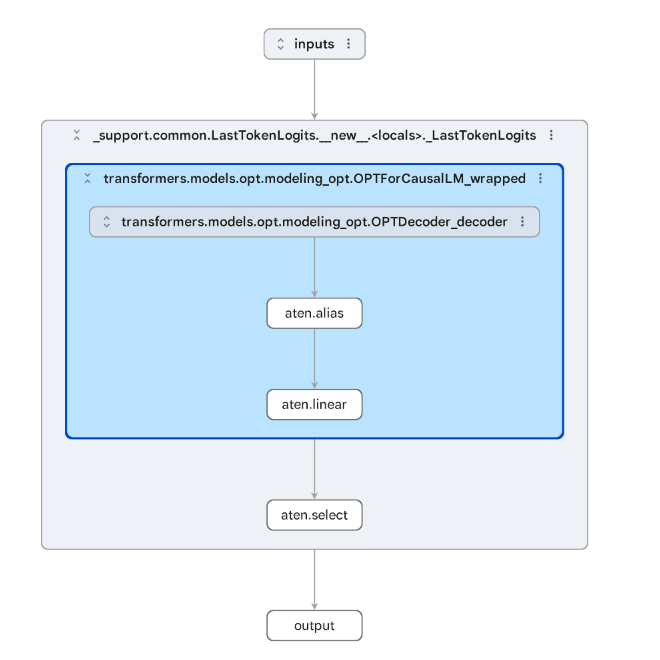
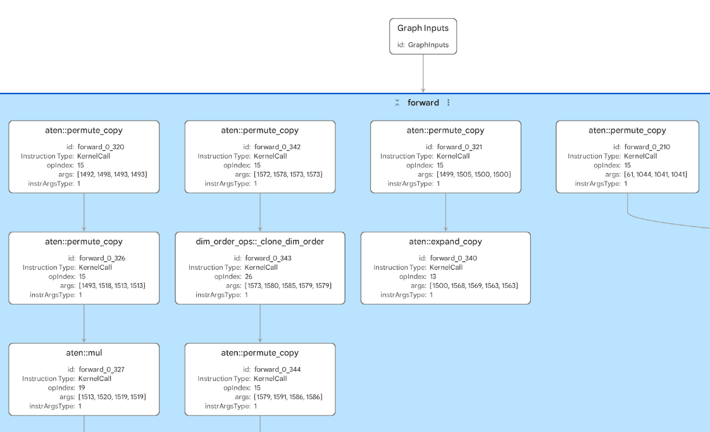
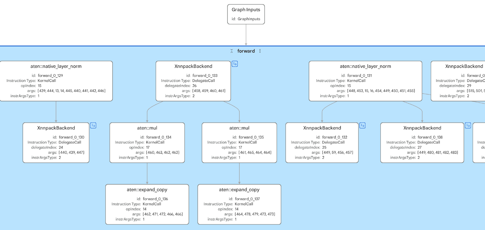
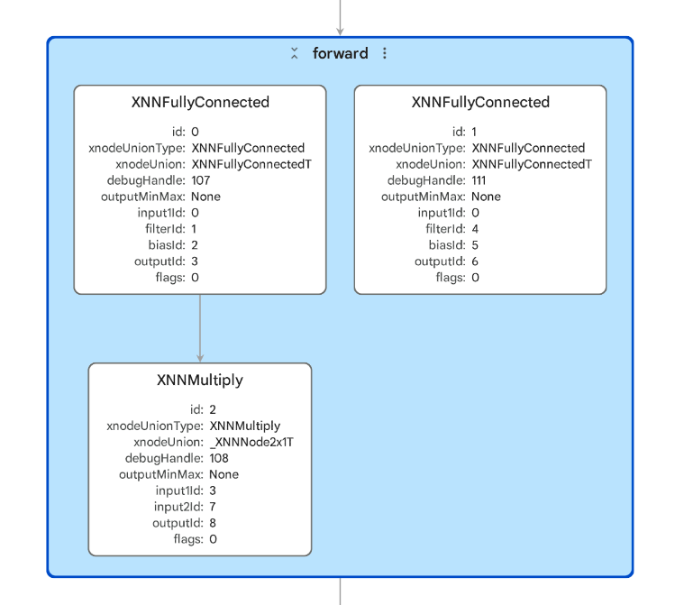

# Module 1: Compare Transformer Inference on Arm CPUs

### When, and how, should I use ExecuTorch instead of the full PyTorch stack on an Arm CPU?

## Introduction

### About this module

In this module, you will compare three ways to run transformer inference
on an Arm CPU: 

- PyTorch eager execution

- ExecuTorch portable runtime

- ExecuTorch with XNNPACK backend

The goal is not to prove that one runtime is always faster than another.
Instead, you will investigate how runtime choice, backend delegation,
model structure, and target hardware affect deployment decisions for
on-device inference.

You will use two transformer models:

> OPT-125M: a decoder-only transformer used for text generation
>
> DistilBERT: an encoder-only transformer used for prediction-style NLP
> tasks

You will use ExecuTorch's `ahead-of-time` workflow to prepare models on
a development machine, collect delegation evidence, and then run the
models on a Raspberry Pi to collect benchmark data. By the end, you
should be able to explain when ExecuTorch is a better deployment choice
than the full PyTorch stack.

### What will you learn?

By the end of this module, you will have: 

- benchmarked OPT-125M using PyTorch eager execution

- exported OPT-125M and generated a portable ExecuTorch `.pte` artifact

- run OPT-125M with ExecuTorch and XNNPACK

- inspected XNNPACK delegation for OPT-125M, including in Model Explorer with the Arm `.pte` adapter

- generated text with the delegated OPT-125M model in an example chatbot application

- exported and benchmarked DistilBERT with PyTorch, portable ExecuTorch, and ExecuTorch with XNNPACK

- used DistilBERT in an example autocomplete application

- compared delegation behaviour across the two transformer models

- used your evidence to decide when ExecuTorch is a suitable CPU
  deployment path

## Before you begin

### Understand ExecuTorch Delegation and Runtime Concepts

1.  **PyTorch is excellent for development, but can be heavy for
    deployment**

PyTorch is widely used for developing, training, and testing models. It
is flexible and highly optimized in many desktop, server, and laptop
environments.

However, the full PyTorch stack may be too large or complex for some
edge and embedded deployments, especially where memory, startup time,
dependency footprint, and packaging constraints matter.

**2. ExecuTorch packages PyTorch models for on-device inference**

ExecuTorch, part of PyTorch, provides a deployment path for PyTorch models. It can export a model, lower it into an edge-oriented representation, and package it
into a .pte artifact that can be loaded by a lightweight runtime.

ExecuTorch is PyTorch-native. In this module, the model starts in PyTorch, is captured with `torch.export`, and is then lowered into an ExecuTorch program. We are not converting through ONNX, TensorFlow Lite, or another intermediate format.

This can make deployment practical on devices where the full PyTorch
stack is not suitable.

For the larger picture, the ExecuTorch documentation describes the
workflow as three phases: program preparation, runtime preparation, and
program execution. This module follows that same shape: prepare and
lower the model on your development machine, copy the emitted `.pte`
program to the Pi, then execute it from a small application. See the
[ExecuTorch architecture and components documentation](https://docs.pytorch.org/executorch/stable/getting-started-architecture.html)
for the full architecture.

**3. ExecuTorch does not automatically mean faster**

By default for CPUs, ExecuTorch can execute models using its portable
runtime and portable kernel library. This execution path prioritizes
broad operator coverage, portability, and correctness, making it useful
for running a wide range of exported models across different Arm-based
devices.

The Portable Kernel Library is the reference-style CPU kernel path: it
is meant to be correct, readable, portable, and broadly useful, but not
necessarily fast for bottleneck operations such as matrix multiplication
or convolution. ExecuTorch also documents an Optimized Kernel Library,
which provides more performance-focused CPU operator implementations for
selected operators. The [kernel library overview](https://docs.pytorch.org/executorch/stable/kernel-library-overview.html)
is useful background when interpreting why the portable run may be slow.

It is useful to separate two ideas:

- **Kernel libraries** provide implementations for individual ATen
  operators that remain on the default ExecuTorch runtime path. Portable
  kernels prioritize correctness and broad coverage. Optimized kernels
  prioritize speed for selected operators, but have more limited
  coverage and are a runtime build/operator-registration concern.

- **Backend delegates** take larger supported subgraphs and hand them to
  a backend-specific execution path. XNNPACK is a backend delegate: the
  partitioner finds supported regions, lowers those regions, and leaves
  unsupported operators on the default ExecuTorch path.

This module uses the portable kernel path as the baseline and XNNPACK as
the optimized CPU path. We do not use the Optimized Kernel Library here
because the module is focused on backend delegation: exporting a model,
partitioning supported subgraphs with XNNPACK, inspecting the delegated
regions, and comparing the resulting `.pte` artifacts. Using the
Optimized Kernel Library is a lower-level runtime configuration topic,
not a `--backend` option in this lab's lowering script.

Backends provide implementations for particular hardware targets, such
as CPUs or NPUs. That is why you will compare portable ExecuTorch with
an optimized backend.

**4. XNNPACK can improve CPU inference when the graph delegates well**

XNNPACK provides optimized CPU kernels for supported operations by
leveraging KleidiAI under the hood.

KleidiAI is an open-source software library from Arm that provides
highly optimized AI kernels for Arm CPUs. It accelerates common machine
learning operations by taking advantage of Arm architecture features
such as Neon and SME2, helping AI frameworks achieve better performance
without requiring changes to model code. In ExecuTorch, KleidiAI
enhancements are integrated through backends such as XNNPACK, improving
inference speed and efficiency for AI workloads running on Arm CPUs.

When ExecuTorch lowers a model with XNNPACK enabled, supported subgraphs
can be delegated to the backend.

For more detail on what the XNNPACK delegate supports and how it is used
with `XnnpackPartitioner`, see the [ExecuTorch XNNPACK backend documentation](https://docs.pytorch.org/executorch/stable/backends/xnnpack/xnnpack-overview.html).

In general:

> More useful delegation → better chance of performance improvement  
> Many fragmented regions → more boundary overhead  
> Unsupported operations → fallback to the default runtime

<span class="mark">\[*Animated VIDEO (30-45 seconds): Delegation is not a
switch – the learner has just encountered delegation for the first time
and is about to use it. Potential for animated video that explains
delegation. Shows a model graph being partitioned into delegated</span>
<span class="mark">regions and fallback regions. This is hard to explain
well in text and central to both XNNPACK and Ethos-U. Potential reuse
across CPU and NPU content.*\]</span>

**5. Model architecture matters**

Not all transformer workloads behave the same way. A decoder-only
transformer used for generation has different execution characteristics
from an encoder-only transformer used for classification, fill-mask,
intent detection, or search-style tasks.

In this module, you will compare both.

**6. Hardware matters**

Your results may vary depending on whether you are using a Raspberry Pi,
Arm Linux device, Mac, or another system.

Focus on the pattern of evidence:

- how PyTorch compares with portable ExecuTorch

- what changes when XNNPACK is enabled

- how much of the graph is delegated

- whether the deployment footprint matters for your target device

At the edge, developers are often working under constraints that do not
apply in cloud or desktop environments. These include: 

- lower memory availability

- tighter power budgets

- lower-specification CPUs

- the need to run inference locally for privacy or connectivity reasons.

ExecuTorch is relevant in this context because it provides a way to
deploy PyTorch models in a lightweight form that is better suited to
constrained hardware. 

On high-specification devices such as laptops, PyTorch may perform as
well as or better than ExecuTorch. This is because PyTorch uses highly
optimized CPU backends. ExecuTorch is designed primarily for constrained
environments, where its smaller runtime and reduced overhead provide an
advantage.

### Ahead-of-Time vs Runtime

ExecuTorch uses an `ahead-of-time` (AOT) workflow. This means that we prepare models ahead of use, on a separate, typically more compute-heavy, device. Once the model has been prepared, we load it, along with our application, onto a target device. The model is used and executed by the application at `runtime`.

We will use the AOT workflow in this lab. Use your development machine, e.g., your laptop, to prepare the models. We will then copy models over to our Raspberry Pi 5 and execute them in benchmarks and applications on the Pi. These instructions have Mac / Linux / Windows running WSL machines in mind.

### Development Machine Setup

Run on your development machine from a terminal.

Clone the repository and enter the directory:

```bash
git clone https://github.com/arm-education/executorch_on_arm_v2.git ~/executorch_on_arm
cd ~/executorch_on_arm
```

Create a new Python 3.11 virtual environment and activate it. Install the pinned Module 1 Python dependencies. These include PyTorch, ExecuTorch, the HF transformers library, matplotlib and numpy for collecting data and plotting graphs, and huggingface_hub for interfacing with HF.

```bash
PYENV_VERSION=3.11.14 python -m venv .cpu_aot_venv
source .cpu_aot_venv/bin/activate
python --version
python -m pip install -r module_1/requirements.txt
```

Use Python 3.11 for this module. The ExecuTorch Python package includes native pybindings that must match the installed PyTorch build. A virtual environment created with a different Python version, such as Python 3.13, can install incompatible wheels and fail later when loading a `.pte`.

The `PYENV_VERSION` prefix asks pyenv to use the installed Python 3.11.14 interpreter even if the generic `python3.11` command is not active in your shell. If you are not using pyenv and your system provides `python3.11`, use `python3.11 -m venv .cpu_aot_venv` instead of the first command above.

We will use HuggingFace to provide our models in this module. If you have not already got an account on HuggingFace, create one and generate an authentication key. Login to HuggingFace via terminal (see below), and when prompted, provide your authentication key:

```bash
hf auth login
```

### Analyze Performance and Delegation Across ExecuTorch Backends

You are now ready to begin. As you work through the module, focus on the following: 

- How does PyTorch performance compare with ExecuTorch portable? 

- Why is ExecuTorch portable not necessarily faster?

- What changes when XNNPACK is enabled? 

- How does delegation differ between OPT-125M and DistilBERT? 

- How might you use ExecuTorch for different classes of model? 

### Script layout

The scripts are split so the main PyTorch and ExecuTorch flow is easy to find:

- `module_1/scripts/aot`: development-machine scripts for export and lowering
- `module_1/scripts/pi`: Raspberry Pi entrypoint scripts for benchmarking and launching demos
- `module_1/scripts/pi/core`: PyTorch and ExecuTorch runtime logic worth reading closely
- `module_1/scripts/_support`: shared helpers, benchmark output handling, and browser page rendering

If you are reading code while you work through the module, start with the files in `aot`, `pi/benchmark_model.py`, and `pi/core`. The `serve_*` scripts are small wrappers that launch the browser demos, while `_support` keeps repetitive setup, plotting, and page-rendering code out of the way.

The code is organized in three layers:

```text
aot scripts                prepare/export/lower models on the development machine
pi/benchmark_model.py      compare PyTorch and ExecuTorch on the Raspberry Pi
pi/core                    load .pte programs and turn model outputs into app behavior
_support                   shared setup, plotting, result writing, and HTML rendering
```

That split is intentional. The AOT scripts show the ExecuTorch export and
lowering workflow. The `pi/core` files show how a `.pte` model is used
inside an application. The `_support` files keep the lab readable by
moving repeated utilities out of the main path.

## OPT-125M

### 1. OPT-125M Preparation and Export

We’ll compare a PyTorch eager baseline against ExecuTorch with no XNNPACK backend and ExecuTorch with the XNNPACK delegate for the OPT-125m model (Open Pre-Trained Transformers) from Meta. Do you have any expectations, perhaps from any prior ML knowledge, about which of the three will have the best performance, and which you expect to have the worst? 

First, we create a clean exported program that ExecuTorch can lower in the next step.

The `prepare_opt125m.py` script loads the tokenizer and OPT-125M model from Hugging Face, wraps the model, creates one fixed-shape example input, exports the model with `torch.export`, and writes a small `model_spec.json`.

Why wrap the model? Transformer language models usually produce logits with shape `[B, T, V]`:

- `B`: batch size

- `T`: sequence length

- `V`: vocabulary size

During training, logits for every token position are useful because loss is computed across the sequence. During generation, earlier tokens are already fixed. We only need the logits at the final position to choose the next token.

That is why the wrapper returns `[B, V]` instead of `[B, T, V]`. It keeps the output focused on what the text generation loop actually uses.

The core of the script looks like this:

```python
tokenizer = AutoTokenizer.from_pretrained(args.model_id)
if tokenizer.pad_token is None:
    tokenizer.pad_token = tokenizer.eos_token

model = load_hf_model(AutoModelForCausalLM, args.model_id).to(args.device).eval()
wrapped = LastTokenLogits(model).eval()

encoded = tokenizer(
    args.example_prompt,
    return_tensors="pt",
    padding="max_length",
    truncation=True,
    max_length=args.seq_len,
)

example_inputs = (
    encoded["input_ids"].to(args.device),
    encoded["attention_mask"].to(args.device),
)

with torch.inference_mode():
    exported_program = export(wrapped, example_inputs)

save(exported_program, exported_path)
```

This step writes `opt125m_exported.pt2` plus `model_spec.json`. Keep both files: the lowering script reads them next.

Run on the development machine.

```bash
module_1/scripts/aot/prepare_opt125m.py \
  --out module_1/artifacts/opt125m
```

The exported program expects two inputs:

- `input_ids`: integer token IDs with shape `[1, 128]`

- `attention_mask`: a matching integer mask with shape `[1, 128]`

Here `1` is the batch size. The sequence is padded or truncated to 128 tokens. In the attention mask, `1` marks real input tokens and `0` marks padding.

### 2. OPT-125M Lowering

The preparation step produced an exported PyTorch program. The lowering step turns that exported program into a deployable ExecuTorch `.pte` file.

The `lower_to_executorch.py` script reads `model_spec.json`, finds the exported `.pt2` program, lowers it through ExecuTorch, writes the `.pte`, and saves a small JSON metadata file containing the output path, file size, backend name, and delegation summary.

You will run the script twice:

- once with `--backend portable`, which creates a generic ExecuTorch baseline without backend delegation

- once with `--backend xnnpack`, which asks ExecuTorch to partition supported parts of the graph for the XNNPACK CPU backend

The core lowering logic looks like this:

```python
exported_program = load(exported_path)
program, delegation = lower(exported_program, backend=args.backend)
write_pte(program, out)

metadata = {
    "model": spec["name"],
    "model_id": spec["model_id"],
    "backend": args.backend,
    "exported_program": str(exported_path),
    "pte": str(out),
    "pte_size_mb": out.stat().st_size / 1_000_000.0,
    "seq_len": spec["seq_len"],
    "delegation": delegation,
}
metadata_path = out.with_suffix(".json")
metadata_path.write_text(json.dumps(metadata, indent=2) + "\n")
```

The key ExecuTorch API here is `to_edge_transform_and_lower()`. It takes the exported PyTorch program, converts it into ExecuTorch's edge representation, applies the lowering passes, and optionally uses a backend partitioner to mark supported subgraphs for delegation. For the full API surface around export and lowering, see the [ExecuTorch export API reference](https://docs.pytorch.org/executorch/stable/export-to-executorch-api-reference.html).

Inside our `lower()` helper, the backend choice controls whether ExecuTorch uses no partitioner or the XNNPACK partitioner:

```python
if backend == "portable":
    edge = to_edge_transform_and_lower(exported_program)
    return edge.to_executorch(), None

edge = to_edge_transform_and_lower(
    exported_program,
    partitioner=[XnnpackPartitioner()],
)
return edge.to_executorch(), inspect_delegation(edge)
```

The delegation summary printed by the script is not magic. It walks the
lowered graph, counts calls to the ExecuTorch delegate operator, and
records the remaining `call_function` targets as fallback operators:

```python
graph = edge.exported_program().graph_module.graph
delegate_op = torch.ops.higher_order.executorch_call_delegate

delegate_calls = 0
fallback_targets = []
for node in graph.nodes:
    if node.op != "call_function":
        continue
    if node.target == delegate_op:
        delegate_calls += 1
    else:
        fallback_targets.append(str(node.target))
```

This is why the summary pairs well with Model Explorer. The printed
counts tell you how many delegate boundaries and fallback operators were
found; the graph view helps you see where those boundaries sit in the
model.

Run on the development machine:

```bash
module_1/scripts/aot/lower_to_executorch.py \
  --spec module_1/artifacts/opt125m/model_spec.json \
  --backend portable
```

This creates `opt125m_portable.pte` and `opt125m_portable.json`. The portable path is kept as a deployable baseline with `.pte` size metadata only.

```bash
module_1/scripts/aot/lower_to_executorch.py \
  --spec module_1/artifacts/opt125m/model_spec.json \
  --backend xnnpack
```

This creates `opt125m_xnnpack.pte` and `opt125m_xnnpack.json`. The XNNPACK metadata includes the delegation summary printed by the script.

For one run of OPT-125M with the pinned Module 1 environment, the script
reported:

| Artifact | Backend | PTE size |
| --- | --- | ---: |
| `opt125m_portable.pte` | portable | 501.12 MB |
| `opt125m_xnnpack.pte` | XNNPACK | 655.57 MB |

The XNNPACK artifact is about 154 MB larger than the portable artifact.
That increase comes from backend-specific lowered data and metadata
stored inside the `.pte`. This is normal: delegation can improve runtime
performance, but it can also make the deployable artifact larger.

The same XNNPACK run reported:

- XNNPACK delegate call sites: 50
- fallback `call_function` operators: 632

The fallback list was dominated by graph bookkeeping, shape, mask, and
normalization-related operations, including `alloc` (285), `getitem`
(111), `expand_copy` (49), `native_layer_norm` (25), and several mask or
elementwise operations such as `logical_not`, `mul.Scalar`,
`scalar_tensor`, and `where` (24 each).

Read that summary before moving on. When ExecuTorch lowers with XNNPACK, it partitions the graph. Supported subgraphs become XNNPACK delegate regions. The remaining operators stay on the default ExecuTorch path, backed by the Portable Kernel Library.

The delegate call count tells you how many separate XNNPACK regions were created. The fallback operator list shows what did not make it into those regions.

More delegation is usually good, but the shape of the delegation matters. A few large delegated regions are better than many small regions split up by fallback operators. In the example above, 50 delegate call sites means XNNPACK found useful regions, but it also means the graph is not one continuous delegated block. If execution has to keep moving between XNNPACK and the default path, that graph fragmentation can eat into the benefit.

Do not treat the fallback count as a direct measure of runtime cost. Some fallback operators are cheap tensor bookkeeping, while a smaller number of delegated operators may contain the expensive matrix operations that dominate transformer inference. Use the PTE size, delegate count, fallback list, Model Explorer graph, and benchmark timing together.

When you inspect the lowered graph in Model Explorer in the next step, delegated regions will appear as `LoweredBackendModule` blocks. Each one represents a subgraph that will run through XNNPACK.

### 3. Inspect OPT Delegation with Model Explorer

[Google's Model Explorer](https://ai.google.dev/edge/model-explorer) is an open-source, web-based tool for inspecting machine learning model graphs. It can load several model formats through adapters, including `.pte`, TOSA, TFLite, ONNX, and PyTorch exported programs.

The tool presents the model as a hierarchical graph. Operators can be expanded, collapsed, searched, and grouped, which makes it easier to follow the model structure, tensor flow, and backend transformations.

In this module, we use it to compare the exported PyTorch graph before lowering with two lowered ExecuTorch versions: portable and XNNPACK. This makes the delegation summary easier to understand, because you can see what changes when the graph is packaged for the default ExecuTorch path versus when supported regions are delegated to XNNPACK.

Install Model Explorer and the Arm `.pte` adapter in your development machine environment:

```bash
.cpu_aot_venv/bin/python -m pip install -r module_1/requirements-model-explorer.txt
```

The PTE adapter is needed for ExecuTorch `.pte` files. The exported PyTorch program, `opt125m_exported.pt2`, can be opened by Model Explorer's built-in PyTorch exported program support.

Start Model Explorer with the PTE adapter enabled. Run the executable from the virtual environment explicitly, so your shell does not accidentally pick up a global `model-explorer` command:

```bash
.cpu_aot_venv/bin/model-explorer \
  --port 8081 \
  --extensions=pte_adapter_model_explorer
```

Model Explorer runs a local server and keeps this terminal session busy. We force it to use port `8081`, so this module keeps the Raspberry Pi result dashboard and application demos on different ports. When you are finished inspecting graphs, return to the terminal and press `Ctrl+C` to stop it.

In the browser UI, select these three files from your machine and open them:

- `module_1/artifacts/opt125m/opt125m_exported.pt2`
- `module_1/artifacts/opt125m/opt125m_portable.pte`
- `module_1/artifacts/opt125m/opt125m_xnnpack.pte`

Use the `.pt2` view as the reference graph. It shows the exported PyTorch program before ExecuTorch has packaged it for deployment. You should see the fixed input contract from the preparation step: `input_ids` and `attention_mask`, each shaped `[1, 128]`, and an output shaped `[1, 50272]` for the final-token vocabulary logits.



Then open the portable `.pte`. This is the baseline ExecuTorch program without XNNPACK delegation. It shows how the model looks when the graph runs through the default ExecuTorch portable-kernel path.



In the portable view, look for:

- regular ExecuTorch `KernelCall` nodes rather than backend delegate regions
- visible `aten::` operators, because ATen is PyTorch's core operator library
- repeated transformer patterns such as `aten::addmm`, `aten::bmm`, `aten::_softmax`, `aten::native_layer_norm`, `aten::relu`, and residual `aten::add`
- layout and shape-manipulation operators such as `aten::permute_copy`, `aten::expand_copy`, `aten::unsqueeze_copy`, and dim-order copies

Those shape and layout operators are worth noticing. They are often cheap compared with the large matrix operations, but they can become boundaries around optimized backend regions.

Now compare the XNNPACK `.pte` with the portable graph. The XNNPACK `.pte` should show delegated blocks, often named as `LoweredBackendModule`, `XnnpackBackend`, or XNNPACK backend regions depending on the adapter version.



The backend has changed the execution plan. In the reference screenshot, the top-level graph is smaller than the portable graph, and many supported regions have been replaced with XNNPACK delegate nodes. The input and output contract stays the same: two `[1, 128]` inputs and one `[1, 50272]` output.

Open one of the delegated regions and look for the expensive transformer work that was captured by the backend, such as linear and batch-matmul-style operations.



Inside the XNNPACK delegate subgraph, you may see backend-level operators such as `XNNFullyConnected`, `XNNBatchMatrixMultiply`, `XNNStaticTranspose`, `XNNAdd`, `XNNMultiply`, and `XNNSoftmax`.

The main thing to notice is what changed between the three views:

- the `.pt2` graph shows the exported PyTorch program before ExecuTorch lowering
- the portable `.pte` shows the deployable ExecuTorch graph without backend delegation
- the XNNPACK `.pte` shows which parts of the deployable graph were delegated and which operators still run on the default path

For OPT-125M, expect the XNNPACK graph to be mixed rather than perfectly clean. Transformer decoder graphs contain masking, reshapes, layout changes, normalization, and indexing-style operations around the expensive matrix work. Those operators can break the graph into several delegated regions with default-path operators in between.

Use this comparison to guide your interpretation:

| Question | What to look for |
| --- | --- |
| Did XNNPACK group expensive work? | Larger delegated regions can indicate that supported transformer operations were grouped for optimized CPU execution. |
| Did the graph fragment? | Multiple small delegate regions can indicate unsupported operators or boundaries between supported regions. |
| What stayed on the default path? | Remaining portable operators may explain residual latency or runtime transitions. |
| Did the artifact size change? | Backend delegation can improve latency but may increase the `.pte` size. |

This is the key difference: XNNPACK does not replace the whole `.pte`. It captures supported subgraphs and leaves the rest of the program in ExecuTorch. In performance work, the balance between large delegated regions and remaining default-path operators is often more important than the raw number of delegate nodes.

### 4. Raspberry Pi Setup

Run the next steps on the Raspberry Pi unless told otherwise - you are recommended to SSH into your Pi from your development machine.

If connecting over SSH, do so whilst also port-forwarding specific ports we will use for application demos:

```bash
ssh -L 8080:localhost:8080 -L 8090:localhost:8090 -L 8091:localhost:8091 <user>@<pi>
```

The port mapping is:

| Port | Used for |
| ---: | --- |
| `8080` | benchmark results dashboard |
| `8081` | reserved for Model Explorer on the development machine |
| `8090` | OPT chatbot demo |
| `8091` | DistilBERT autocomplete demo |

Do not use `8081` for the Raspberry Pi demos or results dashboard while Model Explorer is running.

Clone the repo scripts onto the Pi if they are not already present.

```bash
git clone https://github.com/arm-education/executorch_on_arm_v2.git ~/executorch_on_arm
cd ~/executorch_on_arm
```

We repeat our setup and installation from earlier, keeping the Pi virtual
environment inside `~/executorch_on_arm` with the scripts, artifacts, and
results:

```bash
PYENV_VERSION=3.11.14 python -m venv ~/executorch_on_arm/.cpu_lab_venv
source ~/executorch_on_arm/.cpu_lab_venv/bin/activate
python --version
python -m pip install -r module_1/requirements.txt
hf auth login
```

If your Pi does not use pyenv but has a system `python3.11` command, replace the first command above with `python3.11 -m venv ~/executorch_on_arm/.cpu_lab_venv`.

### 5. Copy OPT Artifacts to Raspberry Pi

Run on your development machine to copy your model artifacts over to the target Pi:

```bash
cd ~/executorch_on_arm
ssh <user>@<pi> "mkdir -p ~/executorch_on_arm/module_1/artifacts"
scp -r module_1/artifacts/opt125m <user>@<pi>:~/executorch_on_arm/module_1/artifacts/
```

Copies the OPT spec, `.pte` files, and metadata to the Pi - note, it may take a few minutes to copy over the files as they are large.

### 6. OPT Benchmark on Raspberry Pi

We use repeated runs for PyTorch and ExecuTorch with XNNPACK so that one unusually fast or slow run does not dominate the result. For portable ExecuTorch, we only do one warmup and one measured run. That path is here as a baseline, and it can be slow enough that repeating it many times distracts from the main comparison.

All benchmarks, PyTorch and ExecuTorch, are run in FP32 to ensure fairness. A typical deployment scenario for ExecuTorch would, however, be quantized, such as down to INT8. This will be discussed in Module 2.

For OPT-125M, expect mixed delegation. Large linear layers and attention matmuls are good candidates for XNNPACK, but autoregressive decoder models also contain masking, reshaping, indexing, and other tensor operations that may stay on the default path. The useful question is not only whether XNNPACK is faster, but whether the delegation summary helps explain the timing you measure.

The `benchmark_model.py` script gives the three runs the same outer structure. It reads the `model_spec.json`, prepares the correct inputs, builds a `forward()` function for the selected runtime, measures that function, then writes JSON, CSV, and plot outputs.

The model-specific PyTorch setup is selected from the spec. This keeps
the benchmark harness shared, while the wrappers for OPT and DistilBERT
stay model-specific:

```python
def prepare_model(spec):
    if spec["adapter"] == "opt125m":
        return prepare_opt(spec)
    if spec["adapter"] == "distilbert_fillmask":
        return prepare_distilbert(spec)
    raise ValueError(f"Unknown adapter: {spec['adapter']}")
```

The first branch is the PyTorch baseline. For OPT, the script reloads the Hugging Face model, applies the same `LastTokenLogits` wrapper used during export, and uses the example prompt from the spec:

```python
with suppress_stderr():
    module, inputs = prepare_model(spec)

def forward() -> object:
    with torch.inference_mode():
        return module(*inputs)
```

The ExecuTorch branch is different. It loads a `.pte` file with the ExecuTorch Python bindings, creates the same fixed-shape input tensors, and calls the model through the ExecuTorch runtime:

```python
with suppress_stderr():
    model = load_executorch_program(args.pte)
    inputs = example_inputs(spec)

def forward() -> object:
    with torch.inference_mode():
        return model.forward(inputs)
```

The timing loop runs a few warmup passes first, then records each measured run in milliseconds:

```python
for _ in range(warmups):
    with suppress_stderr():
        fn()

times = np.empty(runs, dtype=np.float64)
for i in range(runs):
    start = time.perf_counter()
    with suppress_stderr():
        fn()
    times[i] = (time.perf_counter() - start) * 1000.0
```

We will use two warmup runs for PyTorch and XNNPACK, to give the runtime a chance to pay one-time costs before timing starts. That can include loading code paths, allocating internal buffers, and filling CPU caches. We will then use 20 measured runs to give a small latency distribution rather than a single number, so we can compare the mean, median, and spread.

Finally, the script writes a summary JSON, a per-run CSV file, and two plots: a latency histogram and a run-by-run time series. The JSON is useful for comparing mean, median, minimum, maximum, and percentile latency later in the results dashboard.

Run on the Raspberry Pi from the repo root:

```bash
module_1/scripts/pi/benchmark_model.py \
  --runtime pytorch \
  --spec ~/executorch_on_arm/module_1/artifacts/opt125m/model_spec.json \
  --runs 20 \
  --warmups 2 \
  --out ~/executorch_on_arm/module_1/results/opt125m_pytorch.json
```

Benchmarks full PyTorch eager execution for OPT.
Writes JSON/CSV results to `~/executorch_on_arm/module_1/results` and plots to `~/executorch_on_arm/module_1/results/plots`.

Next we will try the portable kernel ExecuTorch path. Do not be surprised if the portable ExecuTorch run is slower than PyTorch eager on a Raspberry Pi. The portable path uses the Portable Kernel Library, which prioritizes broad operator coverage and correctness. It does not use the Optimized Kernel Library in this lab, and it does not delegate supported subgraphs to XNNPACK. PyTorch can often dispatch large matrix operations to highly optimized CPU kernels.

The portable run will use `--warmups 1 --runs 1`, to avoid spending an excessive amount of time waiting for runs to complete. If you want to see a fuller portable distribution, you can increase `--runs`, but expect the script to take much longer to execute.

```bash
module_1/scripts/pi/benchmark_model.py \
  --runtime executorch \
  --spec ~/executorch_on_arm/module_1/artifacts/opt125m/model_spec.json \
  --pte ~/executorch_on_arm/module_1/artifacts/opt125m/opt125m_portable.pte \
  --runs 1 \
  --warmups 1 \
  --out ~/executorch_on_arm/module_1/results/opt125m_portable.json
```

Runs the portable ExecuTorch OPT path once.
Writes JSON/CSV results to `~/executorch_on_arm/module_1/results` and plots to `~/executorch_on_arm/module_1/results/plots`.

The increased latency does not make the portable path useless. It gives us a deployable baseline and a compact `.pte` artifact. On smaller targets, deployability and runtime footprint may matter as much as raw latency.

We will now run the XNNPACK ExecuTorch path, with 2 warmups and 20 measured runs:

```bash
module_1/scripts/pi/benchmark_model.py \
  --runtime executorch \
  --spec ~/executorch_on_arm/module_1/artifacts/opt125m/model_spec.json \
  --pte ~/executorch_on_arm/module_1/artifacts/opt125m/opt125m_xnnpack.pte \
  --runs 20 \
  --warmups 2 \
  --out ~/executorch_on_arm/module_1/results/opt125m_xnnpack.json
```

Benchmarks the OPT XNNPACK `.pte`.
Writes JSON/CSV results to `~/executorch_on_arm/module_1/results` and plots to `~/executorch_on_arm/module_1/results/plots`.

### 7. View the OPT Benchmark Results

At this point, the results directory should contain three OPT result files:

- `opt125m_pytorch.json`
- `opt125m_portable.json`
- `opt125m_xnnpack.json`

We will use a helpful Python script to display results in a browser dashboard. Serve the result dashboard from the Raspberry Pi:

```bash
shared/serve_results.py \
  --results ~/executorch_on_arm/module_1/results \
  --host 127.0.0.1 \
  --port 8080
```

Then open the dashboard locally on your development machine:

```text
http://localhost:8080
```

TODO RESULTS IMAGE HERE

Because only the OPT benchmark files have been generated so far, the dashboard should show the PyTorch, portable ExecuTorch, and XNNPACK ExecuTorch runs for OPT-125M. Later, after the DistilBERT benchmarks, the same dashboard will include both models.

Read the table and plots together. The mean and median show typical latency. The minimum and maximum show how much the run varied. The histogram shows whether most timings are clustered or spread out, and the run-by-run plot can reveal drift from system load, CPU frequency changes, or thermal effects.

For one Raspberry Pi run with the pinned Module 1 environment, the OPT benchmark reported:

| Runtime | Warmups | Runs | Mean | Median | Min | Max |
| --- | ---: | ---: | ---: | ---: | ---: | ---: |
| PyTorch eager | 2 | 20 | 512.96 ms | 510.94 ms | 493.02 ms | 574.86 ms |
| ExecuTorch portable | 1 | 1 | 65,312.65 ms | 65,312.65 ms | 65,312.65 ms | 65,312.65 ms |
| ExecuTorch with XNNPACK | 2 | 20 | 305.90 ms | 301.17 ms | 300.01 ms | 322.87 ms |

The portable ExecuTorch result is a single measured run, so treat it as a baseline check rather than a latency distribution. It shows that the exported portable `.pte` can execute on the Pi, but it also shows why the portable kernel path is not the performance path for this OPT workload.

The XNNPACK result is the main comparison. In this run, XNNPACK reduced mean latency from 512.96 ms to 305.90 ms compared with PyTorch eager execution, about a 1.7x speedup. The median tells the same story: 510.94 ms for PyTorch eager compared with 301.17 ms for XNNPACK.

Now connect that timing back to the lowering evidence. The XNNPACK `.pte` was larger than the portable `.pte`, and the graph still had 50 XNNPACK delegate call sites plus 632 fallback `call_function` operators, but the delegated regions captured enough expensive transformer work to outweigh the backend boundary costs. This is the deployment trade-off in miniature: a larger delegated artifact, but substantially lower CPU latency on this target.

For OPT, compare the timing with the lowering evidence. If portable ExecuTorch is slower than PyTorch eager, that is expected for this baseline: the portable path is optimized for operator coverage and deployability, not peak CPU performance. If XNNPACK is faster, look back at the delegation summary and Model Explorer view to see whether large linear and matmul-heavy regions were delegated. If XNNPACK is only a little faster, or not faster, that is also useful evidence. It may mean the graph was fragmented by fallback operators, or that runtime transitions between delegated and non-delegated regions ate into the backend gains.

The point is not just to crown the fastest runtime. The benchmark should help explain what the exported model is actually doing on the Pi.

### 8. Run the OPT Chatbot Demo

The benchmark measured one fixed forward pass. The OPT demo shows how the same XNNPACK `.pte` can be integrated into a small application loop.

Run on the Raspberry Pi:

```bash
module_1/scripts/pi/serve_opt_chat.py \
  --spec ~/executorch_on_arm/module_1/artifacts/opt125m/model_spec.json \
  --pte ~/executorch_on_arm/module_1/artifacts/opt125m/opt125m_xnnpack.pte \
  --host 127.0.0.1 \
  --port 8090
```

Then open:

```text
http://localhost:8090
```

Try out the application: TODO IMAGE HERE

The serving script is mostly HTTP plumbing. The ExecuTorch-specific application logic is in `module_1/scripts/pi/core/opt_chat_core.py`.

First, the app loads the tokenizer and the lowered `.pte` program:

```python
from _support.common import load_executorch_program
from transformers import AutoTokenizer

tokenizer = AutoTokenizer.from_pretrained(spec["model_id"])
model = load_executorch_program(pte_path)
```

Then each generation step prepares the fixed-shape input expected by the exported model, calls ExecuTorch, samples a next token, and appends it to the running sequence:

```python
in_ids = input_ids[:, -ctx:]
in_mask = attention_mask[:, -ctx:]

logits = self.model.forward((in_ids, in_mask))[0]
next_token = torch.multinomial(
    torch.softmax(logits / temperature, dim=-1),
    num_samples=1,
)

input_ids = torch.cat([input_ids, next_token], dim=1)
attention_mask = torch.cat([attention_mask, torch.ones_like(next_token)], dim=1)
```

This is a good example for OPT because OPT is a decoder-only, autoregressive language model. It does not produce a whole answer in one forward pass. It predicts the next token, then the application decides what to do with that token. The app loop is therefore part of the product behavior, not just a benchmark wrapper.

This also shows the practical shape of ExecuTorch app integration. The model is exported and lowered ahead of time, copied to the target as a `.pte`, loaded by the runtime, and called from normal Python application code. The rest of the app still handles tokenization, input shaping, sampling, output decoding, and UI behavior.

In a production application, this surrounding code would often be written in C++ or integrated into a native mobile app rather than served from a small Python script. The important pattern is the same: the `.pte` is the deployable model artifact, and the application owns the inputs, outputs, and product behavior around it.

Do not worry if the generated text is strange. OPT-125M is small for a language model, and this demo uses a simple sampling loop. The point is to inspect the runtime integration and timing behavior, not to build a polished chatbot.

The demo takes longer than the benchmark because the benchmark measures one fixed next-token forward pass, while the demo generates many tokens. The demo does not use a KV cache, so each generated token runs another forward pass over the current context window. The timing panel in the demo makes that visible: generation latency is the cost of many ExecuTorch forwards plus tokenization, sampling, and page handling.

You could implement a KV cache yourself, and production text-generation systems normally do. Instead of recomputing attention over the whole context on every step, the app stores the previous key/value tensors and feeds them back into the model for the next token. That is much faster for longer generations, but it also changes the model interface: the exported program needs cache inputs and cache outputs, the app has to manage cache tensor shapes and positions, and the benchmark needs to measure a different decode path. We are not covering that in this module because the goal here is to understand export, lowering, delegation, and basic ExecuTorch app integration first.

## DistilBERT

### 1. DistilBERT Preparation and Export

DistilBERT gives us a second transformer shape to compare with OPT. It is an encoder model, not an autoregressive decoder, so its graph structure and runtime behavior are different.

DistilBERT is closer to many on-device NLP workloads than free-form text generation. Encoder models are often used for classification, ranking, search, intent detection, and fill-mask style prediction. They usually run one forward pass over a fixed-length sequence rather than generating tokens one at a time.

For this module, we use DistilBERT as a fill-mask model. The preparation flow still exports a fixed-shape PyTorch program, but the wrapper is different from OPT. Instead of keeping final-token logits, it extracts logits at the `[MASK]` token:

```python
def forward(self, input_ids, attention_mask):
    logits = self.wrapped(input_ids=input_ids, attention_mask=attention_mask).logits
    mask_pos = (input_ids == self.mask_id).to(torch.int64).argmax(dim=1)
    batch = torch.arange(input_ids.shape[0], device=input_ids.device)
    return logits[batch, mask_pos, :]
```

The export example prompt must contain the tokenizer's mask token. In this module, keep it to one mask token so the wrapper has a single position to extract:

```python
tokenizer = AutoTokenizer.from_pretrained(args.model_id, use_fast=True)
prompt = args.example_prompt or f"The Raspberry Pi is a {tokenizer.mask_token} computer."
if tokenizer.mask_token not in prompt:
    raise ValueError(f"Example prompt must contain {tokenizer.mask_token}")
```

DistilBERT also uses a shorter default sequence length in this module:

```python
parser.add_argument("--seq-len", type=int, default=64)
```

Run on your development machine:

```bash
module_1/scripts/aot/prepare_distilbert_fillmask.py \
  --out module_1/artifacts/distilbert
```

This writes `distilbert_fillmask_exported.pt2` and `model_spec.json`. The exported program still takes `input_ids` and `attention_mask`, but the output is `[B, V]` logits for the single mask position rather than next-token logits for a decoder.

### 2. DistilBERT Lowering

We use the same lowering script as OPT. The important change is the model graph being lowered: DistilBERT is an encoder with one fixed forward pass, not a decoder used repeatedly for generation.

Run on the development machine:

```bash
module_1/scripts/aot/lower_to_executorch.py \
  --spec module_1/artifacts/distilbert/model_spec.json \
  --backend portable
```

This creates `distilbert_fillmask_portable.pte` and `distilbert_fillmask_portable.json`. We keep it as the default ExecuTorch comparison point and for visual inspection.

```bash
module_1/scripts/aot/lower_to_executorch.py \
  --spec module_1/artifacts/distilbert/model_spec.json \
  --backend xnnpack
```

This creates `distilbert_fillmask_xnnpack.pte` and `distilbert_fillmask_xnnpack.json`. Read the printed delegation summary and compare it with OPT.

For one run of DistilBERT with the pinned Module 1 environment, the script reported:

| Artifact | Backend | PTE size |
| --- | --- | ---: |
| `distilbert_fillmask_portable.pte` | portable | 268.03 MB |
| `distilbert_fillmask_xnnpack.pte` | XNNPACK | 361.80 MB |

The XNNPACK artifact is about 94 MB larger than the portable artifact. As with OPT, that extra size comes from backend-specific lowered data and metadata stored in the `.pte`.

The same XNNPACK run reported:

- XNNPACK delegate call sites: 27
- fallback `call_function` operators: 354

The fallback list was again dominated by graph bookkeeping, shape, mask, and normalization work, including `alloc` (161), `getitem` (60), `expand_copy` (25), and `native_layer_norm` (14). Mask and elementwise operations such as `logical_not`, `mul.Scalar`, `scalar_tensor`, and `where` also remained on the default path, along with DistilBERT-specific selection work such as `argmax` and `index`.

Compared with the OPT run, DistilBERT produced fewer delegate call sites and fewer fallback operators. That does not automatically mean the graph is better optimized, but it is a useful signal. DistilBERT is an encoder with one fixed forward pass, not an autoregressive decoder used repeatedly for generation, so the graph can be less fragmented. It still contains mask handling, reshapes, normalization, and elementwise operations that stay on the default path.

### 3. Inspect DistilBERT Delegation with Model Explorer

Use the same Model Explorer setup from the OPT section.

Run on the development machine after lowering DistilBERT. If Model Explorer is already running, use the same browser window. Otherwise, start it with the PTE adapter enabled:

```bash
.cpu_aot_venv/bin/model-explorer \
  --port 8081 \
  --extensions=pte_adapter_model_explorer
```

When you are finished, press `Ctrl+C` in the Model Explorer terminal to stop the local server.

In the browser UI, select these three files from your machine and open them:

- `module_1/artifacts/distilbert/distilbert_fillmask_exported.pt2`
- `module_1/artifacts/distilbert/distilbert_fillmask_portable.pte`
- `module_1/artifacts/distilbert/distilbert_fillmask_xnnpack.pte`

TODO MODEL EXPLORER IMAGES HERE

Use the `.pt2` graph as the pre-lowering reference. You should see the same two input names, but the fixed sequence length is `[1, 64]` rather than `[1, 128]`.

Then compare the portable and XNNPACK `.pte` graphs. The useful questions are the same as before, but the expected differences are model-specific:

- Does the XNNPACK graph have fewer or larger delegate regions than OPT?
- Which operators still fall back to the default ExecuTorch path?
- Are normalization, reshape, mask-position, or elementwise operations creating boundaries?
- Does the XNNPACK graph look cleaner than the OPT decoder graph?

Do not compare only delegate counts. A smaller number of delegate regions can be better if they capture the expensive work. A larger number can still be useful if the regions contain the main matrix operations. Use the graph shape, fallback list, and benchmark results together.

### 4. Copy DistilBERT Artifacts to Raspberry Pi

Run on your development machine:

```bash
ssh <user>@<pi> "mkdir -p ~/executorch_on_arm/module_1/artifacts"
scp -r module_1/artifacts/distilbert <user>@<pi>:~/executorch_on_arm/module_1/artifacts/
```

Copies the DistilBERT spec, `.pte` files, and metadata to the Pi. This should be quicker than copying OPT, but still give it a minute or two.

### 5. DistilBERT Benchmark on Raspberry Pi

Run on the Raspberry Pi from the repo root:

```bash
module_1/scripts/pi/benchmark_model.py \
  --runtime pytorch \
  --spec ~/executorch_on_arm/module_1/artifacts/distilbert/model_spec.json \
  --runs 20 \
  --warmups 2 \
  --out ~/executorch_on_arm/module_1/results/distilbert_pytorch.json
```

Benchmarks full PyTorch eager execution for DistilBERT.
Writes JSON/CSV results to `~/executorch_on_arm/module_1/results` and plots to `~/executorch_on_arm/module_1/results/plots`.

```bash
module_1/scripts/pi/benchmark_model.py \
  --runtime executorch \
  --spec ~/executorch_on_arm/module_1/artifacts/distilbert/model_spec.json \
  --pte ~/executorch_on_arm/module_1/artifacts/distilbert/distilbert_fillmask_portable.pte \
  --runs 1 \
  --warmups 1 \
  --out ~/executorch_on_arm/module_1/results/distilbert_portable.json
```

Runs the portable ExecuTorch DistilBERT path once. This mirrors the OPT baseline: enough to confirm the deployable portable path without spending a long time on repeated portable runs.

```bash
module_1/scripts/pi/benchmark_model.py \
  --runtime executorch \
  --spec ~/executorch_on_arm/module_1/artifacts/distilbert/model_spec.json \
  --pte ~/executorch_on_arm/module_1/artifacts/distilbert/distilbert_fillmask_xnnpack.pte \
  --runs 20 \
  --warmups 2 \
  --out ~/executorch_on_arm/module_1/results/distilbert_xnnpack.json
```

Benchmarks the DistilBERT XNNPACK `.pte`.
Writes JSON/CSV results to `~/executorch_on_arm/module_1/results` and plots to `~/executorch_on_arm/module_1/results/plots`.

### 6. View the DistilBERT Benchmark Results

In addition to the OPT results, the results directory should now contain three DistilBERT files:

- `distilbert_pytorch.json`
- `distilbert_portable.json`
- `distilbert_xnnpack.json`

The same dashboard can display the OPT and DistilBERT results together.
If it is still running from the OPT section, refresh the browser.
Otherwise, restart it from the Raspberry Pi:

```bash
shared/serve_results.py \
  --results ~/executorch_on_arm/module_1/results \
  --host 127.0.0.1 \
  --port 8080
```

Open the same local URL on your development machine:

```text
http://localhost:8080
```

TODO RESULTS IMAGE HERE

Read the DistilBERT results in two ways. First, compare PyTorch, portable ExecuTorch, and XNNPACK for DistilBERT itself. Portable ExecuTorch is still a deployable baseline, and XNNPACK is the optimized CPU path. Second, compare the pattern with OPT: did DistilBERT delegate more cleanly, and does the timing reflect that?

Be careful with raw model-to-model comparisons. DistilBERT and OPT have different sequence lengths, vocabulary sizes, tasks, and graph structures. The useful comparison is not "which model is faster?" but "does each model's delegation pattern explain its own runtime behavior?"

For DistilBERT, expect the benchmark to feel more like a single request/response workload. There is no autoregressive generation loop, so the measured forward pass is closer to the way the autocomplete demo uses the model. If XNNPACK is faster, check whether Model Explorer shows useful delegated regions around the encoder's linear and attention work. If the gain is small, look for fallback operators or fragmented regions around shape, mask, or normalization operations.

### 7. Run the DistilBERT Autocomplete Demo

The DistilBERT demo turns the fill-mask model into a small autocomplete application. Unlike the OPT demo, it does not generate a sequence token by token. It inserts one `[MASK]` token, runs one model forward pass, and turns the top vocabulary logits into suggestions.

Run on the Raspberry Pi:

```bash
module_1/scripts/pi/serve_distilbert_autocomplete.py \
  --spec ~/executorch_on_arm/module_1/artifacts/distilbert/model_spec.json \
  --pte ~/executorch_on_arm/module_1/artifacts/distilbert/distilbert_fillmask_xnnpack.pte \
  --host 127.0.0.1 \
  --port 8091
```

Then open:

```text
http://localhost:8091
```

Try out the application: TODO IMAGE HERE

The serving script is mostly HTTP plumbing. The fill-mask runtime logic is in `module_1/scripts/pi/core/distilbert_autocomplete_core.py`.

The core loop differs from OPT. The app appends the mask token, prepares fixed-shape inputs, calls the ExecuTorch model once, then ranks the returned logits:

```python
masked_prompt = self.mask_at_end(text)
encoded = self.tokenizer(
    masked_prompt,
    return_tensors="pt",
    padding="max_length",
    truncation=True,
    max_length=int(self.spec["seq_len"]),
)

logits = self.model.forward((input_ids, attention_mask))[0]
scores = torch.softmax(logits[0], dim=-1)
top = torch.topk(scores, candidate_count)
```

The app then decodes candidate token IDs back into words and filters out special tokens and word pieces:

```python
token_piece = self.tokenizer.convert_ids_to_tokens([token_id])[0]
token = self.tokenizer.decode([token_id]).strip()
if not is_word_suggestion(token, token_piece, self.tokenizer.all_special_tokens):
    continue
```

This is a useful example of integrating ExecuTorch into an app that is not a chatbot. The `.pte` still provides the model execution, but the product behavior comes from the surrounding application code: where the mask is placed, how suggestions are filtered, and how the ranked tokens are presented to the user.

The suggestions may not always be the word a person would choose. DistilBERT is predicting a masked token from context, not running a purpose-built autocomplete product. Treat the demo as an example of model integration and result handling rather than as a finished writing assistant.

## Review Benchmark Results and Reflect on Edge Inference Performance

You should now have three kinds of evidence: benchmark timings, Model
Explorer observations, and the behavior of the two Pi demos. Use them as
an engineering investigation rather than as isolated numbers. For each
row below, record the result you observed and one short conclusion it
supports. This will help you answer the assessment questions that
follow.

| **Investigation Area** | **OPT-125M / Decoder Transformer** | **DistilBERT / Encoder Transformer** | **What it helps you decide** |
|----|----|----|----|
| Average PyTorch latency |  |  | Whether the full PyTorch stack already meets the performance needs of the target device. |
| Portable ExecuTorch Latency |  |  | Whether the lightweight ExecuTorch deployment path is fast enough without backend optimization. |
| XNNPACK delegated latency |  |  | Whether ExecuTorch with an optimized backend is a practical CPU deployment option. |
| Relative speedup after delegation |  |  | Whether backend delegation provides a meaningful performance benefit for this workload. |
| Delegate call count / delegation coverage |  |  | How much of the model can take advantage of optimized XNNPACK execution. |
| Remaining fallback execution observations |  |  | Whether unsupported or non-delegated operations are limiting performance gains. |
| Exported .pte observations for portable and XNNPACK |  |  | Whether use of XNNPACK increases the .pte and what is the implication. |
| Observed generation/prediction behavior |  |  | Whether the exported and delegated model still functions correctly for its intended task. |
| Comparative inference responsiveness observations |  |  | Whether the runtime feels responsive enough for the target user experience. |

Think about the following questions: 

- Which transformer architecture appears more edge-friendly?

- Which optimization had the greatest impact?

- What makes transformer inference practical for edge deployment?

For each answer, point back to a measurement or graph observation. The
goal is to connect observation, explanation, and deployment decision.

## Evaluate ExecuTorch Deployment Strategies for Transformers

The lab is designed to show that ExecuTorch should not be understood
simply as "PyTorch, but faster".

ExecuTorch offers you the possibility to utilize it as a potential
deployment pathway of a PyTorch model for environments where:

- memory is constrained

- runtime size matters

- portability is important

- the full PyTorch stack is impractical. 

The main question was “When should I use ExecuTorch instead of the full
PyTorch stack on an Arm CPU?”

The answer depends on more than latency alone. You need to consider:

- Deployment footprint

- Backend optimization

- Delegation quality

- Target hardware

### Investigation 1 interpretation: PyTorch is the baseline, not the enemy

PyTorch eager execution gives you a useful performance baseline. On some
systems, especially laptop-class hardware, PyTorch may perform very
well.

This matters because the question is not:

“Is ExecuTorch always faster than PyTorch?”

The better question is:

“Which runtime is appropriate for my target device and deployment
constraints?”

If the full PyTorch stack is acceptable on your target and gives the
best performance, it may be a reasonable choice. But on constrained
devices, PyTorch’s size, dependencies, and runtime footprint may make
ExecuTorch more practical. If you are considering deployment to more
than one class of device, you will want something that is portable
across those devices. ExecuTorch would be a good choice as it can be
deployed across all of them.

### Investigation 2 interpretation: portable ExecuTorch is about deployability first

If portable ExecuTorch was slower than PyTorch in your run, that is
expected in many environments.

The portable path uses broadly compatible operator implementations. This
makes it useful as a deployment path, but it is not necessarily the
highest-performance CPU path.

The practical takeaway is:

A smaller runtime does not automatically mean lower latency. The
transformer examples in the lab are extreme, and while it still may not
be the fastest approach, a more simple model with a portable library
will give more reasonable latency.

Portable ExecuTorch may still be the right choice when:

- the full PyTorch stack is too large

- dependencies need to be minimized

- portability matters more than peak performance

- the target environment cannot support a full Python/PyTorch
  deployment.

### Investigation 3 interpretation: XNNPACK changes the performance question

When XNNPACK is enabled, supported parts of the model can run through
optimized CPU kernels.

This changes the question from:

“How fast is ExecuTorch?”

to:

“How much of this model can ExecuTorch delegate to an optimized
backend?”

If you observed a latency improvement after XNNPACK delegation, that
suggests backend optimization is important for CPU-based edge inference.

However, delegate call count alone is not enough. You also need to
consider:

- whether the expensive operations were delegated

- whether the graph was split into many small regions

- how much work remained on the default runtime

- whether boundary overhead reduced the benefit.

The practical takeaway is:

> **Backend delegation can be the difference between a deployable model
> and a useful deployable model.**

### Investigation 4 interpretation: successful generation confirms execution, not model quality

The text generation step shows that the exported and delegated OPT-125M
model can run end to end.

The generated text may appear unusual. That is not the main point of the
investigation. You are not evaluating whether OPT-125M is the best
language model for a product. You are checking whether the exported
model can execute and how the runtime path behaves.

The practical takeaway is:

**Functional execution is necessary, but it is not enough for
deployment.**

A production decision would also require latency, memory, power, output
quality, and target-device validation.

### Investigation 5 interpretation: transformer architecture affects edge suitability

DistilBERT and OPT-125M are both transformer models, but they represent
different workload patterns.

OPT-125M is decoder-only and autoregressive. Generation requires
repeated forward passes to produce tokens one at a time. This can be
expensive on CPU-based edge devices.

DistilBERT is encoder-only and is used for prediction-style workloads
such as fill-mask, classification, ranking, or intent detection. These
workloads often require a single forward pass over a fixed input, which
can make them more practical for edge CPU deployment.

The practical takeaway is:

> **When considering a transformer workload for use at the edge, think
> about what effect it has on your deployment.**

<details>
<summary>Choosing between PyTorch, ExecuTorch portable, or ExecuTorch with XNNPACK.</summary> 

Those familiar with PyTorch will likely be aware that PyTorch, without
ExecuTorch, can be deployed at the edge. So when is it appropriate to
use ExecuTorch, and when should you stick with PyTorch?

The core ExecuTorch runtime is extremely lightweight, in the order of
~50 KB for the base component. This minimalist C++ runtime includes just
the essentials needed for model execution. In contrast, the full PyTorch
library is hundreds of megabytes. The small size means less memory usage
on device, which is critical for low-memory devices, and faster startup
times. As noted in the official documentation, ExecuTorch’s “tiny
runtime” can run on everything from microcontrollers to high-end
smartphones. In practical terms, this means you can integrate AI into
very constrained environments that couldn’t possibly accommodate the
full PyTorch stack.

- **Lower Memory Usage at Inference**: Beyond just code size, ExecuTorch
  also tends to have a lower dynamic memory footprint when running
  models. By pre-compiling and optimizing the model ahead-of-time, it
  can eliminate overhead that an eager PyTorch model might incur, such
  as extra tensor allocations and Python objects. For example, an LLM
  that might barely fit in 2 GB with PyTorch might comfortably run in
  1.5 GB with ExecuTorch due to memory optimizations and the elimination
  of Python interpreter overhead.

- **Improved Inference Speed and Throughput**: ExecuTorch leverages
  ahead-of-time (AOT) compilation and optimized kernels to boost runtime
  performance. When you export a model via \`torch.export\`, it captures
  a static graph. ExecuTorch then applies graph transformations and
  optimizations, such as operator fusion, and selects the best kernels
  for the target CPU. On Arm CPUs, the best approach is typically to
  leverage the XNNPACK library (highly optimized neural network kernels)
  as the backend. In ExecuTorch 1.0, XNNPACK is tuned by Arm’s KleidiAI
  to exploit the available hardware extensions on the Arm CPU. In
  practice, that means lower latency per inference and higher
  throughput, measured as inferences per second, compared with using the
  default ExecuTorch configuration and compared with PyTorch. For
  example, Meta found that, after migrating various on-device models,
  including vision and language models, to ExecuTorch, they saw
  significant speedups. Features in Instagram, WhatsApp, and Messenger
  experienced faster inference and reduced load times.

- **Power Efficiency**: Faster inference directly translates to energy
  savings. If the CPU spends less time busy on a task, it can return to
  idle or low-power states sooner. Moreover, optimized kernels often
  utilize vector instructions and efficient memory access patterns,
  doing more work per clock cycle. The net effect is lower energy per
  inference. Since on-device inference also avoids sending data over
  wireless networks, which is a further power draw, the overall system
  power usage for a given task can be much lower than with a
  cloud-offloaded approach. In summary, by maximizing efficient use of
  the CPU (and other accelerators), ExecuTorch achieves better
  performance per watt, which is essential for battery-powered devices.

- **Quantization and Model Optimization**: As in PyTorch, ExecuTorch
  fully supports quantized models (INT8, etc.), which can drastically
  improve both speed and memory use. This can give two to four times
  speed improvements and a fourfold reduction in model size (32-bit to
  8-bit). Quantization is especially beneficial for Arm CPUs, which
  often have specialized instructions for INT8 arithmetic (for example,
  the DOTPROD extension on Neon, or I8MM).
</details>

You may find it useful to use this checklist when deciding which runtime
path is most appropriate:

| **Situation** | **Likely choice** | **Why** |
|----|----|----|
| You are developing, debugging, or experimenting on a powerful system | PyTorch | Maximum flexibility and familiar tooling |
| The target can support the full PyTorch stack and latency is acceptable | PyTorch may be sufficient | Deployment constraints are not forcing a lighter runtime |
| The target cannot support full PyTorch because of footprint or dependencies | ExecuTorch portable | Smaller deployable artifact and lightweight runtime |
| The target is CPU-only and latency matters | ExecuTorch + XNNPACK | Optimized backend kernels can improve supported operations |
| The workload delegates poorly and has a strict latency target | Reconsider the model, backend, or target | Runtime choice cannot rescue a poor model-task-device fit |
| The workload is encoder-style classification or intent detection | Often more edge-suitable | Usually simpler than autoregressive generation |
| The workload is open-ended generation | Treat carefully | Repeated token generation can be costly on constrained CPUs |

A strong deployment conclusion should not simply say:

“ExecuTorch was faster.”

A stronger conclusion would be:

> “ExecuTorch with XNNPACK is a good candidate for this CPU-only target
> because it generated a compact .pte artifact, delegated the expensive
> parts of the graph, and improved latency enough for the application.
> Before production, I would validate memory use, power, and latency on
> the actual target device.”

## Check your understanding

Question 1. 
Which recorded observation would most strongly suggest that backend
optimization is critical for transformer edge deployment on CPU? 

A.  XNNPACK delegation significantly reduced inference latency

B.  Portable ExecuTorch export produced a smaller .pte file

C.  PyTorch eager execution completed successfully

D.  Input tensor shapes remained fixed during export

<details>
<summary>Answer</summary>

**A. XNNPACK delegation significantly reduced inference latency**
</details>
<details>
<summary>Incorrect answer feedback</summary>
B. A smaller deployment artifact may help with storage and packaging, but it does not show that backend optimization improved CPU inference performance. Look for runtime evidence, such as lower latency after delegation. 
C. Successful PyTorch execution shows that the model can run, but it does not demonstrate that an optimized backend is needed or beneficial for edge CPU deployment.
D. Fixed input shapes can simplify export and deployment, but they do not prove that backend optimization is critical. The strongest evidence is a measured latency improvement from XNNPACK delegation. 
</details>

Question 2.
The lab showed that portable ExecuTorch execution did not outperform
PyTorch eager execution. Which explanation is most consistent with the
observed results?

A.  Portable execution prioritizes broad operator portability over
    backend-specific kernel optimization

B.  ExecuTorch executes transformer models using Python rather than
    compiled operators

C.  Portable runtimes disable graph optimizations that are available in
    PyTorch

D.  Transformer inference performance is determined primarily by model
    file size rather than operator implementation

<details>
<summary>Answer</summary>

**A. Portable execution prioritizes broad operator portability over
    backend-specific kernel optimization**
</details>

<details>
<summary>Incorrect answer feedback</summary>  
B. ExecuTorch is designed as a lightweight deployment runtime, not as a Python execution path for production inference. The issue here is not Python execution, but that the portable runtime is not using backend-specific optimized kernels.
C. This overstates the conclusion. The lab evidence supports the idea that portable execution emphasizes broad operator support rather than backend-specific acceleration, not that optimizations are generally disabled.
D. File size matters for deployment footprint, but inference latency depends heavily on operator implementation, memory access, delegation coverage, and backend optimization. 
</details>

Question 3.
Based on the evidence collected throughout the lab, which factors most
strongly support choosing DistilBERT over OPT-125M for an edge
deployment scenario?

A.  Lower end-to-end inference latency

B.  Reduced computational complexity for the target workload

C.  Better suitability for predictive inference tasks commonly found
    on edge devices

D.  Higher-quality autoregressive text generation

E.  More efficient use of delegated execution backends

<details>
<summary>Answer</summary>

**A. Lower end-to-end inference latency**<br>
**B. Reduced computational complexity for the target workload**<br>
**C. Better suitability for predictive inference tasks commonly found
    on edge devices**<br>
**E. More efficient use of delegated execution backends**
</details>

<details>
<summary>Incorrect answer feedback</summary>  
D. This points toward OPT-125M, not DistilBERT. If the task requires open-ended text generation, a decoder-only model may be more appropriate, but the edge deployment scenario favors faster predictive inference.  
</details>

## Selecting a Transformer for Edge Deployment

A company is developing an offline voice-assistant device using an
Arm-based edge platform.

The device must:

- process natural language locally

- operate without cloud connectivity for privacy reasons

- respond quickly on low-power hardware

- fit within limited memory and storage constraints

The engineering team evaluates two transformer-based solutions using
ExecuTorch:

- **Model A:** a decoder-only transformer used for text generation

- **Model B:** an encoder-based transformer used for intent
  classification and command understanding

Treat this as the same comparison you have just run, reframed as a
product decision. Model A is an OPT-like decoder workload for flexible
text generation, while Model B is a DistilBERT-like encoder workload for
predictive language understanding.

During testing, the team observes that:

- both models export successfully to ExecuTorch

- portable ExecuTorch execution alone does not significantly improve
  latency

- ExecuTorch with XNNPACK delegation achieves substantially better
  performance on the Arm CPU in this test run

- XNNPACK benefits from Arm KleidiAI optimizations for supported
  operations

- Model A provides flexible text generation but requires longer
  inference times

- Model B responds more quickly to user requests and meets the device's
  responsiveness target

- both models run successfully on the target hardware

The team must now decide which deployment approach is most appropriate
for their application.

**Question 1**

Which deployment recommendation is best supported by the evidence?

A. Deploy Model A because decoder-only transformers are always
preferable for edge AI applications

B. Deploy Model B because it satisfies the application's latency and
responsiveness requirements while successfully running on the target
device

C. Use portable ExecuTorch because backend delegation should not
influence deployment decisions

D. Reject both models because transformer inference is unsuitable for
edge deployment

<details>
<summary>Answer</summary>

**B. Deploy Model B because it satisfies the application's latency and
responsiveness requirements while successfully running on the target
device**
</details>

<details>
<summary>Incorrect answer feedback</summary>
A. Decoder-only models are useful for generation, but they are not always preferable on edge devices. The best choice depends on the application’s latency, memory, and task requirements.
C. Backend delegation should influence deployment decisions when it produces measurable performance gains. In this scenario, XNNPACK substantially improves performance on the Arm CPU.
D. The evidence does not support rejecting both models. Model B meets the responsiveness target and runs successfully on the target device, so it remains a viable edge deployment option. 
</details>

**Question 2**

Which observations most strongly support choosing ExecuTorch with
XNNPACK for deployment on this Arm CPU?

Choose all that apply.

A. Delegation allows supported operations to execute using optimized CPU
kernels

B. Arm KleidiAI improves performance for supported AI workloads on Arm
CPUs

C. The optimized execution path achieves better inference performance
than portable execution

D. XNNPACK automatically reduces the number of model parameters during
inference

E. The deployment still benefits from ExecuTorch's lightweight runtime
model

<details>
<summary>Answer</summary>

**A. Delegation allows supported operations to execute using optimized CPU
kernels**<br>
**B. Arm KleidiAI improves performance for supported AI workloads on Arm
CPUs**<br>
**C. The optimized execution path achieves better inference performance
than portable execution**<br>
**E. The deployment still benefits from ExecuTorch's lightweight runtime
model**
</details>

<details>
<summary>Incorrect answer feedback</summary>
D. XNNPACK accelerates supported operations with optimized CPU kernels, but it does not change the model architecture or automatically reduce parameter count.  
</details>

**Question 3**

Before finalizing a production deployment, which additional validation
activities would be most appropriate?

Select all that apply.

A. Measure latency on representative production hardware

B. Evaluate memory usage and deployment footprint

C. Assess power consumption under realistic workloads

D. Verify that the model continues to meet application requirements with
representative user inputs

E. Assume lab benchmark results are sufficient evidence for
production deployment

<details>
<summary>Answer</summary>

**A. Measure latency on representative production hardware**<br>
**B. Evaluate memory usage and deployment footprint**<br>
**C. Assess power consumption under realistic workloads**<br>
**D. Verify that the model continues to meet application requirements with
representative user inputs**
</details>

<details>
<summary>Incorrect answer feedback</summary>  
E. Lab benchmark results are useful early evidence, but production decisions require validation on representative hardware, realistic inputs, and deployment constraints such as latency, memory, and power.
</details>

## Assess transformer deployment options with ExecuTorch

For many edge deployments, the primary benefit of ExecuTorch is not raw
speed. Instead, it provides a lightweight deployment runtime that
enables PyTorch models to run on devices where the full PyTorch stack
may be impractical.

Backend acceleration matters. When XNNPACK successfully delegates
computationally expensive operations, ExecuTorch can achieve meaningful
latency improvements. The value of delegation depends on how much of the
model can be offloaded and how fragmented execution becomes.

The comparison between OPT-125M and DistilBERT demonstrates that
deployment suitability depends on workload characteristics as much as
framework choice.

The evidence collected throughout this module should help you make
deployment decisions based on measurable outcomes rather than
assumptions.

## Module 1 Summary

In this module, you exported two transformer models from PyTorch and lowered them into ExecuTorch. You compared PyTorch eager execution, portable ExecuTorch, and ExecuTorch with XNNPACK.

The main lesson is that ExecuTorch is not simply "PyTorch, but faster." Portable ExecuTorch gives you a compact deployable runtime path. XNNPACK can recover optimized CPU performance when enough of the graph delegates well. The final result depends on the model structure, the operators that fall back, graph fragmentation, and the target hardware.

You also saw why model architecture matters. OPT-125M is an autoregressive decoder and can contain masking, indexing, and reshape work. DistilBERT is an encoder model with a different graph shape. In Module 2, you will compare these transformer results with a convolution-heavy MobileNetV2 model and introduce quantization.

Congratulations on completing Module 1. You can now move on to the next
module.
