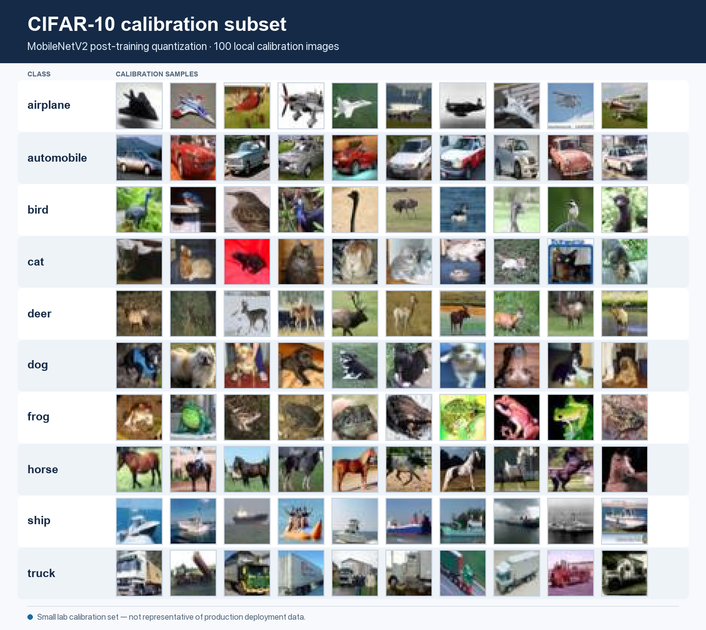
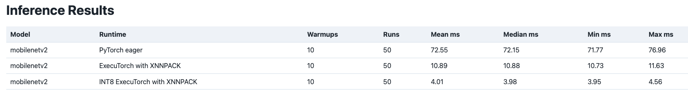
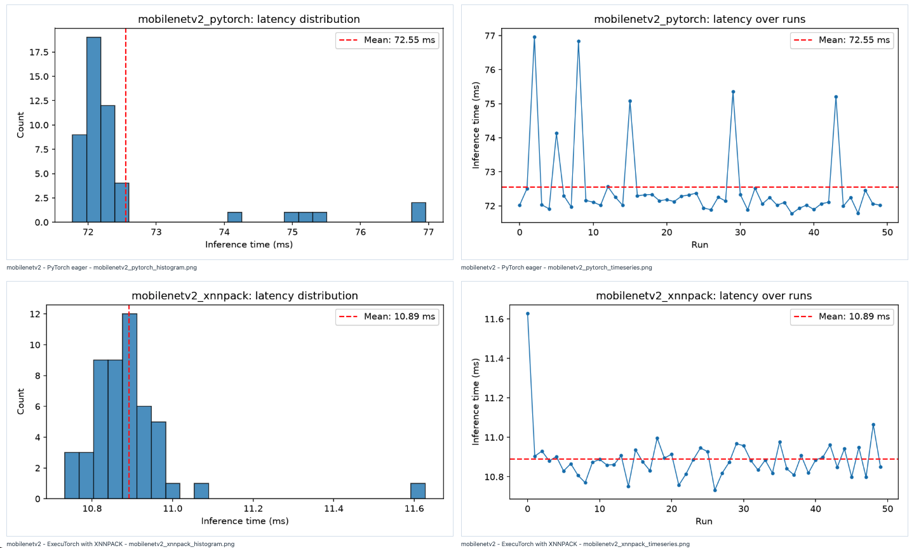
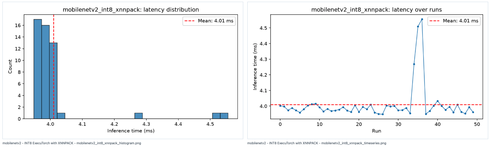
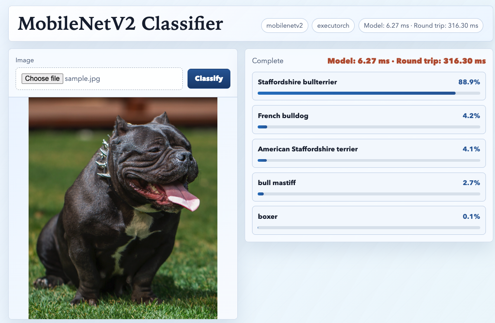

# Module 2: CNN Inference on Arm Cortex-A and Optimize with INT8 Quantization
### How do XNNPACK delegation and INT8 quantization change CNN deployment on an Arm CPU?

# Introduction
## About this module

In Module 1, you compared PyTorch eager, portable ExecuTorch, and ExecuTorch
with XNNPACK for two transformer workloads. Portable ExecuTorch provided a
deployable baseline, while XNNPACK reduced latency by capturing expensive work
in optimized backend regions. The transformer graphs still contained many
delegation boundaries and fallback operations.

In this module, you will compare three ways to run MobileNetV2 image classification on an Arm CPU:

- PyTorch eager execution
- FP32 ExecuTorch with XNNPACK
- INT8 ExecuTorch with XNNPACK

The goal is not to prove that quantization is always better. Instead, you will work through a practical ExecuTorch deployment workflow and compare the trade-offs that appear along the way: model structure, backend delegation, artifact size, target-device latency, quantization, and classification output.

You will use MobileNetV2, a lightweight convolutional neural network for image classification. This provides a contrast with the transformer workloads from Module 1: MobileNetV2 has convolution-heavy structure that can map more cleanly to optimized CPU kernels.

You will repeat the same deployment pattern used in Module 1, with one new step: INT8 quantization.

1. Prepare the model, image, labels, and preprocessing contract.
2. Export MobileNetV2 from PyTorch.
3. Lower the FP32 model to ExecuTorch with XNNPACK.
4. Inspect the delegation summary.
5. Copy the `.pte` artifact to the Raspberry Pi.
6. Benchmark PyTorch eager and FP32 ExecuTorch with XNNPACK.
7. Calibrate and quantize the model to INT8.
8. Benchmark the INT8 ExecuTorch with XNNPACK path.
9. Compare artifact size, latency, delegation, and top-5 output.
10. Run a small image-classifier demo.
11. Choose the next deployment path.

You will build and compare three runtime paths:

| Model and runtime path | Role in the comparison |
|---|---|
| PyTorch eager MobileNetV2 | Provides the full-stack latency and classification reference |
| FP32 ExecuTorch with XNNPACK | Shows the effect of deploying the CNN through optimized CPU kernels |
| INT8 ExecuTorch with XNNPACK | Shows the effect of quantization on artifact size, latency, and classification output |

Portable ExecuTorch is not repeated in this module. Module 1 already
used it as a lightweight, broadly compatible deployment path
rather than the main CPU performance path for these workloads. Keeping XNNPACK
as the backend for both `.pte` artifacts lets this module focus on two new
variables: a convolution-heavy model and INT8 precision.

The completed comparison shows the practical trade-offs for running MobileNetV2
on an edge CPU: runtime latency, `.pte` artifact size, delegation, and
classification output. Producing the correct top-1 label for one image is not
enough on its own.

## What will you be able to do?

By the end of this module, you will be able to:

- prepare pre-trained MobileNetV2 files and record the required image size and
  preprocessing
- export MobileNetV2 to ExecuTorch and lower supported regions to XNNPACK
- read a delegation summary and identify which operations did not run through
  XNNPACK
- benchmark PyTorch eager and ExecuTorch with XNNPACK on a Raspberry Pi
- prepare calibration images for post-training quantization
- create an INT8 MobileNetV2 `.pte` artifact with the XNNPACK quantization flow
- compare FP32 and INT8 artifact size, latency, and top-5 classification output
- explain how model structure, XNNPACK delegation, calibration data, and
  classification results affect the deployment trade-off.


# Before you begin

## Why MobileNetV2 is an appropriate model for edge CPU inference

Running inference on an edge device can reduce latency, keep data local, and
support applications without reliable cloud connectivity. The model still has
to fit within the device's compute, memory, storage, and power limits.

MobileNetV2 was designed for efficient inference. It uses depthwise separable
convolutions and pointwise convolutions, which commonly map to optimized CPU
libraries. XNNPACK provides optimized kernels for supported operations, so a
convolution-heavy model such as MobileNetV2 can often be lowered into a small
number of large delegated regions. Compared with the transformer graphs in
Module 1, this can mean:

- fewer backend boundaries
- less work on the fallback path
- larger portions of the model handled by XNNPACK
- a greater opportunity to reduce latency

INT8 quantization changes model weights and, where supported, activations from
FP32 to a lower-precision representation. This reduces storage and memory
bandwidth requirements and can make optimized integer kernels available.
Quantization also introduces numerical approximation, so confidence scores and, 
occasionally, prediction rankings can change. The relevant check is whether the
model still gives useful results on images like the ones the application will
see.

## Development Machine Setup

Run the setup commands on your development machine from the repository root.

If you completed Module 1, reuse `.cpu_aot_venv` and install the Module 2
add-on requirements:

```bash
cd ~/executorch_on_arm
source .cpu_aot_venv/bin/activate
python -m pip install -r module_2/requirements.txt
```

For a clean clone, create the Python 3.11.14 environment, install the Module 1
base requirements, and then install the Module 2 add-ons:

```bash
cd ~/executorch_on_arm
PYENV_VERSION=3.11.14 python -m venv .cpu_aot_venv
source .cpu_aot_venv/bin/activate
python -m pip install -r module_1/requirements.txt
python -m pip install -r module_2/requirements.txt
```

Use Python 3.11.14 through pyenv for this module. The ExecuTorch Python package
contains native pybindings that must match the installed PyTorch build. An
environment created with another Python version can install incompatible wheels
and fail later when it loads a `.pte` artifact.

This is the same version requirement as Module 1. Reusing `.cpu_aot_venv` keeps
the ExecuTorch, PyTorch, and pybinding versions aligned while adding the additional dependencies required by this module.

# Plan the MobileNetV2 deployment workflow

You are now ready to begin. You will use the same workflow pattern as Module 1, with INT8 quantization added after the FP32 XNNPACK baseline:

1. Prepare the model, labels, image, and pre-processing contract.
2. Export MobileNetV2 from PyTorch.
3. Lower the FP32 model to ExecuTorch with XNNPACK.
4. Inspect the delegation summary.
5. Copy the artifacts to the Raspberry Pi.
6. Benchmark PyTorch eager and FP32 ExecuTorch with XNNPACK.
7. Calibrate and quantize the model to INT8.
8. Benchmark INT8 ExecuTorch with XNNPACK.
9. Compare artifact size, latency, delegation, and top-5 output.
10. Run the image-classifier demo.
11. Choose the next deployment path.

As you work, pay attention to the engineering trade-offs: latency, `.pte` artifact size, quantization accuracy shift, calibration data quality, application responsiveness, and production validation still needed.
By the end of the workflow, you should have three benchmark results, two `.pte` artifact sizes, one delegation comparison, INT8 top-5 output, and at least one application-demo observation.

## Script layout

Module 2 follows the script workflow used in Module 1:

- `module_2/scripts/aot`: development-machine scripts for model preparation,
  export, lowering, calibration, and quantization
- `module_2/scripts/pi`: Raspberry Pi benchmark and demo entry points
- `module_2/scripts/pi/core`: Raspberry Pi runtime helpers
- `module_2/scripts/_support`: shared helpers

You will prepare and lower the model on the development machine, copy the
deployable `.pte` files to the Raspberry Pi, and measure them on the target.
The model family changes from transformers to CNNs, and we introduce the new quantization step, but the split between
ahead-of-time preparation and target-side execution remains the same.

# 1. Prepare MobileNetV2 and define the input contract

This step prepares one set of model weights, labels, image, tensor
shape, and preprocessing settings for every runtime path. This gives the rest
of the module the same inputs to work from, so later differences come from the
runtime path or precision rather than from a different input tensor.

## Prepare the Model Assets

Run the following on the development machine:

```bash
module_2/scripts/aot/prepare_mobilenetv2.py \
  --out module_2/artifacts/mobilenetv2
```

The script downloads the MobileNetV2 weights through TorchVision, saves the
state dictionary, writes the ImageNet labels and `model_spec.json`, and attempts
to download a sample dog image for benchmarking. TorchVision is the PyTorch
library that provides common computer vision datasets, image transforms, and
pretrained vision models.

You should expect to see output similar to this:

```text
Wrote module_2/artifacts/mobilenetv2/mobilenet_v2.pth
Wrote module_2/artifacts/mobilenetv2/imagenet_labels.json
Wrote module_2/artifacts/mobilenetv2/sample.jpg
Wrote module_2/artifacts/mobilenetv2/model_spec.json
```

The four files have distinct roles:

- `mobilenet_v2.pth`: the local TorchVision MobileNetV2 state dictionary
- `imagenet_labels.json`: the ImageNet class names used to interpret the output
  logits
- `sample.jpg`: the image used by the benchmark and demo commands
- `model_spec.json`: the image size, layout, and preprocessing settings used by
  export, benchmarking, quantization, and the web demo

This step creates the PyTorch-side inputs for later export and lowering. It does
not create an ExecuTorch program.

## Check and understand the saved model data

The preparation script loads the pre-trained model and saves its weights and
labels locally:

```python
weights = MobileNet_V2_Weights.IMAGENET1K_V1
model = mobilenet_v2(weights=weights).eval()
torch.save(model.state_dict(), weights_path)

labels = weights.meta["categories"]
labels_path.write_text(json.dumps(labels, indent=2) + "\n")
```

TorchVision supplies both the pre-trained weights and the ImageNet categories.
Saving them in the module artifact directory ensures that export, benchmarking,
and the demo use the same model data.

The script records the image size and preprocessing in `model_spec.json`:

```python
"input": {
    "shape": [1, 3, 224, 224],
    "dtype": "float32",
    "layout": "nchw",
    "preprocessing": {
        "resize": 256,
        "center_crop": 224,
        "mean": [0.485, 0.456, 0.406],
        "std": [0.229, 0.224, 0.225],
    },
}
```

The shape `[1, 3, 224, 224]` represents one RGB image in NCHW order: batch,
channels, height, and width. The resize, crop, mean, and standard deviation are
the ImageNet pre-processing values used by the pre-trained model. The PyTorch
reference, ExecuTorch benchmarks, calibration flow, and web demo all read these
settings so they do not accidentally resize or normalize the image differently.

Module 1 used `model_spec.json` for token inputs such as `input_ids` and
`attention_mask`. Module 2 uses it for image tensor shape and pre-processing. In
both modules, the file keeps the development-machine and Raspberry Pi code
using the same model inputs.

### Check prepared assets

Before moving on, confirm that the preparation step produced:

- `mobilenet_v2.pth`
- `imagenet_labels.json`
- `sample.jpg`
- `model_spec.json`

If any file is missing, rerun `prepare_mobilenetv2.py` before continuing. Later export, benchmarking, quantization, and demo steps depend on these shared inputs.

## Preparation Takeaway

You now have the shared model files, ImageNet labels, sample image, and
pre-processing settings that every later command will use. The important point
is that a fair runtime comparison starts before benchmarking: PyTorch,
ExecuTorch with XNNPACK, and INT8 ExecuTorch with XNNPACK all need to receive
the same resized, cropped, normalized image tensor.

# 2. Export and lower MobileNetV2 with ExecuTorch and XNNPACK

As in Module 1, ExecuTorch deploys a prepared program rather than a live PyTorch model. This step captures the fixed-shape MobileNetV2 graph, delegates supported work to XNNPACK, and packages the result as an FP32 `.pte` artifact that can be copied to the Raspberry Pi.

## Create the FP32 ExecuTorch Artifact

Run on the development machine:

```bash
module_2/scripts/aot/lower_mobilenetv2_xnnpack.py \
  --spec module_2/artifacts/mobilenetv2/model_spec.json
```

The script exports MobileNetV2, lowers supported regions to XNNPACK, prints a
delegation summary, and writes the FP32 `.pte` artifact and its size metadata.

You should expect to see output similar to this:

```text
Loading MobileNetV2 weights from module_2/artifacts/mobilenetv2/mobilenet_v2.pth...
Exporting MobileNetV2...
Lowering with XNNPACK...
Wrote module_2/artifacts/mobilenetv2/mobilenetv2_xnnpack.pte
PTE size: 13.99 MB
Wrote module_2/artifacts/mobilenetv2/mobilenetv2_xnnpack.json

Delegation
==========
XNNPACK delegate call sites: 1
Fallback call_function ops:  1
  <built-in function getitem> (1)
```

The generated `mobilenetv2_xnnpack.pte` is the FP32 artifact that will run on
the Raspberry Pi.

## Understand export and lowering

The central export and lowering sequence is:

```python
example_inputs = (torch.randn(*spec["input"]["shape"]),)

with torch.inference_mode():
    exported = export(model, example_inputs)

edge = to_edge_transform_and_lower(
    exported,
    partitioner=[XnnpackPartitioner()],
)
program = edge.to_executorch()
```

`torch.export` captures a fixed-shape PyTorch program using the input shape in
`model_spec.json`. `to_edge_transform_and_lower()` converts the exported
program to the ExecuTorch edge representation and uses `XnnpackPartitioner` to
identify subgraphs that XNNPACK supports. `to_executorch()` then packages the
lowered program as a deployable `.pte` file.

This is the same export-and-lower sequence used for OPT-125M and DistilBERT in
Module 1. The difference lies in the graph. Transformer graphs contain
attention, masks, reshapes, indexing, and normalization around their main
compute. MobileNetV2 is dominated by convolution patterns that can form a more
compact XNNPACK region.

## Inspect the delegation summary

For the example run, the FP32 artifact data was:

| Artifact | Backend | Precision | `.pte` size | XNNPACK delegate call sites | Fallback `call_function` operations |
|---|---|---|---:|---:|---:|
| `mobilenetv2_xnnpack.pte` | XNNPACK | FP32 | 13.99 MB | 1 | 1 |

One XNNPACK delegate call site means that ExecuTorch will hand one region to
XNNPACK at runtime. In this graph, that region contains the expensive CNN work.
The only remaining `call_function` operation is `<built-in function getitem>`.
This operation selects a value from the graph output. It is not part of the main
convolutional workload.

The script obtains this summary by walking the lowered graph:

```python
graph = edge.exported_program().graph_module.graph
delegate_op = torch.ops.higher_order.executorch_call_delegate

delegate_calls = 0
fallback_targets = []
for node in graph.nodes:
    if node.op != "call_function":
        continue
    if node.target == delegate_op:
        delegate_calls += 1
    else:
        fallback_targets.append(str(node.target))
```

A delegate call marks a region handled by XNNPACK. A fallback target remains on
the default ExecuTorch path. Counts alone do not describe the amount of work in
either path: one delegate call can contain most of a model, and one fallback
operation can be a small helper operation, such as selecting an output value.
Read the delegate regions and fallback list together, then confirm their
practical effect with target-side timing.

This example provides a good contrast with Module 1. XNNPACK captured useful work in
the transformer models, but their graph structure produced more boundaries.
MobileNetV2's convolution-heavy structure allows its main compute to sit in one
delegated region.

Compare the delegation counts from Module 1 with the MobileNetV2 count in this module:

| Model | Workload | XNNPACK delegate call sites | Fallback `call_function` operations |
|---|---|---:|---:|
| OPT-125M | Autoregressive transformer decoder | 50 | 632 |
| DistilBERT | Transformer encoder | 27 | 354 |
| MobileNetV2 | Convolutional image classifier | 1 | 1 |

This table should not be read as a percentage comparison. The models have
different graph sizes and different operation costs, so the counts are not
directly comparable as coverage metrics. The table shows graph fragmentation:
OPT-125M and DistilBERT are split across many delegated and fallback
operations, while MobileNetV2 is captured as one large XNNPACK region with one
small helper operation left on the default ExecuTorch path.

### Check the FP32 deployable artifact

Before moving on, confirm that the lowering step produced:

- `mobilenetv2_xnnpack.pte`
- `mobilenetv2_xnnpack.json`

If you ran the command yourself, compare your `.pte` size and delegation summary with the reference values. If they differ, keep a note of the difference and continue.

### Inspect delegation

Before benchmarking, make a prediction from the delegation summary:

| Question | Your prediction |
|---|---|
| Does the MobileNetV2 graph look mostly delegated or fragmented? | |
| What does one XNNPACK delegate call site suggest about the CNN workload? | |
| What benchmark result would this delegation pattern lead you to expect? | |
| What risk remains before you trust the runtime path? | |

## Lowering takeaway

You have converted the PyTorch model into a deployable FP32 ExecuTorch program
and checked how much of the graph XNNPACK will run. When you read the
delegation summary, remember that one delegate call can contain most of the
model's work, while a fallback operation may be a small helper, such as selecting
an output value. The next task tests whether that graph placement reduces
latency on the target CPU.


# 3. Benchmark PyTorch and FP32 ExecuTorch on the Raspberry Pi

Delegation shows where ExecuTorch plans to run parts of the graph. It does not
tell you how fast the model will run on the Raspberry Pi. This step measures PyTorch eager and FP32 ExecuTorch with XNNPACK on the same Raspberry Pi
using the same weights, image, pre-processing, warm-up count, and run count.
This allows us to measure the effect of changing the runtime while keeping the input
and model fixed.

Module 1 used two warm-up runs and 20 measured runs for its slower transformer
paths, and only one measured run for portable ExecuTorch. MobileNetV2 completes
each forward pass much more quickly, so ten warm-up runs and 50 measured runs remain
practical and provide a larger latency sample.

## Prepare the Raspberry Pi runtime

If you connect over SSH, forward the benchmark dashboard and web application
ports:

```bash
ssh -L 8080:localhost:8080 -L 8092:localhost:8092 <user>@<pi>
```

| Port | Use |
|---:|---|
| `8080` | benchmark results dashboard |
| `8092` | MobileNetV2 image classifier demo |

Clone or copy the course repository to the Pi, then create the runtime
environment. If you previously performed Module 1 setup on this Pi, these commands will just add additional installs:

```bash
cd ~/executorch_on_arm
PYENV_VERSION=3.11.14 python -m venv .cpu_lab_venv
source .cpu_lab_venv/bin/activate
python -m pip install -r module_1/requirements.txt
python -m pip install -r module_2/requirements.txt
```

As in Module 1, you keep the Pi runtime environment separate from the development
machine's AOT environment. Both use the same Python version and pinned base
dependencies, but they serve different parts of the workflow.

Copy the MobileNetV2 artifacts from the development machine:

```bash
ssh <user>@<pi> "mkdir -p ~/executorch_on_arm/module_2/artifacts"
scp -r module_2/artifacts/mobilenetv2 \
  <user>@<pi>:~/executorch_on_arm/module_2/artifacts/
```

## Run the PyTorch reference

```bash
cd ~/executorch_on_arm
source ~/executorch_on_arm/.cpu_lab_venv/bin/activate

module_2/scripts/pi/benchmark_mobilenetv2.py \
  --runtime pytorch \
  --spec ~/executorch_on_arm/module_2/artifacts/mobilenetv2/model_spec.json \
  --image ~/executorch_on_arm/module_2/artifacts/mobilenetv2/sample.jpg \
  --runs 50 \
  --warmups 10 \
  --out ~/executorch_on_arm/module_2/results/mobilenetv2_pytorch.json
```

This run records the classification output and latency for the full PyTorch
stack.

## Run FP32 ExecuTorch with XNNPACK

```bash
module_2/scripts/pi/benchmark_mobilenetv2.py \
  --runtime executorch \
  --backend xnnpack \
  --spec ~/executorch_on_arm/module_2/artifacts/mobilenetv2/model_spec.json \
  --pte ~/executorch_on_arm/module_2/artifacts/mobilenetv2/mobilenetv2_xnnpack.pte \
  --image ~/executorch_on_arm/module_2/artifacts/mobilenetv2/sample.jpg \
  --runs 50 \
  --warmups 10 \
  --out ~/executorch_on_arm/module_2/results/mobilenetv2_xnnpack.json
```

Both benchmark paths use the same pre-processed tensor. The script changes only
the runtime call:

```python
if args.runtime == "pytorch":
    def forward():
        return module(input_tensor)
else:
    def forward():
        return module.forward((input_tensor,))[0]
```

The PyTorch branch calls the `torch.nn.Module`. The ExecuTorch branch loads the
`.pte` artifact and calls it through the ExecuTorch runtime. The source image,
pre-processing, weights, warm-ups, and measured run count remain fixed.

# 4. View the FP32 MobileNetV2 benchmark results

On the Raspberry Pi, you should expect to see top-5 predictions similar
to this:

| Rank | Label | Score |
|---:|---|---:|
| 1 | Staffordshire bullterrier | 71.62% |
| 2 | bull mastiff | 13.37% |
| 3 | French bulldog | 8.97% |
| 4 | American Staffordshire terrier | 5.01% |
| 5 | boxer | 0.82% |

Example latency measurements are:

| Runtime path | Warm-ups | Runs | Mean | Median | Min | Max |
|---|---:|---:|---:|---:|---:|---:|
| PyTorch eager | 10 | 50 | 72.55 ms | 72.15 ms | 71.77 ms | 76.96 ms |
| ExecuTorch with XNNPACK | 10 | 50 | 10.89 ms | 10.88 ms | 10.73 ms | 11.63 ms |

Your own results will differ slightly, but should be similar.

The matching predictions confirm that the runtime comparison is performing the
same classification for this input. Mean latency fell from 72.55 ms to 10.89
ms, a speedup of approximately 6.7 times for this run. This timing result is
consistent with the delegation report: XNNPACK received the model's main
convolutional workload as one region.

### Compare FP32 runtime performance

Use your dashboard result if you ran the benchmark. Otherwise, use the reference result.

After reviewing the latency and top-5 output, answer:

| Decision question | Your conclusion |
|---|---|
| Would you take FP32 ExecuTorch with XNNPACK forward for this MobileNetV2 workload? | |
| What latency result supports that choice? | |
| Did the classification output remain consistent enough for this sample image? | |
| What risk or limitation remains before production use? | |

### FP32 benchmark takeaway

You have measured the runtime change on the target device while keeping the
model input and classification result fixed. In the example measurements,
ExecuTorch with XNNPACK reduced the mean latency by about 6.7 times. Delegation and
benchmarking answer different questions: delegation shows where the graph is
expected to run, while the Raspberry Pi benchmark shows the actual latency
improvement. MobileNetV2 delegated cleanly to XNNPACK in one large region containing the heavy convolution compute. This delegation pattern is consistent with the substantial latency improvement measured on the Raspberry Pi.

# 5. Quantize MobileNetV2 to INT8 with XNNPACK

The FP32 ExecuTorch artifact improves latency, but edge deployment also places
limits on storage, memory bandwidth, and response time. Post-training
quantization produces a second artifact that uses INT8 values for supported
parts of the graph. This step calibrates the model, converts it,
lowers it to XNNPACK, and compares the new INT8 `.pte` artifact with the FP32
artifact.

Quantization happens ahead of deployment. ExecuTorch does not take the FP32
`.pte` file and quantize it at runtime. The workflow starts from the FP32
PyTorch program, applies quantization preparation and conversion, and then
packages a new INT8 `.pte` artifact.

If you completed Module 1's optional LLM deployment section, you saw
quantization selected through LLM-specific export flags such as `--qlinear` and
`--qembedding`. This module uses a direct PyTorch 2 Export (PT2E) quantization path: post-training quantization with observers, a calibration dataset, conversion, and XNNPACK lowering.

## Understand post-training quantization

Post-training quantization (PTQ) starts with a trained FP32 model. Preparation
adds observers to the graph. A calibration pass then runs example images
through the prepared model so the observers can record activation ranges.
Conversion uses those ranges to select parameters such as scales and
zero-points and replaces supported FP32 computation with quantized forms.

This module uses `XNNPACKQuantizer`, so the quantization configuration is
designed for the backend that will run the model. This is preferable to applying
a generic INT8 transformation and expecting the backend to accept every
resulting pattern. The converted graph must still contain forms that XNNPACK can
lower and execute efficiently.

The three expected benefits are:

- a smaller model artifact
- lower memory bandwidth requirements
- lower latency where optimized integer kernels are available

The cost is numerical approximation. We will evaluate that cost by checking the
classification results, not by requiring bit-for-bit agreement with FP32.

## Create the calibration image set

Run on the development machine:

```bash
module_2/scripts/aot/create_calibration_images.py \
  --out module_2/artifacts/mobilenetv2/calibration_images \
  --images-per-class 10
```

On its first run, the script downloads the CIFAR-10 archive. This can take
several minutes. TorchVision or NumPy may also print a deprecation warning while
the archive is unpacked.

You should expect to see output similar to this:

```text
Saved calibration images:
  airplane: 10 images
  automobile: 10 images
  bird: 10 images
  cat: 10 images
  deer: 10 images
  dog: 10 images
  frog: 10 images
  horse: 10 images
  ship: 10 images
  truck: 10 images
```

The result is a small ImageFolder-style subset containing 100 images across ten
classes. This is a lab calibration set, not a production recommendation. It is intentionally small so the workflow runs quickly. A production calibration set should match the deployed camera, lighting, image composition, and expected object distribution.

The script downloads CIFAR-10 once and writes the selected images into class
folders:

```python
dataset = datasets.CIFAR10(
    root=args.data_root,
    train=True,
    download=True,
    transform=transforms.ToTensor(),
)

for image, label in dataset:
    class_dir = args.out / class_name
    save_image(image, class_dir / f"img_{index:04d}.jpg")
```

The directory layout allows the quantization script to load the data with
`torchvision.datasets.ImageFolder`. Calibration does not train the model and
does not use the labels as targets. It only supplies realistic input values for
the observers.



## Quantize and lower the model

```bash
module_2/scripts/aot/quantize_mobilenetv2_xnnpack.py \
  --spec module_2/artifacts/mobilenetv2/model_spec.json \
  --calibration-images module_2/artifacts/mobilenetv2/calibration_images \
  --num-calib 100
```

The script runs PT2E post-training quantization with the XNNPACK quantizer,
calibrates the prepared graph, converts it, lowers it to ExecuTorch with
XNNPACK, and writes the INT8 `.pte` artifact.

You should expect to see output similar to this:

```text
Calibrating on up to 100 images from module_2/artifacts/mobilenetv2/calibration_images...
Wrote module_2/artifacts/mobilenetv2/mobilenetv2_int8_xnnpack.pte
INT8 PTE size: 7.59 MB
FP32 PTE size: 13.99 MB
Wrote module_2/artifacts/mobilenetv2/mobilenetv2_int8_xnnpack.json
```

For one run with the pinned Module 2 environment, the quantization script reported:

| Artifact | Backend | Precision | `.pte` size |
|---|---|---|---:|
| `mobilenetv2_xnnpack.pte` | XNNPACK | FP32 | 13.99 MB |
| `mobilenetv2_int8_xnnpack.pte` | XNNPACK | INT8 | 7.59 MB |

In that run, the INT8 artifact was 7.59 MB rather than 13.99 MB, a reduction of
approximately 46%.

Module 1 described the theoretical fourfold storage reduction when a value
moves from 32 bits to 8 bits. That ratio does not apply automatically to the
complete `.pte` artifact. The file also contains graph and backend metadata,
not every component is quantized, and this lab leaves the classifier head in
FP32 by default. Measure the finished artifact instead of deriving its size
from the precision ratio.

Before moving on, confirm that quantization produced:

- `mobilenetv2_int8_xnnpack.pte`
- `mobilenetv2_int8_xnnpack.json`

If you ran the command yourself, compare your INT8 `.pte` size with the reference value. If it differs, keep a note of the difference and continue.

The complete preparation path is:

```text
FP32 PyTorch model
  -> torch.export
  -> prepare_pt2e with XNNPACKQuantizer
  -> calibration images
  -> convert_pt2e
  -> torch.export quantized model
  -> lower to ExecuTorch with XNNPACK
  -> INT8 .pte artifact
```

The script configures the quantizer as follows:

```python
quantizer = XNNPACKQuantizer()
quantizer.set_global(get_symmetric_quantization_config(is_per_channel=True))

if not args.quantize_classifier_head:
    quantizer.set_filter_function(skip_classifier_head)
```

The global configuration requests symmetric quantization with per-channel
weight quantization where supported. Per-channel quantization gives each output
channel its own scale, which is often useful for convolution weights. By
default, the script leaves the final classifier head in FP32. The classifier
head is the last layer that maps MobileNetV2 features to ImageNet class scores.
This is a conservative compromise between optimization and classification
stability: most of the model's compute is in the convolutional feature
extractor, while the classifier head directly produces the final ImageNet
scores. You can optionally pass `--quantize-classifier-head` as a follow-up
experiment. It may reduce size or latency a little more, but rerun the
delegation, latency, and top-5 checks because the final scores may shift.

Next, the script prepares the exported model for calibration by adding observer
modules:

```python
exported = export(model, example_inputs)
prepared = prepare_pt2e(exported.module(), quantizer)
move_exported_model_to_eval(prepared)
```

The observers collect values during calibration; their presence alone does not
make inference faster. The calibration loop supplies the observed ranges:

```python
for index, (image, _) in enumerate(calibration_loader):
    if index >= args.num_calib:
        break
    prepared(image)
```

Calibration quality depends on input quality. A set with different lighting,
composition, preprocessing, or subject matter from the deployed workload can
produce activation ranges that do not represent real use. Module 1 did not
include this step because its transformer comparisons remained in FP32.

After calibration, conversion creates the quantized model. The script exports
and lowers that converted graph:

```python
quantized_model = convert_pt2e(prepared)
exported_quantized = export(quantized_model, example_inputs)
edge = to_edge_transform_and_lower(
    exported_quantized,
    partitioner=[XnnpackPartitioner()],
    compile_config=EdgeCompileConfig(_check_ir_validity=False),
)
program = edge.to_executorch()
```

The resulting graph is no longer the original FP32 program. It contains the
quantized operations and delegated regions that ExecuTorch will execute. The
metadata JSON records the artifact path and size, calibration count, and
delegation summary.

<details> <summary>Optional: Inspect the FP32 and INT8 Graphs with Model Explorer</summary>

Use Model Explorer if you want a visual comparison with the transformer graphs
from Module 1 and with the FP32 MobileNetV2 graph from earlier in this module.

Install the optional tooling used in Module 1:

```bash
.cpu_aot_venv/bin/python -m pip install -r module_1/requirements-model-explorer.txt
```

Start Model Explorer with the Arm `.pte` adapter:

```bash
.cpu_aot_venv/bin/model-explorer \
  --port 8081 \
  --extensions=pte_adapter_model_explorer
```

Open the FP32 and INT8 artifacts:

```text
module_2/artifacts/mobilenetv2/mobilenetv2_xnnpack.pte
module_2/artifacts/mobilenetv2/mobilenetv2_int8_xnnpack.pte
```

In both graphs, look for the large `LoweredBackendModule` region. The FP32 and
INT8 graphs will not look identical because quantization changes the operations
that are lowered, but the main question is the same: does XNNPACK contain the
expensive MobileNetV2 work? Compare both MobileNetV2 artifacts with the more
fragmented transformer graphs from Module 1. Press `Ctrl+C` in the terminal
when you have finished.
</details>

# 6. Benchmark INT8 ExecuTorch on Raspberry Pi
## Copy the INT8 artifact to Raspberry Pi

Copy the new artifact to the Raspberry Pi:

```bash
scp module_2/artifacts/mobilenetv2/mobilenetv2_int8_xnnpack.pte \
  <user>@<pi>:~/executorch_on_arm/module_2/artifacts/mobilenetv2/
```

Run the benchmark:

```bash
module_2/scripts/pi/benchmark_mobilenetv2.py \
  --runtime executorch \
  --backend int8_xnnpack \
  --spec ~/executorch_on_arm/module_2/artifacts/mobilenetv2/model_spec.json \
  --pte ~/executorch_on_arm/module_2/artifacts/mobilenetv2/mobilenetv2_int8_xnnpack.pte \
  --image ~/executorch_on_arm/module_2/artifacts/mobilenetv2/sample.jpg \
  --runs 50 \
  --warmups 10 \
  --out ~/executorch_on_arm/module_2/results/mobilenetv2_int8_xnnpack.json
```

On the Raspberry Pi, you should expect to see output similar to this:

| Rank | Label | Score |
|---:|---|---:|
| 1 | Staffordshire bullterrier | 88.9% |
| 2 | French bulldog | 4.2% |
| 3 | American Staffordshire terrier | 4.1% |
| 4 | bull mastiff | 2.7% |
| 5 | boxer | 0.1% |

The latency result was:

| Runtime path | Warm-ups | Runs | Mean | Median | Min | Max |
|---|---:|---:|---:|---:|---:|---:|
| INT8 ExecuTorch with XNNPACK | 10 | 50 | 4.01 ms | 3.98 ms | 3.95 ms | 4.56 ms |

The top prediction remained `Staffordshire bullterrier`, and the same five dog
breeds appeared in the top five, although their scores and order changed. Such
numerical differences are expected after quantization. For this sample, the
classification output remained useful.

Mean latency fell from 10.89 ms for FP32 ExecuTorch with XNNPACK to 4.01 ms for
the INT8 path. Relative to the 72.55 ms PyTorch eager reference, the INT8 path
was approximately 18.1 times faster in this run.

### Compare INT8 deployment results

Use your benchmark result if you ran the INT8 path. Otherwise, use the reference result.

After reviewing artifact size, latency, and top-5 output, answer:

| Decision question | Your conclusion |
|---|---|
| Would you take the INT8 XNNPACK path forward for this MobileNetV2 workload? | |
| What artifact-size or latency result supports that choice? | |
| Did the top-5 output remain useful enough for this sample image? | |
| What additional image set would you validate before production? | |

<details><summary>Optional background: When quantization needs more validation</summary>

CNN classifiers are often a practical starting point for quantization because
convolution, activation, and pooling patterns are common in backend
quantization flows; their input shape is usually fixed; and top-5
classification often tolerates small score changes.

Other model types can be more sensitive. Detection models may include heads and
post-processing thresholds affected by small numerical changes. Transformer
graphs can contain masks, normalization, indexing, shape operations, and
dynamic sequence behavior that fragment the graph or increase numerical
sensitivity. A successful export therefore does not guarantee a satisfactory
quantized model.

Possible remedies include a larger calibration set that better matches the
application's images, selective quantization, mixed precision, or quantization-aware training (QAT).
QAT simulates quantization effects during training or fine-tuning so that the
model can adapt before final INT8 conversion.

To explore techniques such as QAT, begin with the same MobileNetV2 workflow: train or
fine-tune with QAT enabled, convert the prepared model, lower it to ExecuTorch
with XNNPACK, and repeat the artifact size, delegation, latency, and top-5
checks.

For initial resources to get started, see the
[PyTorch 2 Export QAT documentation](https://docs.pytorch.org/ao/stable/pt2e_quantization/pt2e_quant_qat.html),
which matches this module's PT2E and `XNNPACKQuantizer` approach. The broader
[torchao QAT workflow](https://docs.pytorch.org/ao/stable/workflows/qat.html)
explains fake quantization and the prepare, train, and convert sequence.
</details>

### INT8 quantization takeaway

You have created a second `.pte` artifact from the same FP32 PyTorch model,
this time using PT2E post-training quantization for ExecuTorch with XNNPACK.
The important pieces are calibration, conversion, and measurement: calibration
supplies the activation ranges, conversion creates the quantized graph, and the
Raspberry Pi benchmark checks whether the result is still acceptable. In the
example run, INT8 reduced artifact size by about 46% and mean latency from
10.89 ms to 4.01 ms while keeping a useful top-5 result for the sample image.

# 7. Compare MobileNetV2 benchmark results

After the individual benchmark runs, we will view the results together in the
dashboard. This makes it easier to compare average latency, run-to-run
variation, artifact size, classification output, and delegation instead of
looking only at one number.

Run on the Raspberry Pi:

```bash
shared/serve_results.py \
  --results ~/executorch_on_arm/module_2/results \
  --host 127.0.0.1 \
  --port 8080
```

Open on the development machine:

```text
http://localhost:8080
```

The summary shows the three MobileNetV2 runs side by side:



The PyTorch eager and FP32 ExecuTorch with XNNPACK plots show the latency
distribution and run-to-run variation for the first two paths:



The INT8 plots show the quantized path:



Use the summary table for the average latency comparison. Use the histograms
and run-by-run plots to verify that the result is consistent across the
measured runs.

### Benchmark comparison takeaway

You have brought the three runtime paths into one comparison. The dashboard
helps you check both the average latency and the spread across runs, while the
results table keeps size, classification output, and delegation in the same
view.

A deployment path needs acceptable latency, artifact size, and classification
output, not just a good mean time.

# 8. Run the INT8 image classifier demo

The benchmark uses one fixed image to make the runtime comparison controlled.
This step places the INT8 `.pte` artifact inside a small application
so that you can check the complete input-to-output path with additional images.

Run on the Raspberry Pi:

```bash
module_2/scripts/pi/serve_image_classifier.py \
  --runtime executorch \
  --spec ~/executorch_on_arm/module_2/artifacts/mobilenetv2/model_spec.json \
  --pte ~/executorch_on_arm/module_2/artifacts/mobilenetv2/mobilenetv2_int8_xnnpack.pte \
  --host 127.0.0.1 \
  --port 8092
```

Open on the development machine:

```text
http://localhost:8092
```

Upload JPEG or PNG images and review the top-5 predictions and model latency.
This demo is an integration check rather than a complete image-classification
product.

The application uses the same inference sequence as the benchmark:

```python
input_tensor = self._preprocess(image_bytes)
output = self.model.forward((input_tensor,))[0]

probabilities = torch.nn.functional.softmax(output[0], dim=0)
scores, indices = torch.topk(probabilities, topk)
```

The uploaded image is converted to the normalized tensor described by
`model_spec.json`. The ExecuTorch program returns logits; softmax and top-k
selection convert them to labels and confidence scores.

This follows the same application pattern as the Module 1 demos: load a `.pte`
artifact, convert user input to the expected tensor representation, run
inference, and translate the raw output into application behavior.

The demo displays the uploaded image, the top-5 predictions, and latency for the
INT8 ExecuTorch with XNNPACK artifact:



## Check application behavior

After trying the classifier demo and reading the explanation above, answer:

| Application-fit question | Your conclusion |
|---|---|
| Did the app run correctly with uploaded images? | |
| Were latency and top-5 outputs acceptable for the intended interaction? | |
| Did any uploaded image expose a preprocessing or classification issue? | |
| What would need to change before this pattern was production-ready? | |

## Application integration takeaway

You have moved from a benchmark command to a small application that accepts
user-supplied images. This shows that the `.pte` artifact is only one part of a
working deployment: the application must turn image bytes into the expected
tensor, call the ExecuTorch runtime, convert logits to probabilities, and map
the top results back to labels. The same image size, normalization, and label
mapping used during preparation and benchmarking still matter in the demo.

# Compare deployment trade-offs from the workflow

You now have four comparison points:

- **Model architecture:** MobileNetV2 uses convolution patterns that align well
  with optimized CPU kernels.
- **Backend delegation:** the example graph places its expensive CNN work in one
  XNNPACK region and leaves only a small helper operation on the default
  ExecuTorch path.
- **Quantization:** the example INT8 artifact is smaller and faster than the
  FP32 artifact.
- **Classification results:** the top prediction and set of top-five labels
  remain useful for the sample image, despite changed confidence values and
  ranking.

Use the workflow outputs and your own test images to choose the next deployment path:

- latency is low enough for the intended interaction
- the artifact fits the device's storage and memory constraints
- classification quality is acceptable across the expected image types
- preprocessing and application integration remain consistent with the model
  input settings

Now answer the module question: “How do XNNPACK delegation and INT8 quantization change CNN deployment on an Arm CPU?”

| Deployment question | Your conclusion |
|---|---|
| Which runtime path would you take forward for MobileNetV2, and why? | |
| What result most strongly supports that choice? | |
| What changed after INT8 quantization: artifact size, latency, top-5 output, or all three? | |
| Did quantization introduce any classification concern for the sample image? | |
| What would you validate before treating this as production-ready? | |

A strong answer should connect delegation quality, artifact size, target-device latency, calibration data, classification output, and missing production validation.

The comparison with Module 1 demonstrates a broader deployment principle. The
framework and hardware do not determine performance on their own. Model graph
structure affects both delegation and quantization, so model choice is part of
system optimization.

# Decide the MobileNetV2 deployment strategy

The main question in this module was: “How do XNNPACK delegation and INT8 quantization change CNN deployment on an Arm CPU?”

The answer depends on more than the fastest mean latency. You need to consider:

- model structure
- backend delegation
- artifact size
- calibration data
- classification output
- target-device latency
- production image distribution

## Model trade-off: CNN structure versus transformer fragmentation

MobileNetV2's convolution-heavy graph delegated much more cleanly than the transformer graphs in Module 1. One XNNPACK delegate call site does not mean “one operator.” It can contain most of the expensive convolutional work.

The takeaway is:

**Use model structure as an optimization signal. CNNs with supported convolution patterns can be strong candidates for XNNPACK on Arm CPUs.**

## Runtime trade-off: PyTorch eager versus FP32 ExecuTorch with XNNPACK

The FP32 XNNPACK artifact should be judged by target-device latency and classification consistency, not by export success alone.

The takeaway is:

**Use FP32 ExecuTorch with XNNPACK when the graph delegates cleanly and the measured target latency improves enough to matter for the application.**

## Quantization trade-off: smaller and faster versus numerical change

INT8 quantization reduced artifact size and latency in the example run, but it changed confidence values and may change rankings on some images.

The takeaway is:

**Use INT8 when the size and latency gains are valuable and classification output remains acceptable on representative images.**

## Calibration trade-off: demo images versus production distribution

The CIFAR-10 calibration set is enough to demonstrate PTQ mechanics, but production calibration should reflect the images the deployed app will actually see.

The takeaway is:

**Treat calibration data as part of the deployment design, not as a one-time script detail.**

## Application trade-off: benchmark image versus uploaded images

The benchmark controls one sample image. The demo checks whether the artifact can run inside an application path, but it is not a full product validation.

The takeaway is:

**Validate latency and classification quality on realistic images, hardware conditions, and product inputs before production.**

# Check your understanding

**Question 1.**

Which recorded result best shows that XNNPACK improved the CNN
deployment?

A. A significant target-side latency reduction after delegation

B. A longer export time on the development machine

C. A larger exported `.pte` artifact

D. Additional image pre-processing operations

<details>
<summary>Answer</summary>

**A. A significant target-side latency reduction after delegation**

Delegation describes the graph mapping. The target-side measurement confirms
the practical performance benefit.
</details>

<details>
<summary>Incorrect answer feedback</summary>

B. Export time happens on the development machine and does not show target-side inference performance.
C. A larger `.pte` artifact may be an acceptable trade-off, but it does not prove a runtime benefit.
D. Pre-processing is required for correct input handling, but it does not demonstrate that XNNPACK improved CNN inference.
</details>


**Question 2.**

The INT8 model produces different confidence values but retains
useful classification output. Why can this be acceptable for deployment?

A. Quantization always improves model accuracy

B. Small numerical changes are acceptable when the classifier still gives useful
results and inference becomes more efficient

C. Confidence values never matter in deployed classifiers

D. Quantization guarantees identical rankings on all inputs

<details>
<summary>Answer</summary>

**B. Small numerical changes are acceptable when the classifier still gives
useful results and inference becomes more efficient**
</details>

<details>
<summary>Incorrect answer feedback</summary>

A. Quantization does not always improve model accuracy. It often improves size or latency, but it introduces numerical approximation.
C. Confidence values can matter in deployed classifiers, especially when thresholds, ranking, or downstream decisions depend on them.
D. Quantization does not guarantee identical rankings. Rankings can change, so you need to check representative inputs.

</details>

**Question 3.**

Which two results are required to support an upload-based or live
camera application?

A. The exported artifact exists

B. Top-5 results remain useful on images like the application will receive

C. Latency meets the application's responsiveness requirement

D. Calibration completed without an error

<details>
<summary>Answer</summary>

**B and C.** The application needs both useful predictions and acceptable
response time. Export and calibration are preparation steps; they do not show
whether the deployed application is fast enough or accurate enough for its use
case.
</details>

<details>
<summary>Incorrect answer feedback</summary>

A. An exported artifact is necessary, but it does not prove the application is useful or responsive.
D. Calibration completing without an error only shows that the quantization workflow ran. It does not prove classification quality or runtime suitability.
</details>

## Selecting a vision deployment strategy

A team is building an offline visual inspection device on an Arm-based edge platform.

The device must:

- classify images locally without cloud connectivity
- respond quickly enough for an operator-facing workflow
- fit within limited storage and memory constraints
- maintain useful top-5 classification output on realistic camera images

The team evaluates three MobileNetV2 deployment paths:

- PyTorch eager execution
- FP32 ExecuTorch with XNNPACK
- INT8 ExecuTorch with XNNPACK

During testing, the team observes that:

- PyTorch eager produces the expected top-5 output but has higher latency
- FP32 ExecuTorch with XNNPACK substantially reduces latency
- the MobileNetV2 graph delegates cleanly to XNNPACK
- INT8 ExecuTorch with XNNPACK further reduces artifact size and latency
- INT8 changes confidence values but keeps useful top-5 output on the test image
- the calibration set is small and may not represent production camera images

**Question 1**

Which deployment recommendation is best supported by these results?

A. Use PyTorch eager because it is the original model implementation  
B. Use INT8 ExecuTorch with XNNPACK as the next prototype path, while validating on representative production images  
C. Reject quantization because confidence values changed  
D. Use export success alone as proof that the model is production-ready  

<details>
<summary>Answer</summary>

**B. Use INT8 ExecuTorch with XNNPACK as the next prototype path, while validating on representative production images**
</details>

<details>
<summary>Incorrect answer feedback</summary>

A. PyTorch eager is a useful reference, but the measured workflow showed a faster deployable path.
C. Changed confidence values are expected after quantization. The relevant question is whether the output remains useful for the application.
D. Export success only proves that an artifact was created. It does not validate latency, classification quality, calibration data, or production behavior.
</details>

**Question 2**

Before production, which additional validation activities are most important?

Select all that apply.

A. Test top-5 output on representative production images  
B. Measure latency under realistic device load and thermal conditions  
C. Evaluate memory usage, startup time, and artifact footprint  
D. Confirm that calibration data matches the deployment image distribution  
E. Assume the sample dog image proves general classification quality  

<details>
<summary>Answer</summary>

**A, B, C, and D**
</details>
<details><summary> Incorrect answer feedback</summary>
E. A single sample image is useful for a controlled benchmark, but it does not prove general classification quality. Production validation needs representative images, realistic device conditions, memory and startup checks, and calibration data that matches the deployment distribution.
</details>

# Apply the MobileNetV2 deployment decision

You can now use delegation quality, artifact size, target-device latency, calibration data, and classification output to decide whether FP32 or INT8 ExecuTorch with XNNPACK is the right next deployment path for a MobileNetV2-style vision workload. You prepared MobileNetV2 with a fixed image size, preprocessing recipe,
labels, and sample image; exported it to an FP32 `.pte` artifact; lowered
supported work to XNNPACK; benchmarked it on a Raspberry Pi; then created and
measured an INT8 `.pte` artifact.

You also compared the practical trade-offs between the three runtime paths:

- The same weights, labels, image size, and preprocessing must be used across
  PyTorch, FP32 ExecuTorch with XNNPACK, and INT8 ExecuTorch with XNNPACK.
- A delegation report tells you which parts of the graph are handed to
  XNNPACK, but the Raspberry Pi benchmark tells you whether that actually
  improves latency.
- MobileNetV2 is a good fit for this exercise because its convolution-heavy
  graph can be captured as one large XNNPACK region with only a small fallback
  operation.
- PTQ is an ahead-of-time conversion step. Calibration images give the
  quantizer the activation ranges it needs before the INT8 `.pte` artifact is
  created.
- INT8 quantization can change confidence scores and ranking details, so you
  compare the top-5 output as well as artifact size and latency.
- The web demo checks the application path: image upload, preprocessing,
  ExecuTorch runtime call, softmax, top-k selection, and label lookup.

For the example measurements in this module, FP32 ExecuTorch with XNNPACK reduced the mean latency from 72.55 ms to 10.89 ms, and the INT8 artifact reduced it again to 4.01 ms while preserving a useful top-5 result for the sample image. The same
workflow can be applied to another model, but you need to rerun the same
comparisons. Export success alone does not prove that delegation is good, that
quantization is acceptable, or that the target device meets the application's
latency and quality requirements.
