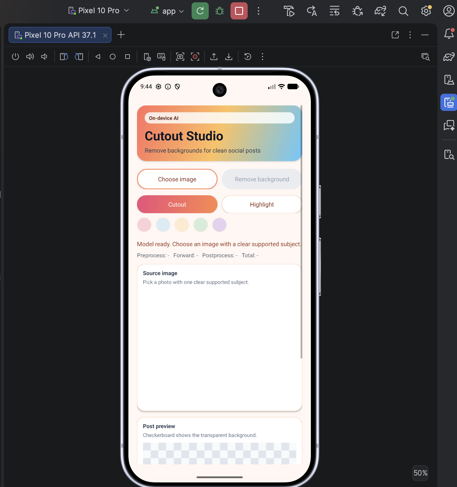
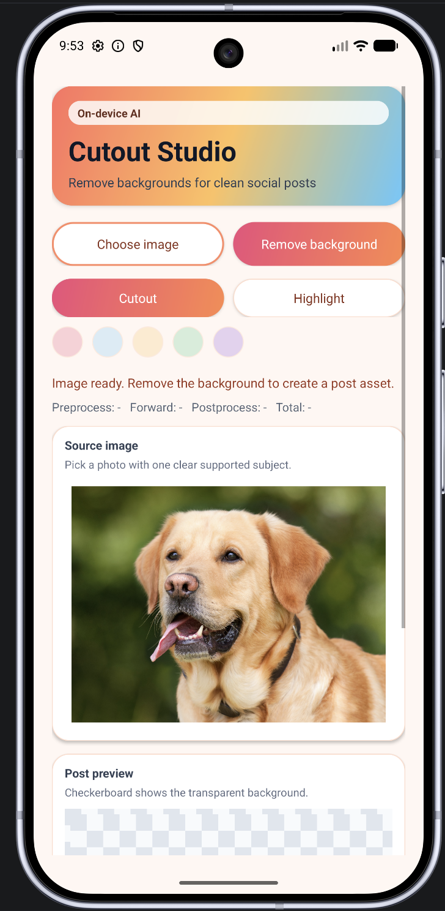
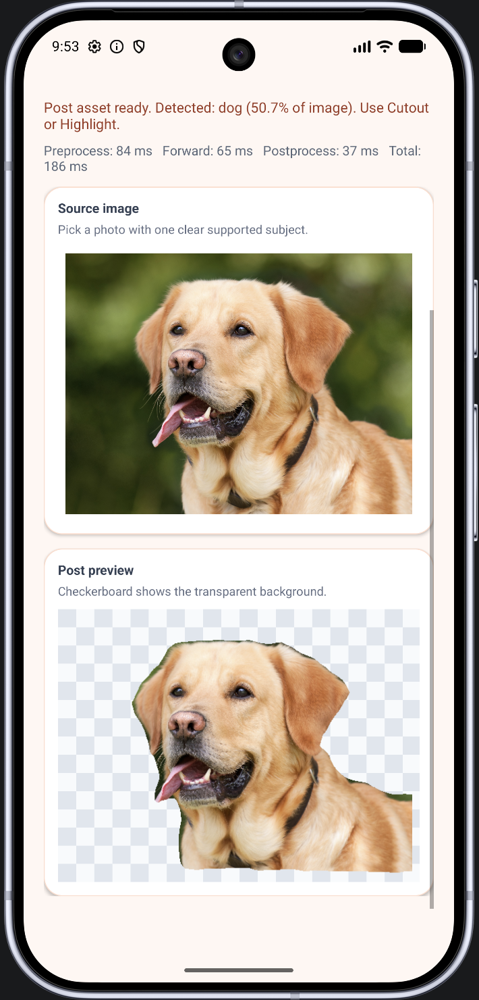
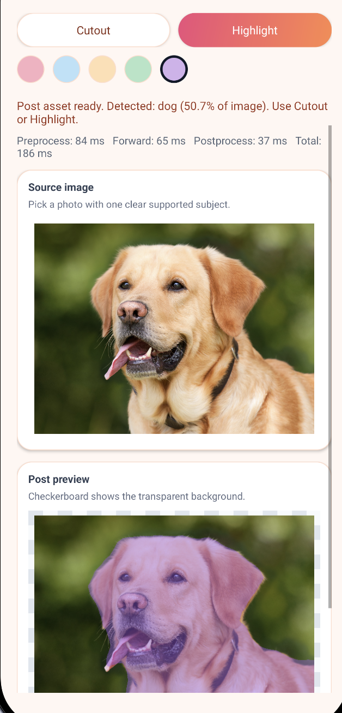
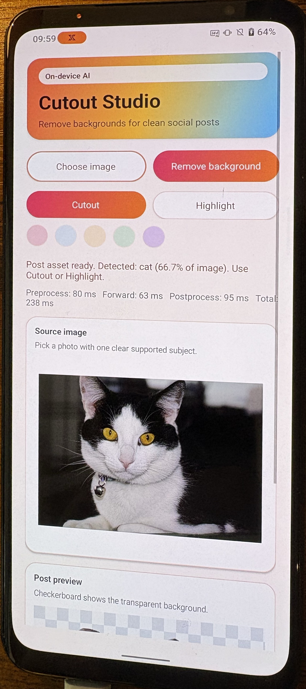
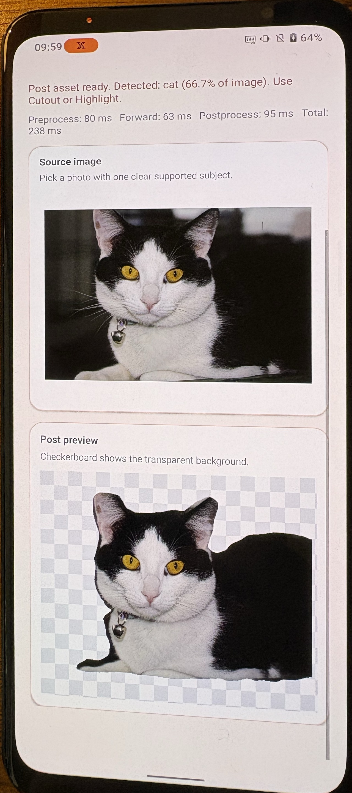

# Module 3: ExecuTorch on Mobile - Using the XNNPACK Backend on Android for Semantic Segmentation

## Introduction

Modules 1 and 2 prepared ExecuTorch programs on a development machine and
ran them on a Raspberry Pi, an Edge Linux device. Module 3 keeps the same
ahead-of-time model preparation workflow and changes the deployment target to
a mobile application, specifically on Android. This module uses semantic
segmentation as its example, but the same deployment workflow can support
other models and applications, including image classification, chatbots,
audio processing, and object detection.

You do not need an Android phone to complete the module. A physical device is
preferable for performance testing, but you can run the application with an
Android Studio emulator.

## ExecuTorch on Mobile

PyTorch originally supported phone deployment through PyTorch Mobile. PyTorch
Mobile is no longer actively supported, and the correct route for deploying PyTorch models on mobile devices is via ExecuTorch. Mobile applications use on-device inference for several practical reasons:

- interactive features can avoid a network round trip, leading to lower latency
- inference can continue without a reliable connection being required
- private inputs can remain on the device
- applications can use the CPU, GPU, or neural processing unit (NPU) already
  present in the device, rather than placing additional load on datacenters
- the energy usage occurs on-device, rather than in datacenters

Phones have constraints similar to other edge devices. A mobile application
shares memory, storage, battery power, and thermal capacity with the operating
system and other applications. Model size, startup time, inference latency,
runtime footprint, and library dependencies therefore matter. ExecuTorch
provides a small runtime for on-device inference. Quantization can reduce model
size and computation, while delegation to an optimized backend such as XNNPACK
can reduce CPU inference latency.

Although this module focusses on mobile, the principles are largely the same across other handheld devices, such as tablets, smartwatches, and notebooks, that use Android or iOS.

### Android Runtime Terms

The Android part of this module introduces several potentially new terms:

- **Java** is a general-purpose programming language widely used for Android
  applications. Android build tools compile Java source into DEX bytecode,
  which is executed by the Android Runtime (ART). This application uses Java
  to load the `.pte` file, create tensors, call the ExecuTorch Java API, and
  update the user interface.
- **Kotlin** is a newer programming language that works directly with Java
  code and libraries. It adds features such as concise syntax, null-safety,
  and coroutines for asynchronous work. A Kotlin Android application can call
  the same ExecuTorch Java API used in this module.
- **Gradle** is the Android build and dependency system.
- **Maven Central** is the package repository from which Gradle downloads the
  ExecuTorch Android library.
- An **AAR**, or Android Archive, is a reusable Android library package. The
  ExecuTorch AAR contains the Java API and native runtime libraries.
- **JNI**, the Java Native Interface, connects Java or Kotlin code to the
  native C++ ExecuTorch runtime.
- An **ABI**, or application binary interface, identifies a native binary
  target such as `arm64-v8a` for Arm phones or `x86_64` for an emulator.
- An **Android asset** is a file packaged inside the application. Assets are
  read-only after installation.
- **App-private storage** is writable storage owned by one application. This
  app copies the packaged `.pte` asset there before loading it.
- An **Activity** is an Android component that owns a screen and receives
  lifecycle callbacks as that screen is created or destroyed.
- The **main thread** handles UI events and drawing. Model loading and
  inference must run on a background worker so the interface remains
  responsive. This project uses an `ExecutorService`, a Java utility that
  runs submitted work on a separate thread.
- An **APK** is an installable Android package. An **Android App Bundle** is a
  publishing format used to generate device-specific APKs.
- The **Android SDK** supplies Android APIs and build tools. The **JDK**, or
  Java Development Kit, supplies the Java compiler and runtime used by Gradle.

The application source in this module is Java. Files ending in `.gradle.kts`
use the Kotlin DSL, or domain-specific language, to configure Gradle. They are
build files rather than Kotlin application source files.

For more detail about ExecuTorch usage within Android, see the official documentation [ExecuTorch with Android](https://docs.pytorch.org/executorch/stable/using-executorch-android.html).

## Moving from Edge Linux to Mobile

Python remains part of the workflow when moving from Edge Linux to mobile. The
ahead-of-time stages remain largely unchanged: prepare, export, quantize,
lower, and validate the model on the development machine. The output is still
a `.pte` artifact. The main change is the application that runs around it.

| Edge Linux application | Android application |
|---|---|
| Runs as a command, service, or web application | Runs inside Android application components such as an Activity |
| Starts from a shell, service manager, or web request | Responds to UI events and Android lifecycle callbacks |
| Reads models and configuration from ordinary filesystem paths | Packages assets in the APK or downloads them into app-private storage |
| Can expose results through a terminal, API, or browser UI | Updates native controls and images on the main UI thread |
| Uses normal process, thread, or web-server concurrency | Moves model loading and inference off the main UI thread |
| Is deployed as files, packages, containers, or services for a known board | Is distributed as an APK or App Bundle with native libraries for selected ABIs |
| Usually targets a controlled hardware and OS configuration | Must account for device variation, battery use, memory pressure, and temperature |

Once the model has been prepared, it can be utilized by application code written in Java or Kotlin, just as it can be used by application code written in Python or C++. The application code loads the `.pte` artifact, creates input tensors, calls the runtime, and presents the
result.

## Application Overview

You will build an Android object-cutout application using TorchVision LR-ASPP
MobileNetV3 and the XNNPACK backend. The application lets the user choose a
photo, runs semantic segmentation, selects the largest predicted foreground
class, and makes all other pixels transparent.

Object cutout is a common building block in mobile photo-editing applications.
It can remove or replace a background before an image is added to a social
media post, turn a person or object into a sticker, place a subject in a
collage, apply portrait effects, or clean up a product photograph. Running the
segmentation model on the phone can make these edits interactive without
sending the original image to a server.

TorchVision is a PyTorch library that provides pretrained vision models and
image transforms. LR-ASPP MobileNetV3 combines a mobile-oriented MobileNetV3
feature extractor with a lightweight semantic segmentation head.

You will prepare two ExecuTorch programs, compare their local segmentation
results, and deploy the INT8 program to Android:

| Model | Purpose |
|---|---|
| FP32 LR-ASPP MobileNetV3 with XNNPACK | Establish correctness on your development-machine and  a cutout-quality baseline |
| INT8 LR-ASPP MobileNetV3 with XNNPACK | Confirm acceptable quantized output, then deploy to Android |

The application packages the INT8 `.pte` artifact, `model_spec.json`, and class
labels as Android assets. Java code copies the model into app-private storage,
loads it with ExecuTorch, prepares a selected image, runs inference, and
converts the output tensor into a transparent cutout.

The app reports preprocessing, model forward, postprocessing, and total time.

## What is Semantic Segmentation?

Semantic segmentation classifies every pixel in an image. Instead of
returning one label for the whole image, the model returns a grid of class
scores with a prediction at every image location.

Compare four common computer vision tasks:

| Task | Typical output | What it tells the application |
|---|---|---|
| Image classification | One list of class scores | Which objects or scenes are likely to appear somewhere in the image |
| Object detection | Class labels and bounding boxes | Which objects were found and their approximate rectangular locations |
| Semantic segmentation | One class for every pixel | Which image regions belong to each class |
| Instance segmentation | A separate mask for each detected object | Which pixels belong to each individual object instance |

For example, consider a photograph containing a cat sitting on a chair:

- a classifier might report `cat` and `chair`, but it does not identify their
  pixels
- a detector might draw one box around the cat and another around the chair
- a semantic segmentation model labels cat pixels as `cat`, chair pixels as
  `chair`, and the remaining pixels as `background`
- an instance segmentation model could also distinguish two separate cats,
  even though both use the same class label

This module uses semantic segmentation. If an image contains two cats, both
cats receive the same `cat` class. The model does not return separate cat
objects or object IDs.

### Pascal VOC Classes

Pascal VOC is the **Pascal Visual Object Classes** dataset. The pretrained
LR-ASPP model uses its semantic segmentation categories, so every output pixel
is assigned one of 21 labels: `background` plus 20 supported object classes.

```text
background   aeroplane    bicycle      bird          boat
bottle       bus          car          cat           chair
cow          diningtable  dog          horse         motorbike
person       pottedplant  sheep        sofa          train
tvmonitor
```

These are the exact label names used by the model. There is no separate label
for other objects such as a phone, laptop, or tree. An unsupported object may be classified as
`background` or confused with one of the supported classes.

### From Logits to a Class Mask

A semantic segmentation model returns a tensor with one class-score plane for
each output class. **NCHW** describes the order of the four tensor dimensions:

- **N — batch:** the number of images processed together
- **C — channels:** RGB channels in the input or class-score planes in the
  output
- **H — height:** the number of pixel rows
- **W — width:** the number of pixel columns

For this model, an input shape of `[1, 3, 520, 520]` means one image, three RGB
channels, 520 rows, and 520 columns. Its output shape of `[1, 21, 520, 520]`
means one result containing 21 class-score planes at the same height and
width. Task 1 records these shapes in `model_spec.json`.

The output values are **logits**. A logit is a raw model score, not a class
name and not the finished cutout. At each output pixel, the application
compares 21 logits and selects the class with the largest value:

```text
   output[0, :, y, x]
        |
        +-- batch item 0, all 21 class scores for pixel (x, y)
                    |
                    +-- argmax selects one class ID
```

If the scores at one pixel are highest for class ID `8`, that pixel becomes
`cat`. If the highest score is class ID `0`, the pixel becomes `background`.
Repeating this operation for every output location creates a two-dimensional
class-ID mask.

### From a Class Mask to a Transparent Cutout

The segmentation model does not directly return a transparent image. The
cutout is an application postprocessing choice:

```text
RGB image
   -> model logits for 21 classes
   -> class ID at every pixel
   -> choose one foreground class
   -> convert that class to an alpha mask
   -> make every other pixel transparent
```

An alpha mask stores transparency rather than color. In this app, a mask value
of 255 keeps a pixel fully opaque and 0 makes it fully transparent.

This application counts the pixels assigned to every non-background class
and selects the class with the largest count. Suppose the class mask contains:

| Class | Predicted pixels |
|---|---:|
| Background | 140,000 |
| Cat | 95,000 |
| Chair | 30,000 |
| Other classes combined | 5,400 |

The app selects `cat`, keeps pixels whose class ID is `8`, and sets the alpha
value of all other pixels to zero. The chair becomes transparent even though
the model detected it correctly. This behavior keeps the example small and
predictable, but it is not the only possible postprocessing strategy.

Another application could let the user choose a class, keep several classes,
preserve all foreground pixels, smooth the mask boundary, or use instance
segmentation to select one specific object.

### Outputs and Limits

The local validation step writes three views of the same prediction:

- `mask.png` shows which pixels belong to the selected class
- `overlay.png` places the mask over the input image so boundary errors are
  easy to see
- `cutout.png` uses the mask as transparency, matching the Android result

Semantic segmentation has practical limits:

- unsupported objects may become background or be confused with a supported
  class
- small or thin objects may disappear after resizing
- several objects with the same class merge into one semantic region
- the largest predicted class is not necessarily the object the user wanted
- hard `argmax` masks can produce rough edges without additional refinement

### Module Layout

| Path | Contents |
|---|---|
| `module_3/scripts/aot` | Model preparation, export, lowering, calibration, quantization, and validation |
| `module_3/scripts/android` | Android asset synchronization |
| `module_3/android/ObjectCutout` | Java Android Studio project |
| `module_3/artifacts` | Generated model files and validation images |

## Development Machine Setup

We will start, as usual, with our AOT flow on our development-machine.

Use Python 3.11.14, matching Modules 1 and 2. If `.cpu_aot_venv` already
exists, activate it and install the pinned Module 3 requirements:

```bash
cd ~/executorch_on_arm
source .cpu_aot_venv/bin/activate
python -m pip install -r module_3/requirements.txt
```

For a clean clone, create the environment first:

```bash
cd ~/executorch_on_arm
PYENV_VERSION=3.11.14 python -m venv .cpu_aot_venv
source .cpu_aot_venv/bin/activate
python -m pip install -r module_3/requirements.txt
```

The tested environment uses ExecuTorch 1.3.1, PyTorch 2.12.1, TorchVision
0.27.1, and TorchAO 0.17.0.

## Task 1: Prepare LR-ASPP MobileNetV3

Run the preparation script from the repository root:

```bash
module_3/scripts/aot/prepare_lraspp_mobilenetv3.py \
  --out module_3/artifacts/lraspp_mobilenetv3
```

Model loading and weight storage follow the pattern used in Module 2. An additional requirement for semantic segmentation is to preserve the mapping between output
channels and Pascal VOC classes. The script writes the labels in class-ID
order so Python and Android interpret each output plane consistently:

```python
labels_path.write_text(
    json.dumps(VOC_SEGMENTATION_LABELS, indent=2) + "\n"
)
```

The script also records the image preprocessing and output layout used by the
export, validation, and Android code:

```json
"input": {
  "shape": [1, 3, 520, 520],
  "dtype": "float32",
  "layout": "nchw",
  "preprocessing": {
    "resize": [520, 520],
    "resize_mode": "letterbox",
    "pad_rgb": [0, 0, 0],
    "mean": [0.485, 0.456, 0.406],
    "std": [0.229, 0.224, 0.225]
  }
},
"output": {
  "shape": [1, 21, 520, 520],
  "dtype": "float32",
  "layout": "nchw",
  "postprocessing": {
    "background_class": 0,
    "default_class": "largest_non_background"
  }
}
```

Letterboxing preserves the source aspect ratio and adds black padding to make
a 520×520 tensor. Python validation, PTQ calibration, and the Android app all
use this same operation.

The command creates the saved weights, ordered labels, and preprocessing
settings. It also downloads a CC0 Labrador photograph to the artifact directory
as `sample.jpg`. The dog is clearly separated from the background, so the mask
boundary and transparent cutout are easy to inspect. The command does not
create a `.pte` file; export and lowering happen in Task 2.

## Task 2: Export and Lower the FP32 Model

Modules 1 and 2 introduced PyTorch export, ExecuTorch lowering, and XNNPACK
delegation. This task applies the same process to LR-ASPP and writes an FP32
model we can use as a quality baseline:

```bash
module_3/scripts/aot/lower_lraspp_xnnpack.py \
  --spec module_3/artifacts/lraspp_mobilenetv3/model_spec.json \
  --backend xnnpack
```

TorchVision segmentation models return a dictionary. The wrapper returns only
the `out` logits tensor, giving the exported program a single output tensor
with a fixed `[1, 21, 520, 520]` shape that the Android code can read directly:

```python
def forward(self, image):
    return self.inner(image)["out"]
```

The remaining export and XNNPACK lowering sequence is the same as in Module 2:

```python
example_inputs = (torch.randn(*spec["input"]["shape"]),)
with torch.inference_mode():
    exported = export(model, example_inputs)

program, delegation = lower_xnnpack(exported)
write_pte(program, out)
```

`lower_xnnpack()` applies `XnnpackPartitioner`; `to_executorch()` then creates
the `.pte` program loaded by the Android runtime.

Check the artifact size and delegation summary:

```text
PTE size: 12.90 MB

Delegation
==========
XNNPACK delegate call sites: 1
Fallback call_function ops:  33
  <built-in function getitem> (1)
  <function alloc> (16)
  dim_order_ops._to_dim_order_copy.out (16)
```

The 12.90 MB file is the FP32 baseline for the later INT8 comparison. One
delegate call means XNNPACK receives one partition containing the main model
work. The 33 fallback entries are output selection, memory allocation, and
layout copies around that partition; they are not 33 unaccelerated neural
network layers.

## Task 3: Validate the FP32 Cutout

Run the XNNPACK `.pte` artifact on your development-machine:

```bash
module_3/scripts/aot/validate_cutout.py \
  --spec module_3/artifacts/lraspp_mobilenetv3/model_spec.json \
  --pte module_3/artifacts/lraspp_mobilenetv3/lraspp_mobilenetv3_xnnpack.pte \
  --image module_3/artifacts/lraspp_mobilenetv3/sample.jpg \
  --out-dir module_3/artifacts/lraspp_mobilenetv3/validation
```

This way we can assess whether the model, in FP32 form, meets the quality we are looking for.

The script keeps both the normalized input tensor and the letterbox dimensions
needed to map the output back to the visible image:

```python
input_tensor, letterboxed = preprocess_image(image_path, spec)
model = _load_for_executorch(str(args.pte))

with torch.inference_mode():
    output = model.forward((input_tensor,))[0]
```

Before interpreting the logits, it rejects an output that does not match the
expected `[1, 21, 520, 520]` shape:

```python
expected_shape = tuple(spec["output"]["shape"])
if tuple(output.shape) != expected_shape:
    raise ValueError(
        f"Unexpected output shape {tuple(output.shape)}; "
        f"expected {expected_shape}"
    )
```

It then applies `argmax` across the 21 class planes and selects the largest
non-background class:

```python
mask = output[0].argmax(dim=0).cpu().numpy().astype("uint8")
background_class = spec["output"]["postprocessing"]["background_class"]
class_id = largest_non_background(mask, background=background_class)
```

The padding recorded during preprocessing is removed before the binary mask is
used as image transparency:

```python
selected = mask[top:bottom, left:right] == class_id
mask_image = Image.fromarray((selected.astype("uint8") * 255), mode="L")
cutout.paste(rgba, mask=mask_image)
```

The selected class should be `dog`:

```text
Selected class: dog (12)
ExecuTorch forward: 29.18 ms
```

The reported time covers only the ExecuTorch `forward()` call. It excludes
image loading, preprocessing, and postprocessing, and, since it runs on your development-machine, should not be treated as Android performance data.

Inspect these files in `module_3/artifacts/lraspp_mobilenetv3/validation/`:

- `mask.png` shows the selected class as white pixels.
- `overlay.png` applies a blue tint to the selected pixels.
- `cutout.png` makes all other pixels transparent.

Confirm that the application correctly extracts the dog and then sets the background as transparent.

## Task 4: Quantize and Validate the INT8 Model

Module 2 introduced PT2E post-training quantization for image classification.
Module 3 uses the same observer, calibration, conversion, and XNNPACK lowering
process. The main difference is how quality is checked: compare segmentation
masks and cutout boundaries rather than top-five classification results.

### Create Local Calibration Images

Create 16 deterministic crop and flip variants from the downloaded image:

```bash
module_3/scripts/aot/create_segmentation_calibration_images.py \
  --source-image module_3/artifacts/lraspp_mobilenetv3/sample.jpg \
  --out module_3/artifacts/lraspp_mobilenetv3/calibration_images \
  --count 16
```

Each source image is reused with deterministic crops and horizontal flips:

```python
scale = (1.0, 0.92, 0.84, 0.76)[index % 4]
cropped = image.crop((left, top, left + crop_width, top + crop_height))
resized = cropped.resize((width, height), Image.Resampling.BICUBIC)
if index % 2:
    resized = resized.transpose(Image.Transpose.FLIP_LEFT_RIGHT)
```

The generated directory should contain 16 images derived from the Labrador.
This small set is enough to run the quantization workflow and compare FP32 and
INT8 results, but it is not representative production calibration data. No
segmentation masks are needed because calibration records activation ranges;
it does not measure segmentation accuracy or update model weights.

To calibrate with your own images, replace `--source-image` with
`--source-dir /path/to/images`. The script accepts JPEG, PNG, and WebP files and
distributes the 16 variants across the images it finds. For production
quantization, use a larger image set that matches the application workload.

### Quantize and Lower

Run PT2E quantization with the 16 generated images:

```bash
module_3/scripts/aot/quantize_lraspp_xnnpack.py \
  --spec module_3/artifacts/lraspp_mobilenetv3/model_spec.json \
  --calibration-images module_3/artifacts/lraspp_mobilenetv3/calibration_images \
  --num-calib 16
```

The quantizer uses per-channel symmetric INT8 weights. Calibration runs the
prepared graph with the same letterbox and normalization code used for
validation:

```python
quantizer = XNNPACKQuantizer()
quantizer.set_global(get_symmetric_quantization_config(is_per_channel=True))
prepared = prepare_pt2e(exported.module(), quantizer)
move_exported_model_to_eval(prepared)

for index, (image, _label) in enumerate(calibration_loader):
    if index >= args.num_calib:
        break
    prepared(image)

quantized_model = convert_pt2e(prepared)
exported_quantized = export(quantized_model, example_inputs)
```

{}
`XNNPACKQuantizer` supplies the quantization policy for the ExecuTorch XNNPACK
backend. `set_global()` applies the selected configuration to supported graph
operations. PyTorch PT2E performs preparation, calibration, and conversion
using that backend policy.
{}

The converted graph is then lowered with `XnnpackPartitioner` and packaged as
an ExecuTorch program. Compare the artifact sizes:

```text
INT8 PTE size: 3.52 MB
FP32 PTE size: 12.90 MB
```

The INT8 program is about 73% smaller. Its delegation summary should still
show one XNNPACK partition with the same surrounding allocation and layout
operations as the FP32 graph.

### Validate the INT8 Cutout

Now that we have reduced the model size, we expect to have a slight reduction in quality. Let's validate on the application level whether it is still capable of achieving our semantic segmentation use-case by running locally on the development-machine.

Run the same validation path with the INT8 model:

```bash
module_3/scripts/aot/validate_cutout.py \
  --spec module_3/artifacts/lraspp_mobilenetv3/model_spec.json \
  --pte module_3/artifacts/lraspp_mobilenetv3/lraspp_mobilenetv3_int8_xnnpack.pte \
  --image module_3/artifacts/lraspp_mobilenetv3/sample.jpg \
  --out-dir module_3/artifacts/lraspp_mobilenetv3/validation_int8
```

The selected class should remain `dog`; the reported forward time will vary by
development machine:

```text
Selected class: dog (12)
```

Compare the FP32 and INT8 mask boundaries, missing regions, and transparent
edges. A smaller model is only useful if the cutout remains acceptable for
the application.

### XNNPACK Compatibility and Portable Fallback

XNNPACK is the preferred CPU backend for this application because it provides
optimized kernels across common Arm and x86 mobile processors. The ExecuTorch
Android AAR used here includes the XNNPACK backend and native libraries for the
`arm64-v8a` and `x86_64` ABIs packaged by the project.

Do not infer XNNPACK compatibility from an Android version number alone. It
depends on the packaged ABI, runtime build, available backend, and processor
features. This project requires Android API 28 or newer, but that minimum SDK
setting is separate from XNNPACK operator and CPU support.

An operator that cannot be included in an XNNPACK partition can remain on the
default ExecuTorch path. The allocation, layout-copy, and output-selection
operations shown in the FP32 and INT8 delegation summaries are examples of
work outside the XNNPACK partition; they do not require a separate model.

If the XNNPACK program cannot be loaded or executed on the chosen target, use
the portable lowering approach from Module 1 to create a separate **FP32
portable** `.pte` program. Adapt the FP32 AOT flow rather than the INT8 flow:
the INT8 model in this module is prepared with `XNNPACKQuantizer` and should
not be assumed to work by simply removing `XnnpackPartitioner`.

The Portable Kernel Library favors broad operator coverage, correctness, and
few external dependencies. It is a useful compatibility path when an
optimized backend is unavailable, but convolution-heavy models such as
LR-ASPP will usually run more slowly than with XNNPACK. See the [XNNPACK
backend documentation](https://docs.pytorch.org/executorch/stable/backends-xnnpack.html)
and [kernel library
overview](https://docs.pytorch.org/executorch/stable/kernel-library-overview.html)
for architecture and kernel-library details.

## Task 5: Package and Run the INT8 Model on Android

### Android Studio and Project Configuration

Install [Android Studio](https://developer.android.com/studio/install) and make
sure the Android SDK includes:

- Android SDK Platform 35
- Android SDK Build Tools
- Android SDK Platform Tools
- an Android 9 or newer device or emulator

The project configuration is:

| Setting | Value |
|---|---|
| Application ID | `org.arm.education.executorch.objectcutout` |
| Minimum SDK | 28 |
| Compile and target SDK | 35 |
| Android Gradle Plugin | 8.7.3 |
| Gradle wrapper | 8.9 |
| ExecuTorch Android | 1.3.1 |
| Packaged ABIs | `arm64-v8a`, `x86_64` |

The minimum SDK is the oldest Android API level the app supports. The compile
SDK supplies APIs used while building, and the target SDK tells Android which
platform behavior the app has been tested against. The Android Gradle Plugin
connects Gradle to the Android SDK, while the Gradle wrapper pins the build
tool version used by the project.

The `x86_64` ABI lets the app run in a compatible emulator. Use a physical
Arm-based phone for meaningful mobile timing measurements.

The project obtains the ExecuTorch AAR from Maven Central through Gradle:

```kotlin
dependencies {
    implementation("org.pytorch:executorch-android:1.3.1")
}
```

The AAR supplies the Java API, JNI bridge, native runtime libraries, kernels,
and XNNPACK backend. It does not provide the application UI or image handling.
The official guide also describes two alternative integration paths:

- add a downloaded AAR directly when a build must work without repository
  access
- build the Android runtime from source when adding a custom backend,
  modifying native code, or contributing to ExecuTorch

### Run the application

After confirming that the INT8 cutout remains acceptable, package the INT8
XNNPACK model, model specification, and labels as Android assets. The Android
project loads the stable asset name `lraspp_mobilenetv3.pte`:

```bash
module_3/scripts/android/sync_android_assets.py \
  --pte-name lraspp_mobilenetv3_int8_xnnpack.pte
```

The sync script maps the selected `.pte` to the filename expected by the app:

```python
(
    args.artifact_dir / args.pte_name,
    args.android_assets / args.asset_pte_name,
)
```

It also copies the labels and preprocessing settings. Files under
`app/src/main/assets` are embedded in the APK as read-only assets. At runtime,
the model is copied to app-private storage because `Module.load()` requires a
filesystem path.

Load Android Studio. Either connect a physical Android device to your development-machine via USB-C, or navigate to `Device Manager`, click `Add a new device`, click `Create Virtual Device` and setup a virtual device. Recommended settings include:

- Android 17.0 ("CinnamonBun") | arm64
- 4GB of RAM

Open the project directory in Android Studio:

```text
module_3/android/ObjectCutout
```

Wait for Gradle synchronization, select your device, and run the `app`
configuration. If emulating, you will see a phone emulation appear on your development-machine. If using a physical device, the app will boot on your phone.



The INT8 debug APK should be about 30 MiB. This includes the model, application
code, ExecuTorch runtime, and native libraries for both packaged ABIs.

To add test images to your phone / emulation, navigate to `Device Manager`, click on the three dots by your device and `Open in Device Explorer`. Scroll to `sdcard`, `Downloads` and drag/drop any images, such as `sample.jpg` there.

In the app:

1. wait for `Model ready`
2. tap **Choose image**
3. select an image containing one clear Pascal VOC object
4. tap **Remove background**
5. compare **Cutout** and **Highlight** modes
6. record the INT8 preprocessing, forward, postprocessing, and total times

`Model ready` confirms that the packaged `.pte` was copied and loaded. A
successful cutout confirms that image conversion, ExecuTorch inference, and
postprocessing agree on tensor shapes and class order.

The emulator screenshots below show the selected Labrador image, the
transparent cutout, and the class-highlight view:

| Image selected | Cutout result | Highlight result |
|---|---|---|
|  |  |  |

| Timing | Includes |
|---|---|
| Preprocessing | Letterbox resize and NCHW normalization |
| Forward | Tensor creation, ExecuTorch execution, and output extraction |
| Postprocessing | Class selection, mask creation, and cutout generation |
| Total | The three stages above |

The same application can run on a physical Android phone. These photos show a
cat image processed on-device and the resulting transparent cutout:

| Physical-device result | Physical-device cutout |
|---|---|
|  |  |

Use an emulator to check application behavior. Measure performance on a
physical Arm-based phone.

## Task 6: Inspect the Android Runtime Code

### Application Architecture

The application uses one Android `Activity` for the screen and separates model
execution into small Java classes. The Java source is under:

```text
module_3/android/ObjectCutout/app/src/main/java/
  org/arm/education/executorch/objectcutout/
```

| Java file | Responsibility |
|---|---|
| `MainActivity.java` | Builds the UI, opens the Android image picker, submits model work to the background executor, displays results on the UI thread, and closes the model when the Activity is destroyed |
| `ExecuTorchSegmenter.java` | Owns the ExecuTorch `Module` and coordinates preprocessing, `Module.forward()`, postprocessing, and timing |
| `AssetUtils.java` | Reads JSON assets and copies the packaged `.pte` file into app-private storage |
| `ModelSpec.java` | Loads `model_spec.json` and checks tensor shapes, NCHW layout, data types, resize settings, normalization values, and class counts |
| `ImagePreprocessor.java` | Converts an Android `Bitmap` into the letterboxed, normalized NCHW float array expected by the model |
| `MaskPostprocessor.java` | Converts output logits into a class mask, removes letterbox padding, creates the transparent cutout, and applies the optional highlight color |
| `CutoutResult.java` | Carries the output bitmaps, alpha mask, selected label, foreground size, and timing values back to the UI |
| `CheckerboardDrawable.java` | Draws the checkerboard behind the output image so transparent pixels are visible |

`MainActivity` builds the interface in Java rather than loading an XML layout.
The model pipeline is kept outside the Activity so Android UI and lifecycle
code do not contain tensor indexing or mask-generation logic.

The main data flow is:

```text
APK assets ──> AssetUtils ──> ModelSpec + ExecuTorch Module
                                      |
Selected image URI ──> MainActivity ──> Bitmap
                                      |
                                      v
                            ExecuTorchSegmenter
                         /          |           \
              ImagePreprocessor  Module.forward  MaskPostprocessor
                         \          |           /
                                      v
                                 CutoutResult
                                      |
                                      v
                           MainActivity UI thread
```

The sections below follow this path through the code:

1. load the packaged `.pte` program
2. decode the selected image into a `Bitmap`
3. letterbox and normalize the image into an NCHW float array
4. create an ExecuTorch `Tensor` and call `Module.forward()`
5. convert the logits into an alpha mask and cutout
6. return the result to the UI thread and release the module with the Activity

### Load the Model Asset

Android assets are read-only and are not exposed as ordinary filesystem paths.
`ExecuTorchSegmenter` uses `AssetUtils` to copy the `.pte` asset into
app-private storage before loading it:

```java
File modelFile = AssetUtils.copyAssetToFiles(context, MODEL_ASSET);
module = Module.load(modelFile.getAbsolutePath());
```

{}
`Module.load()` creates an ExecuTorch Java `Module` backed by the native
runtime and loads the `.pte` program from a filesystem path. Android APK
assets are not ordinary files, so the application first copies the model to
app-private storage and passes that path to `Module.load()`.
{}

`Module` owns the native runtime state for the loaded program. Labels and
preprocessing settings are application data loaded separately; they are not
interpreted by the ExecuTorch runtime.

### Select and Decode an Image

The Android document picker returns a **content URI**, an Android reference to
a file supplied by another application or storage provider. `MainActivity`
opens the URI through `ContentResolver`, the Android API for accessing content
URIs, and decodes the image into a `Bitmap`:

```java
Uri uri = data.getData();
try (InputStream stream = getContentResolver().openInputStream(uri)) {
    selectedBitmap = BitmapFactory.decodeStream(stream);
}
```

A production photo application should also account for image orientation,
large source images, and additional color formats.

### Prepare the Input Tensor

`ImagePreprocessor` preserves the source aspect ratio, centers the resized
image on a black 520×520 bitmap, and writes normalized RGB values in NCHW
order:

```java
float scale = Math.min(
        spec.inputWidth / (float) sourceWidth,
        spec.inputHeight / (float) sourceHeight
);

tensor[index] = (red - spec.mean[0]) / spec.std[0];
tensor[pixelsPerChannel + index] = (green - spec.mean[1]) / spec.std[1];
tensor[2 * pixelsPerChannel + index] = (blue - spec.mean[2]) / spec.std[2];
```

The channel indexing matches the Python preprocessing used for calibration and
validation.

### Run ExecuTorch and Validate the Output

`ExecuTorchSegmenter` creates the input tensor from the shape in
`model_spec.json`, runs the model, and rejects an unexpected output shape:

```java
Tensor inputTensor = Tensor.fromBlob(input.tensor, spec.inputShape);
Tensor outputTensor = module.forward(EValue.from(inputTensor))[0].toTensor();

if (!Arrays.equals(outputTensor.shape(), spec.outputShape)) {
    throw new IllegalArgumentException("Unexpected model output shape");
}
```

{}
`Tensor.fromBlob()` associates the Java float array with the shape expected by
the exported program. `EValue.from()` converts the tensor to the value type
used for ExecuTorch method arguments. `Module.forward()` invokes the exported
`forward` method and returns an array of `EValue` outputs; `[0].toTensor()`
selects the segmentation-logit tensor. Class selection, mask resizing, and
cutout creation remain application code.
{}

`Tensor` combines the float data with its shape. `EValue` is the value wrapper
used by the ExecuTorch Java API for method inputs and outputs. The shape check
prevents the postprocessor from applying NCHW indexing to an incompatible
output.

### Create the Cutout

For flattened NCHW output, all pixels for one class are contiguous. The score
for a class and pixel is therefore read at `classIndex * pixels + pixel`:

```java
for (int classIndex = 1; classIndex < classes; classIndex++) {
    float score = logits[classIndex * pixels + pixel];
    if (score > bestScore) {
        bestScore = score;
        bestClass = classIndex;
    }
}
```

After counting the winning class at every pixel, `MaskPostprocessor` chooses
the largest non-background class. It removes the letterbox padding and sets
alpha to 255 for the selected class and 0 elsewhere:

```java
int tensorIndex = (y + padTop) * tensorWidth + x + padLeft;
alphaMask[contentIndex] =
        squareMask[tensorIndex] == selectedClass ? (byte) 255 : 0;
```

### Keep Runtime Work off the UI Thread

`MainActivity` runs model loading and inference on a single background
executor. Only the UI update is sent back to the main thread:

```java
executor.execute(() -> {
    CutoutResult result = segmenter.cutout(selectedBitmap);
    runOnUiThread(() -> {
        lastResult = result;
        displayLastResult();
    });
});
```

When the Activity is destroyed, `Module.close()` is queued after any active
inference and the executor is shut down. This releases the native runtime
without closing it while a model call is still running.

{}
`Module.close()` releases the native runtime resources owned by the Java
`Module`. It must run after outstanding inference work has completed so that
an active `forward()` call does not lose the native state it is using.
{}

### Device Testing

An emulator is useful for checking Gradle integration, assets, navigation,
image selection, tensor creation, and error handling. It is not a substitute
for performance testing on an Arm phone. Physical-device results can vary
with the system-on-chip (SoC), Android version, available memory, battery
mode, background applications, and device temperature.

When measuring a mobile application, compare more than one model call:

- first-run latency, including runtime or backend work deferred until the
  first inference
- warmed-up forward latency over several runs
- preprocessing and postprocessing time
- peak application memory
- APK or App Bundle size
- behavior after repeated inference as the device warms up
- UI responsiveness while inference runs

### What about iOS?

Although this module focusses on Android to make it most accessible, you can also use ExecuTorch to build iOS applications for Apple devices. Applications on iOS can call ExecuTorch from
Swift, Objective-C, Objective-C++, or C++ and add the runtime as Apple
frameworks. An Apple framework packages reusable code and related resources
for an application.

The high-level iOS flow is the same:

1. prepare, export, quantize, and lower the model with Python
2. add the ExecuTorch runtime to the Xcode project
3. package or download the `.pte` artifact
4. load the model from Swift, Objective-C, Objective-C++, or C++
5. create input tensors, run the model, and interpret the output
6. keep inference away from the main UI thread

Xcode is Apple's application development and build environment. The Xcode
project fills the same broad role as the Android Studio and Gradle project in
this module.

ExecuTorch distributes prebuilt Apple runtime components as frameworks that
can be added to an Xcode project. Apple deployments can use XNNPACK for CPU
execution and can also target Apple-specific backend paths. Core ML connects
models to Apple's on-device machine learning stack, while Metal Performance
Shaders provides GPU-accelerated operations through Apple's Metal platform.
A model intended for one of those backends may need to be lowered differently
from the XNNPACK `.pte` artifact used in this Android exercise.

The surrounding application steps would remain similar: app-bundle or sandbox
storage, image orientation and color handling, memory pressure, lifecycle
events, background work, model updates, and physical-device testing. The API
and project tooling change, but the separation between AOT Python model
preparation and native application integration remains.

See the [official iOS integration
guide](https://docs.pytorch.org/executorch/stable/apple-runtime.html)
for the current Swift, Objective-C, and framework setup.

## Compare Validation and Deployment Results

Use FP32 as the local quality baseline and record the Android measurements for
the INT8 deployment:

| Comparison | FP32 local baseline | INT8 deployment |
|---|---:|---:|
| `.pte` artifact size | 12.90 MB | 3.52 MB |
| Local selected class | `dog` | `dog` |
| Local cutout quality | Inspect `validation/cutout.png` | Inspect `validation_int8/cutout.png` |
| Android forward time | Not deployed | Record on device |
| Android total time | Not deployed | Record on device |
| Debug APK size | Not built | About 30 MiB |

Confirm all of the following:

- the FP32 and INT8 `.pte` programs produce plausible local results
- INT8 does not introduce unacceptable missing regions or boundary errors
- the INT8 `.pte` loads successfully in the Android application
- Python and Android preprocessing produce the same tensor layout and values
- the application remains responsive during repeated inference
- device measurements justify using INT8 for the intended application

If INT8 was not sufficient quality, you can consider switching to FP32.

## Potential Next Steps: ExecuTorch on Mobile

Once you have completed this module, you may be interested to try other applications and use-cases on Mobile. To get you started, Arm has provided several short learning paths:

- [Generate audio from text prompts on-device with Stable Audio and ExecuTorch](https://learn.arm.com/learning-paths/mobile-graphics-and-gaming/run-stable-audio-with-executorch/)
- [Build an on-device Llama 3 chat application for Android with ExecuTorch and XNNPACK](https://learn.arm.com/learning-paths/mobile-graphics-and-gaming/build-llama3-chat-android-app-using-executorch-and-xnnpack/)
- [Build an on-device customer-support chatbot with Llama and ExecuTorch on Arm-based mobile devices](https://learn.arm.com/learning-paths/mobile-graphics-and-gaming/customer-support-chatbot-with-llama-and-executorch-on-arm-based-mobile-devices/)

You may also be introduced in exploring the latest hardware extension for mobile devices, SME2.

### The Scalable Matrix Extension 2 (SME2)

Module 1 introduced XNNPACK as an optimized ExecuTorch CPU backend. On Arm
CPUs, XNNPACK can use [Arm KleidiAI](https://github.com/ARM-software/kleidiai)
micro-kernels for supported operations. A micro-kernel is a small, low-level
implementation of a performance-critical calculation, such as packing data or
matrix multiplication. KleidiAI provides variants tuned for Arm CPU features
including Neon, dot-product instructions, I8MM, and SME2. XNNPACK can select a
compatible implementation for the CPU at runtime, without requiring the
Android application to call these instructions directly.

**SME2**, or Scalable Matrix Extension 2, is an Armv9-A **CPU instruction-set
extension**. It is not an NPU. SME2 adds matrix-oriented and multi-vector
instructions that can accelerate calculations used by convolutions, linear
layers, and other matrix-heavy operators. On a supported device and software
stack, KleidiAI micro-kernels can use SME2 underneath XNNPACK while the
ExecuTorch model and Java application continue to use the same XNNPACK APIs.

Not every Arm phone supports SME2. Check the target processor and operating
system before expecting SME2 kernels to be selected. For more detail, see:

- the [ExecuTorch XNNPACK architecture documentation](https://docs.pytorch.org/executorch/stable/backends/xnnpack/xnnpack-arch-internals.html)
- the [Arm SME2 overview](https://www.arm.com/technologies/sme2)
- the [Arm SME and SME2 Programmer's Guide](https://developer.arm.com/documentation/109246/latest/SME-Overview/SME-and-SME2)
- the PyTorch blog [Accelerating On-Device ML Inference with ExecuTorch and Arm SME2](https://pytorch.org/blog/accelerating-on-device-ml-inference-with-executorch-and-arm-sme2/)

If you have access to an SME2-capable device, these advanced Learning Paths
show how to measure the kernel and model-level effects:

- [Benchmark KleidiAI SME2 micro-kernels for linear, convolution, and matrix-multiplication operators in ExecuTorch](https://learn.arm.com/learning-paths/mobile-graphics-and-gaming/measure-kleidiai-kernel-performance-on-executorch/)
- [Profile ExecuTorch operators with SME2 enabled and identify the next inference bottlenecks](https://learn.arm.com/learning-paths/cross-platform/sme-executorch-profiling/)

Alternatively, you may be interested in understanding how Neural Graphics workloads can be deployed on mobile via ExecuTorch.

### Arm Neural Graphics and the ExecuTorch VGF Backend

**Neural graphics** places machine-learning models inside a graphics rendering
pipeline. A mobile game can, for example, render a frame at a lower resolution
and use a neural upscaling model to reconstruct a sharper output. Related
techniques can denoise ray-traced images or generate intermediate frames. The
aim is to improve image quality or frame rate without paying the full power,
memory-bandwidth, and GPU cost of rendering every output pixel conventionally.

[Arm Neural Technology](https://developer.arm.com/mobile-graphics-and-gaming/neural-technology)
provides models and tools for these mobile graphics workloads. Neural Super
Sampling (NSS) is the upscaling example: the renderer produces a lower-resolution
frame and a compact neural network reconstructs the higher-resolution result.

ExecuTorch provides the [Arm VGF backend](https://docs.pytorch.org/executorch/stable/backends/arm-vgf/arm-vgf-overview.html)
to prepare PyTorch models for VGF-compatible Vulkan hardware. During AOT model
preparation, the backend lowers supported model regions through TOSA and uses
the [ML SDK for Vulkan](https://developer.arm.com/mobile-graphics-and-gaming/ml-sdk-vulkan)
model converter to generate VGF content. The resulting `.pte` can execute the
delegated graph through ExecuTorch, or the `.vgf` artifact can be extracted for
integration into another Vulkan application or game engine.

This is a different deployment target from the XNNPACK path used in this
module. XNNPACK runs the model on the CPU; VGF targets Vulkan GPU execution and
requires VGF-specific lowering, quantization, runtime components, and compatible
Vulkan hardware. You therefore prepare a separate model artifact rather than
using the XNNPACK `.pte` unchanged.

These advanced Learning Paths cover the model-preparation stages:

- [Prepare a PyTorch neural-graphics model, lower it through TOSA to VGF, and inspect the generated artifacts](https://learn.arm.com/learning-paths/mobile-graphics-and-gaming/preparing-models-for-nt/)
- [Compare PTQ and QAT for INT8 neural-upscaling models and export them for VGF deployment](https://learn.arm.com/learning-paths/mobile-graphics-and-gaming/quantize-neural-upscaling-models/)

## Check Your Understanding

- TODO MCQs

## Module 3 Summary

You prepared LR-ASPP MobileNetV3, exported an FP32 XNNPACK ExecuTorch program,
validated its segmentation output, quantized the model to INT8, confirmed the
quantized cutout remained acceptable, and deployed the INT8 program in the
Android application.

The Python and Java paths now share the same generated model specification.
Both preserve image aspect ratio with letterbox padding, normalize RGB values
with the same mean and standard deviation, expect NCHW tensors, and reject an
unexpected model output shape.

ExecuTorch runs the model program, while the Android application remains
responsible for assets, image selection, preprocessing, postprocessing,
threading, lifecycle cleanup, memory use, and UI updates. The same Python
preparation stages can feed an iOS application, but the application language,
runtime package, project tooling, and hardware backend change. Evaluate the
model and the surrounding application together when comparing mobile
deployments.
